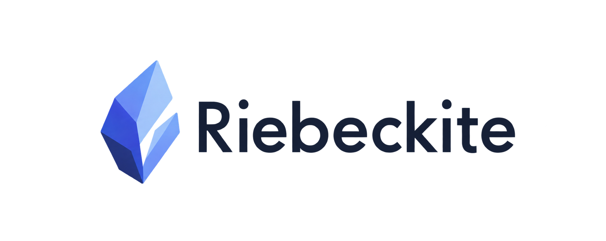

<p align="center">
  
</p>

<p align="center">
  <a href="https://www.npmjs.com/package/@riebeckite/cli"></a>
  <a href="https://www.npmjs.com/package/@riebeckite/cli"></a>
  <a href="./LICENSE"></a>
</p>

# Riebeckite

**Your content. Your code. Your framework.**

Obsidian のノートや Markdown を、TypeScript と拡張可能な Plugin エコシステムで、自由にカスタマイズできる Web サイトとして公開します。

[はじめる](https://riebeckite.dev/ja/docs/getting-started/) · [ドキュメント](https://riebeckite.dev/ja/docs/) · [ショーケース](https://riebeckite.dev/ja/docs/plugins/showcase) · [GitHub](https://github.com/Rerurate514/riebeckite)

[English](./README.md) | 日本語

## Riebeckite を選ぶ理由

Riebeckite は、Quartz 4 で自分のノートを公開していたときに感じた使いにくさから生まれました。Markdown を書けばサイトになる。その基本はよくできていました。ただ、ブラウザ側の UI を作ろうとすると、普段使っているコンポーネントの書き方ではなく、Hooks と DOM 操作に向き合う必要がありました。Quartz 独自の書き方も覚える必要がありました。Vault とサイトのコードを分けて管理するのも簡単ではなく、Quartz 4 から 5 へ移るときには、サイトのセットアップをやり直すことになりました。

Riebeckite は、その経験から出発点を変えました。生成されるサイトは普通の HonoX アプリケーションで、TypeScript と JSX で組み立てられます。Markdown は入力であって、アーキテクチャの中心ではありません。ヘッダー、検索、インタラクション、ページの種類まで、モダンな Web プロジェクトと同じように作れます。

Obsidian や Markdown で書きながら、少しのコードも自分で持ちたい人に向いています。用意されたプリセットを調整するだけでは物足りず、自分のサイトとして作り込みたい人のためのフレームワークです。

## Riebeckite でできること

### いつもの道具で作る

TypeScript、JSX、HonoX。コンポーネント、ルート、インタラクティブな islands、CSS、そして使い慣れた npm エコシステムをそのまま使えます。独自のテンプレート言語を覚える必要はありません。

### コンテンツを自分で持つ

フォルダでも、既存の Obsidian Vault でも、好きな場所を指定できます。サイトと同じリポジトリに置いても、隣に置いても、別のリポジトリに分けても構いません。

### npm で拡張する

Plugin も Theme も普通の npm パッケージです。公式のものを使うことも、自分で公開することもできます。[Plugin カタログ](https://riebeckite.dev/ja/docs/plugins/)と[テーマ](https://riebeckite.dev/ja/docs/themes/)を参照してください。

### 知識を公開する

Obsidian 形式の Markdown が、ページ、ナビゲーション、検索、バックリンクになります。WikiLink、埋め込み、Callout、プロパティ、タグもそのまま扱えます。

### 静的生成で速い

ページはビルド時に静的 HTML として生成されるため、JavaScript がなくても本文を読めます。ブラウザ側の動作は、必要な場所だけ HonoX islands や Plugin で追加できます。

## クイックスタート

サイトを作成します:

```bash
npx create-riebeckite
```

初めて試すなら、`starter`、`This project`、`Not now` の既定のまま進めてください。続けて:

```bash
cd my-site
npm install
npm exec riebeckite dev
```

ターミナルに表示された URL を開きます。`content/index.md` を編集すると、保存に合わせてページが更新されます。公開する準備ができたら:

```bash
npm exec riebeckite build
```

静的サイトは `dist/` に出力されます。新しいノートは、frontmatter に `publish: true` があると公開対象になります。別のフォルダ名を選んだ場合は `my-site` を置き換えてください。`npx create-riebeckite my-site` のように名前を渡すと、質問を省略できます。

Riebeckite には Node.js LTS と npm が必要です（npm は Node.js に同梱されています）。Git はデプロイするときだけ必要です。

必要な環境、公開手順、生成されるプロジェクトの構成は [Getting Started](https://riebeckite.dev/ja/docs/getting-started/) を参照してください。

## サイトはフレームワークの付属物ではない

Riebeckite は npm パッケージの集合です。生成されたサイトは、`@riebeckite/*` を依存に持つ普通の HonoX アプリで、`riebeckite.config.ts` と、自分で管理する `app/` ディレクトリがあります。Riebeckite の更新はサイトの書き直しではなく依存パッケージの更新なので、バージョンを固定して自分のタイミングで上げられます。ただし、メジャーバージョンの更新では変更が必要になることがあります。アップグレード前に[アップグレードガイド](https://riebeckite.dev/ja/docs/guides/upgrading)を確認してください。

コンテンツは `app/` の外にも、リポジトリの外にも置けます。`content.directory` に隣の Vault（`../vault`）を指定したり、CI でコンテンツ用リポジトリを checkout したりできます。分離した構成については[コンテンツリポジトリのガイド](https://riebeckite.dev/ja/docs/guides/content-repositories)を参照してください。

## 拡張できる設計

Plugin と Theme を追加します:

```bash
npm install @riebeckite/plugin-highlight @riebeckite/theme-minimal
```

生成された設定に import とエントリを追加します。最小構成は次のとおりです:

```ts
import { defineConfig } from "@riebeckite/core";
import { obsidianMarkdown } from "@riebeckite/plugin-obsidian-markdown";
import { highlight } from "@riebeckite/plugin-highlight";
import { minimalTheme } from "@riebeckite/theme-minimal";

export default defineConfig({
  site: {
    title: "My notes",
    baseUrl: "https://example.com",
  },
  theme: minimalTheme(),
  plugins: [obsidianMarkdown(), highlight()],
});
```

Plugin は `plugins` 配列に追加する関数、Theme は `theme` に渡す値です。Plugin は Markdown の変換、ページ、コンポーネント、CSS、ブラウザ側のコード、HTTP エンドポイント、生成ファイルを追加できます。[Plugin API](https://riebeckite.dev/ja/docs/reference/plugin-api) と [Theme API](https://riebeckite.dev/ja/docs/reference/theme-api) を参照してください。

## ショーケース

[riebeckite.dev](https://riebeckite.dev/) 自体が Riebeckite で作られています。[Plugin Showcase](https://riebeckite.dev/ja/docs/plugins/showcase) では、Markdown のソースと実際の表示を並べて確認できます。追加する前に、各 Plugin が何をするのか見てみてください。

## ドキュメントとコミュニティ

- [ドキュメント](https://riebeckite.dev/ja/docs/) — ガイド、リファレンス、フレームワークの内部
- [Getting Started](https://riebeckite.dev/ja/docs/getting-started/) — 空のフォルダから公開まで
- [Plugin カタログ](https://riebeckite.dev/ja/docs/plugins/)と[テーマ](https://riebeckite.dev/ja/docs/themes/)
- [設定](https://riebeckite.dev/ja/docs/reference/configuration)と [CLI リファレンス](https://riebeckite.dev/ja/docs/reference/cli)
- [GitHub Issues](https://github.com/Rerurate514/riebeckite/issues) — 不具合報告と機能要望
- [GitHub Discussions](https://github.com/Rerurate514/riebeckite/discussions) — 質問とアイデア
- [セキュリティポリシー](./SECURITY.md)

大きな変更を始める前に、Issue か Discussion で相談してください。

## Riebeckite 本体の開発

Riebeckite 本体、インテグレーション、Plugin、Theme、リファレンスサイトを開発する場合は、モノレポをクローンしてください。セットアップとコマンドは [Framework Development](./docs/docs/framework/development.ja.md) にあります。

<p align="center"><strong>Publish your knowledge. Build without limits.</strong></p>
