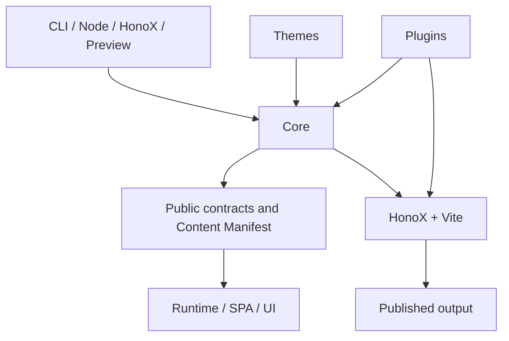
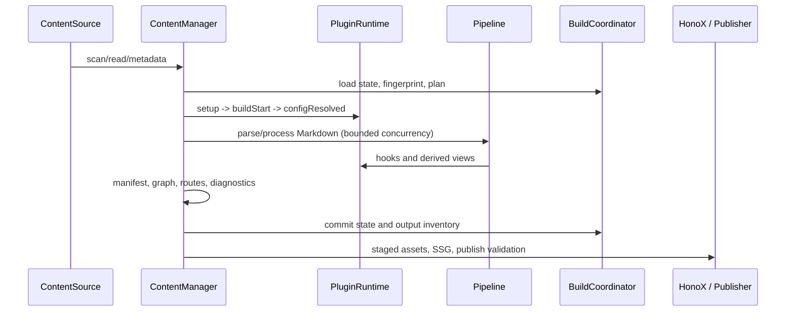
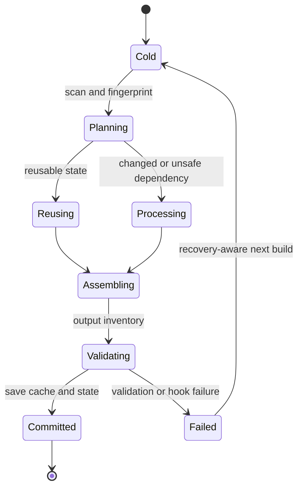

# Architecture Simplification Review

## Inventory

The workspace contains 116 packages. Its package and runtime dependency graphs
are acyclic.

|Area|Responsibility|Implementations|
|---|---|---|
|Core|Configuration, content, derived views, plugin contracts, publication plans|`packages/core`|
|I/O and operations|Filesystem, CLI, scaffolding, preview, development inspector|`node`, `cli`, `create-riebeckite`, `preview`, `dev-inspector`|
|Integrations|HonoX/Vite SSG, Cloudflare, Webmention|`integrations/*`|
|Presentation and runtime|Themes, UI, client runtime, SPA, graph, diagram, OG image|`themes/*`, `ui`, `runtime`, `spa`, `graph`, `diagram`, `og-image`|
|Extensions|Markdown, search, l10n, taxonomy, pages, embeds, media, publication support|`plugins/*` (84 packages)|
|Quality and delivery|Test helpers, dependency/source checks, build and release scripts|`test`, `scripts/*`|

Core must not depend on outer application layers. Plugins must not depend on
themes, CLI, or HonoX. The only allowed plugin-to-plugin edges are
`article-metadata -> taxonomy` and `docs -> navigation`.

## Content lifecycle and state ownership

|State|Owner|Lifetime|
|---|---|---|
|Content index, locations, manifest, routes|`ContentManager`|Build|
|Processed content and dependencies|`ContentManager` / persistent cache|Build / restart|
|Hook order, derived views, generated outputs|`PluginRuntime`|Build|
|Change plan, output inventory, commit|`ContentBuildCoordinator`|Build / state file|
|Browser initialization and SPA navigation|`runtime` / `spa`|Page|
|Development inspection snapshot|`dev-inspector`|Development only|

`ContentSource` owns scanning, reads, and metadata. `ContentManager` owns
interpretation, pipelines, manifests, graphs, plugin orchestration, and location
resolution. Resolved `permalink` is the only public content URL. Build state and
persistent caches are optimizations, not public data. Mutation and migration
write through the Node boundary. Publication stages assets and SSG output, checks
the inventory, saves state, then publishes recoverably.

## Implemented simplification

`ContentManager` now uses the same completed-value plus in-flight-Promise
memoization pattern for `Pipeline` as it already uses for index, manifest, and
route initialization. Concurrent Markdown processing previously could construct
several equivalent `Pipeline` objects before the first assignment completed.
Initialization is now shared, and a rejected initialization is cleared for a
later retry.

The constructor also now assembles `pipelineOptions` once instead of rebuilding
it four times. Its effective configuration, publishing time, cached source, and
dependency tracker are unchanged. The public API and output format are unchanged.
The regression test asserts that two concurrent pipeline requests receive the
same instance; the prior implementation returns distinct instances after its
asynchronous prerequisites resolve.

## Baseline and result

|Metric|Before|After|Result|
|---|---:|---:|---|
|Dependency graph|116 packages, acyclic|116 packages, acyclic|Preserved|
|Analysed source|1,006 files / 147,193 lines / 9,032 functions|1,006 files / 147,198 lines / 9,033 functions|Test addition only|
|Source-health errors|0|0|Preserved|
|Advisories|130|130|Preserved|
|Core API contract|Unchanged|Unchanged|Preserved|
|Equivalence benchmark|Baseline|8/8 scenarios equivalent|Output equivalent|
|Chaos benchmark|Baseline|6/6 scenarios equivalent|Recovery equivalent|

## Remaining hotspots

|Priority|Location|Observation|Decision|
|---|---|---|---|
|High|`core/content/content_manager.ts`|1,192 lines; coordinates several build states|Split only along proven change boundaries; do not separate incrementality, publication, and diagnostics mechanically.|
|High|`core/plugin/plugin_runtime.ts`|1,167 lines; lifecycle, derived views, pages, outputs|Specialized subsystems already exist; do not change its broad contract without a focused need.|
|High|HonoX SSG and output cache|912 / 876 lines|Preserve the publication transaction boundary while splitting incrementally.|
|Medium|Node mutation/migration and CLI builtins|1,197–1,548 lines|Candidate for I/O and recovery-oriented extraction.|
|Medium|Core directory cycle|`content -> derived -> plugin -> publication -> types`|Not a package cycle; narrow contract dependencies before relocating files.|
|Medium|Wildcard exports|Core CLI and Runtime|Review explicit exports separately while preserving `api.json`.|

No broad rewrite, speculative abstraction, or dependency was added.

## Fitness checks

|Check|Result|
|---|---|
|`pnpm --filter @riebeckite/core test`|PASS: 514 tests|
|`pnpm check`|PASS|
|`pnpm test:checks`|PASS: 13 tests|
|`pnpm check:dependencies`|PASS|
|`pnpm check:source-health`|PASS: 0 errors, 130 advisories|
|`pnpm check:core-api`|PASS|
|`pnpm benchmark:equivalence`|PASS: 8 scenarios equivalent to fresh cold builds|
|`pnpm benchmark:chaos`|PASS: 6 recovery scenarios equivalent|
|`pnpm typecheck`|FAIL before this change: 77 workspace-subpath resolution errors when packages are not built first|

The typecheck failure is an existing ordering problem and was not changed to
manufacture a green result.
