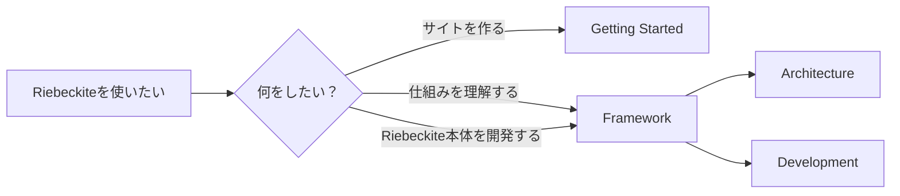
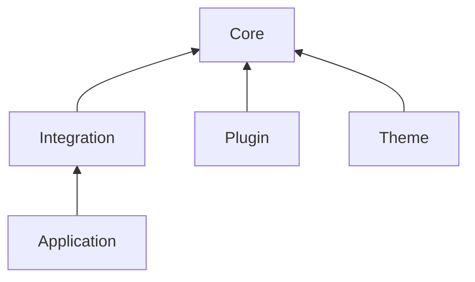

# Framework

この章では、**Riebeckite 自体がどのように動いているか**を説明します。

この章で説明する境界の背景にある原則は [設計思想](../philosophy.ja.md) にあります。この章は現在の実装を、設計思想はなぜそうするのかを説明します。

この章のうち次の 3 ページは、利用者向けの概要から始まり、Framework の残りを読まなくても役立ちます。[コンテンツ変更](./content-mutation.ja.md) は安全なコンテンツ書き込み、[コンテンツ移行](./content-migration.ja.md) はバージョン付きの一括変更、[Interactive Runtime](./interactive-runtime.ja.md) はブラウザー側の Plugin UI を扱います。概要を読んだあと、必要なら内部実装へ進んでください。

対象となるのは、

- Riebeckite の内部構造を理解したい人
- プラグインやテーマの仕組みを詳しく知りたい人
- Riebeckite 本体を開発・変更したい人

です。

Riebeckite を使って自分のサイトを作りたいだけなら、この章を最初から読む必要はありません。[Getting Started](../getting-started/README.ja.md) から始めてください。



## どこから読む？

目的に合わせて、必要なページだけ読めます。

| 知りたいこと | ページ |
| --- | --- |
| フレームワークがなぜこの形なのか | [設計思想](../philosophy.ja.md) |
| Riebeckite 全体の構造 | [アーキテクチャ](./architecture.ja.md) |
| Markdown やコンテンツがどう処理されるか | [コンテンツシステム](./content-system.ja.md) |
| コンテンツを安全に作成・編集・移動・削除する方法と、書き込みの計画・ジャーナル・復旧 | [コンテンツ変更](./content-mutation.ja.md) |
| バージョン付きのコンテンツ変更を定義・適用する方法と、計画・適用の仕組み | [コンテンツ移行](./content-migration.ja.md) |
| ビルドの入力、変換、出力がどこから来たか | [データ来歴](./build-system/provenance.ja.md) |
| デプロイ前の計画、承認、ゲート、履歴 | [公開ワークフロー](../guides/deployment/publication-workflow.ja.md) |
| プラグインがどう動くか | [プラグインシステム](./plugin-system.ja.md) |
| プラグインがビルド時の計算値を共有する仕組み | [派生データ](./derived-data.ja.md) |
| 型付きコマンド定義とプラグインの CLI コマンド | [CLI Extension API](../reference/cli-extension.ja.md) |
| ダイアグラムプラグインの共有ユーティリティと契約 | [ダイアグラムプラグイン基盤](./diagram-infrastructure.ja.md) |
| プラグインが独立したページを提供する仕組み | [ページシステム](./page-system.ja.md) |
| テーマが見た目を変更する仕組み | [テーマシステム](./theme-system.ja.md) |
| 任意で利用する UI プリミティブとアクセシビリティ動作 | [UI](./ui.ja.md) |
| ビルドと増分ビルドの仕組み | [ビルドシステム](./build-system.ja.md) |
| プラグインがビルド依存関係を宣言する仕組み | [ビルド依存関係の取り決め](./build-dependency.ja.md) |
| Riebeckite と HonoX / Vite の接続 | [HonoX との統合](./honox-integration.ja.md) |
| SPA ナビゲーションがシェルを残してページを置き換える仕組み | [SPA ナビゲーションの構成](./spa-navigation.ja.md) |
| ページ移動の処理、中断、ライフサイクルの制約 | [SPA ランタイムの内部実装](./spa-runtime.ja.md) |
| プラグインがブラウザーで何を動かせるかと、ランタイムアダプタの仕組み | [Interactive Runtime](./interactive-runtime.ja.md) |
| 設定や Content の問題を調べる | [Diagnostics](./diagnostics.ja.md) |
| 解決済みの設定や状態を確認する | [Inspector](./inspector.ja.md) |
| Log / Trace / Performance を調べる | [Observability](./observability.ja.md) |
| Riebeckite のテストを書く・実行する | [Testing](./testing.ja.md) |
| Riebeckite 本体を開発する | [Development](./development.ja.md) |
| 変更エントリ、リリース手順、GitHub Releases | [リリース作業](./release.ja.md) |

## 最初に内部構造を理解したい場合

まず [Architecture](./architecture.ja.md) を読むのがおすすめです。

Riebeckite は大きく、



という責務に分かれています。

Architecture を読んだあと、変更したい領域に応じて Content System、Plugin System、Theme System などへ進むと理解しやすくなります。

## Riebeckite 本体を開発する場合

Riebeckite repository を clone して Framework 自体を変更する場合は、[Development](./development.ja.md) を参照してください。

Development では、

- monorepo の clone
- `pnpm install`
- root の `pnpm` コマンド
- `packages/*` の構成
- `website`
- Package ごとのテスト
- Scaffold / External Site の検証

などを扱います。

```text
Riebeckite repository 自体を開発する
    → Framework / Development

Riebeckite を使ってサイトを作る
    → Getting Started
```

`website` は Riebeckite のドキュメントとリファレンスのアプリケーションです。

一般ユーザーが Riebeckite を使うために `website` をコピーしたり、Riebeckite monorepo をクローンしたりする必要はありません。

## この章の境界

この章では、Riebeckite の**内部設計とフレームワーク開発**を扱います。

一方、

- サイトの作成
- コンテンツの追加
- プラグイン / テーマの設定
- デプロイ

といった通常の利用方法は [Getting Started](../getting-started/README.ja.md) や Guides で説明します。

この境界を分けることで、Riebeckite を使うだけの人が フレームワーク内部の知識を覚えなくてもサイトを作れるようにしています。
