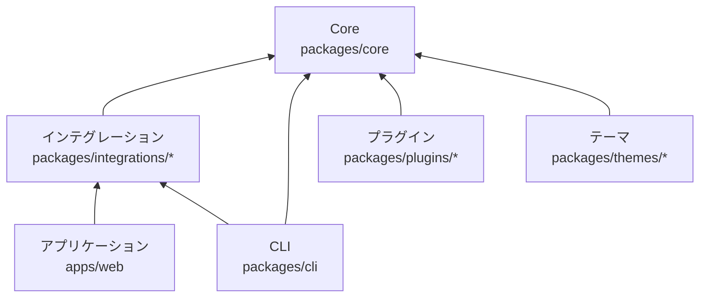
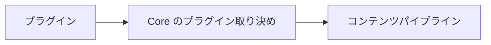
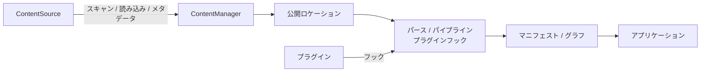
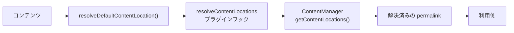
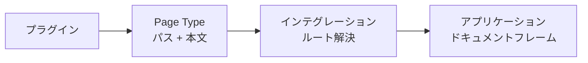
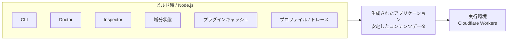
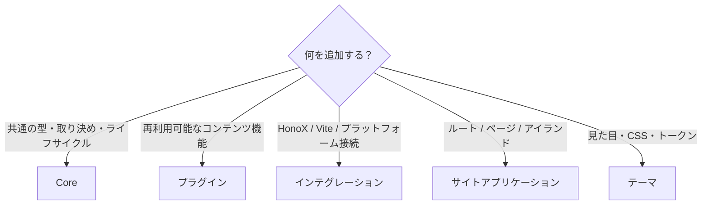

---
date: 2026-10-08
title: アーキテクチャ
---
# アーキテクチャ

Riebeckite は、Core を中心にプラグイン、インテグレーション、テーマ、アプリケーションを分離した pnpm workspace です。依存関係は意図的に一方向に保っています。

重要な原則は、**内側のパッケージが外側の実装を知らないこと**です。たとえば Core はコンテンツ処理の仕組みを提供しますが、次のことは知りません。

- HonoX がどう表示するか
- Vite がどうビルドするか
- どのプラグインがインストールされているか
- サイトがどんな UI を持つか



矢印は依存の方向を示します。Core からプラグイン、インテグレーション、アプリケーション、テーマへの逆向きの依存は作りません。

## パッケージの責務

Riebeckite のコードは、責務ごとにパッケージを分けています。

| 場所 | 主な責務 | 所有してはいけないもの |
| --- | --- | --- |
| `packages/core` | 移植可能な取り決め、設定、コンテンツのオーケストレーション、マニフェスト、グラフ、パイプライン、プラグインランタイム、可観測性、テーマの取り決め | HonoX / Vite の API、特定のプラグイン、アプリケーションの UI |
| `packages/plugins/*` | 再利用可能な Markdown、HTML、メタデータ、アセット、診断、ブラウザ、Page Type の機能 | アプリケーションのルート、フレームワーク固有のルーティング |
| `packages/integrations/*` | フレームワーク / バンドラー / プラットフォームとの接続 | Core がすでに表している再利用可能なドメイン上の方針 |
| `packages/themes/*` | プレゼンテーションの設定と CSS | コンポーネント、ルート、プラグイン、コンテンツの読み込み |
| `packages/cli` | Node 上で動くコマンドとビルドツール | リクエスト実行時のアプリケーションの振る舞い |
| `apps/web` | 実際のルート、アイランド、アプリケーションコンポーネント、Worker へのデプロイ | 再利用可能なフレームワークの取り決め |

依存関係を要約すると次のとおりです。

```text
Application -> Integration -> Core
Plugin -------------------> Core contracts
Theme ---------------------> Core theme contract
CLI -----------------------> Core and integration APIs
```

Core が HonoX、テーマ、プラグイン、アプリケーションへ逆依存することは決してありません。ある責務は、外側のレイヤーを import せずに所有できる最も内側のレイヤーに置きます。

### Core

```text id="cxz98n"
packages/core
```

Core は、特定の Web フレームワークに依存しない Riebeckite の基盤です。主に次の機能を所有します。

- 設定
- コンテンツのオーケストレーション
- マニフェスト
- コンテンツグラフ
- パイプライン
- プラグインランタイム
- 可観測性
- テーマの取り決め
- 共通の型とライフサイクルの取り決め

Core は移植性を重視しています。そのため、次のものには依存しません。

```text id="zpfh9w"
HonoX
Vite
Cloudflare
特定の Plugin
Site 固有の UI
```

### プラグイン

```text id="56z84x"
packages/plugins/*
```

プラグインは、複数のサイトで再利用できる機能を追加します。たとえば、次のような機能です。

- Markdown の変換
- HTML の変換
- メタデータの追加
- アセットの生成
- ブラウザ側の動作
- Page Type の提供

プラグインは、Core が公開している取り決めを通じて機能を拡張します。



Core が特定のプラグインの実装を知るような依存関係は作りません。

### インテグレーション

```text id="n94ykv"
packages/integrations/*
```

インテグレーションは、Riebeckite と外部技術を接続します。たとえば `@riebeckite/honox` は、次の2つを接続します。

```text id="ldd2oa"
Riebeckite Core
      ↕
HonoX / Vite
```

フレームワーク、バンドラー、プラットフォームに固有の処理は、Core ではなくインテグレーションに置きます。詳しくは [HonoX Integration](./honox-integration.ja.md) を参照してください。

### テーマ

```text id="1as7cf"
packages/themes/*
```

テーマはサイトの見た目を変更します。主に次の仕組みを利用します。

- CSS
- セマンティックトークン
- 安定した CSS フック
- `data-*` 属性
- CSS カスケード

テーマはプレゼンテーションを担当しますが、サイトの構造そのものは所有しません。そのため、次のものを所有することはありません。

- ルート
- Page Type ID
- アプリケーションコンポーネント
- サイトのページ構成

### サイトアプリケーション

```text id="9otuxo"
apps/web
```

`apps/web` は実際の Riebeckite サイトアプリケーションです。主に次のものを所有します。

- ルート
- アプリケーションコンポーネント
- アイランド
- ページ構成
- サイトシェル
- Workers との接続

Core やインテグレーションが「どう表示するか」まで決めるのではなく、最終的なサイトの構造はアプリケーションが決定します。

### CLI

```text id="k0pqbm"
packages/cli
```

CLI は、Node.js 上で実行されるコマンドとビルドツールを担当します。たとえば、次のような入口を提供します。

```sh id="kt0j27"
riebeckite build
riebeckite check
riebeckite doctor
riebeckite inspect
riebeckite profile
```

CLI は必要に応じて Core やインテグレーションの機能を呼び出します。

## コンテンツ処理とレンダリングの流れ

コンテンツ処理では、`ContentSource` と `ContentManager` の責務を明確に分けています。



### ContentSource

`ContentSource` は「コンテンツをどこから、どのように読み込むか」を担当します。主に次のようなソース情報を提供します。

- scan
- read
- content identity
- `mtime`
- size
- ETag
- hash

たとえば、ファイルシステムを扱うコンテンツソースはファイルを読み込みますが、`ContentManager` 自身がファイルシステムを直接走査することはありません。新しいコンテンツソースを追加するときも、この取り決めに従います。

### ContentManager

`ContentManager` は、読み込まれたコンテンツを処理します。主に次の責務を担います。

- 公開ロケーションの解決
- パース
- パイプライン
- プラグインフック
- マニフェスト
- コンテンツグラフ

つまり、役割は次のように分かれます。

```text id="g1g93m"
ContentSource
    ↓
コンテンツを取得する

ContentManager
    ↓
コンテンツを解決・処理する
```

`ContentManager` に独自のファイルシステム走査を追加するのではなく、`ContentSource` の取り決めを利用してください。

## 公開 URL の解決

コンテンツの URL は、ファイルシステムのパスや slug から推測しません。Riebeckite が **公開ロケーション（Public Location）** を明示的に解決します。基本的な流れは次のとおりです。



利用側は、この処理で確定した `permalink` を使います。たとえば、ファイルシステム上のパスが

```text id="ez3dhv"
content/posts/hello.md
```

であっても、それが

```text id="qysr09"
/posts/hello
```

になるとは限りません。プラグインや設定によって、

```text id="i4omv8"
/blog/hello/
```

に解決されているなら、それが正式な公開 URL です。そのため、利用側で

```text id="crklqd"
filesystem path → slug → URL
```

のような再計算をしないでください。

**公開 URL の基準となるのは、解決済みの `permalink` です。**

## Page Type によるページ提供

プラグインは Page Type を使うことで、通常の Markdown コンテンツとは異なるページを提供できます。ただし、Page Type は特定の Web フレームワークに依存しません。



プラグインが提供するのは、主に公開パスとページ本文です。それを実際の URL として扱うのはインテグレーションの役割で、最終的な HTML ドキュメントとして組み立てるのはアプリケーションの役割です。プラグインが HonoX のルートやサイトシェルを所有する必要はありません。詳しくは [Page System](./page-system.ja.md) を参照してください。

プラグインは公開された取り決めを通じて処理を拡張できますが、アプリケーションに隠れた第2の層になることはありません。Page Type が提供するのはフレームワークに依存しない本文と公開パスであり、インテグレーションが汎用のルートを通じてそれを解決し、アプリケーションがドキュメントフレームを保持します。テーマは、テーマ設定、CSS トークン、安定したフック、`data-*` 属性を通じて描画結果のスタイルだけを整えます。Page Type ID によって分岐することはありません。

## ビルド時と実行環境の境界

Riebeckite では、ビルド時にだけ必要なものと、公開サイトの実行環境で必要なものを分離しています。



次のものはビルド時の情報です。

- `.riebeckite/build/content-state.json`
- プラグインキャッシュ
- CLI
- Doctor
- Inspector
- プロファイル / トレース

Cloudflare Workers のリクエスト実行環境は、これらを読み書きしません。実行環境が利用するのは、ビルドによって生成されたアプリケーションと安定したコンテンツデータであり、書き込み可能な `.riebeckite` ディレクトリではありません。CLI、Inspector、Doctor、プロファイラのトレース、`.riebeckite/build/content-state.json` の増分状態、ファイルシステム上のプラグインキャッシュは Node / ビルド時のものであり、Cloudflare Workers のリクエスト実行環境が変更を前提とする依存ではありません。これにより、ビルドの最適化に使う状態と公開サイトの動作を分離しています。

この境界はデプロイの再現性も保ちます。ビルドが失敗した場合でも、以前の正常な状態を書き換えることはなく、リクエストが Worker に存在しないローカルファイルに依存することもありません。

## コードの配置先を選ぶ

新しい機能を追加するときは、まず「どのパッケージがその責務を持つべきか」を考えます。



判断の目安は次のとおりです。

| 追加するもの | 配置先 |
| --- | --- |
| 移植可能な型やライフサイクルの取り決め | **Core** |
| 再利用可能なコンテンツの振る舞い | **プラグイン** |
| Vite / HonoX / プラットフォームとの接続 | **インテグレーション** |
| ルート / ページ構成 / アイランド | **サイトアプリケーション** |
| ビジュアルトークン / CSS | **テーマ** |

迷った場合は、**その機能を成立させるために必要な最も内側のパッケージ**に置きます。ただし、内側のパッケージから外側へ依存させてはいけません。

たとえば、

```text id="mfpzfj"
「Plugin Page を HonoX で表示したい」
```

という理由で Core に HonoX のコードを追加するのではなく、次のように責務を分割します。

```text id="qlfw3c"
Core
  → framework-independent な Page contract

Plugin
  → Page を提供

HonoX Integration
  → Page を route と接続

Site
  → 最終的な document を描画
```

この境界を維持することで、Core やプラグインを特定のサイト、フレームワーク、プラットフォームに固定せずに再利用できます。関連する設計については、[Content System](./content-system.ja.md)、[Plugin System](./plugin-system.ja.md)、[Theme System](./theme-system.ja.md)、[HonoX Integration](./honox-integration.ja.md) を参照してください。
