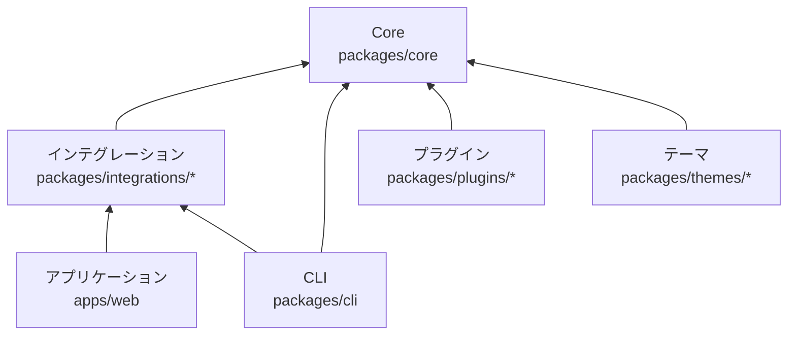

# アーキテクチャ

Riebeckite は、Core を中心に[[glossary/plugin|プラグイン]]、インテグレーション、[[glossary/theme|テーマ]]、アプリケーションを分離した pnpm workspace です。依存関係は意図的に一方向に保っています。

このページでは構造を説明します。背景にある原則とトレードオフは [設計思想](../philosophy.ja.md) にあります。

重要な原則は、**内側のパッケージが外側の実装を知らないこと**です。たとえば Core はコンテンツ処理の仕組みを提供しますが、次のことは知りません。

- [[framework/honox-integration|HonoX]] がどう表示するか
- Vite がどうビルドするか
- どのプラグインがインストールされているか
- サイトがどんな [[glossary/ui|UI]] を持つか

矢印は依存の方向を示します。Core からプラグイン、インテグレーション、アプリケーション、テーマへの逆向きの依存は作りません。

## このページの構成

- [パッケージ構成](./architecture/packages.ja.md)
- [処理の流れ](./architecture/flows.ja.md)
- [境界](./architecture/boundaries.ja.md)
