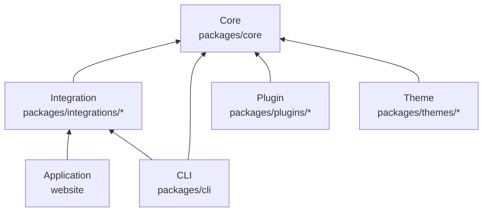

# Architecture

Riebeckite is a pnpm workspace that separates Core from [[glossary/plugin|Plugin]], Integration,
[[glossary/theme|Theme]], and Application, with intentionally one-way dependencies.

This page describes the structure. The principles and trade-offs behind it are in
[Design Philosophy](../philosophy.md).

The guiding principle is that **an inner package does not know the
implementation of an outer one**. Core provides the content-processing
machinery, but it does not know:

- how [[framework/honox-integration|HonoX]] renders it,
- how Vite builds it,
- which plugins are installed, or
- what [[glossary/ui|UI]] the site has.

Arrows point in the dependency direction. There is never a reverse dependency
from Core to a plugin, integration, application, or theme.

## In this section

- [Packages](./architecture/packages.md)
- [Flows](./architecture/flows.md)
- [Boundaries](./architecture/boundaries.md)
