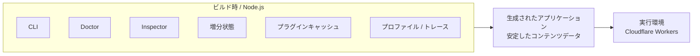
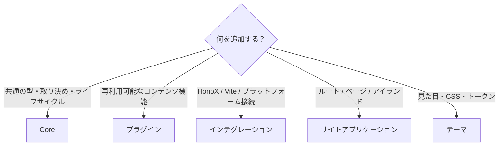

# 境界

## ビルド時と実行環境の境界

Riebeckite では、ビルド時にだけ必要なものと、公開サイトの実行環境で必要なものを分離しています。



次のものはビルド時の情報です。

- `.riebeckite/build/content-state.json`
- [[glossary/plugin-cache|プラグインキャッシュ]]
- CLI
- [[glossary/doctor|Doctor]]
- Inspector
- プロファイル / トレース

Cloudflare Workers のリクエスト実行環境は、これらを読み書きしません。実行環境が利用するのは、ビルドによって生成されたアプリケーションと安定したコンテンツデータであり、書き込み可能な `.riebeckite` ディレクトリではありません。CLI、Inspector、Doctor、[[glossary/profiler|プロファイラ]]のトレース、`.riebeckite/build/content-state.json` の増分状態、ファイルシステム上のプラグインキャッシュは Node / ビルド時のものであり、Cloudflare Workers のリクエスト実行環境が変更を前提とする依存ではありません。これにより、ビルドの最適化に使う状態と公開サイトの動作を分離しています。

この境界はデプロイの再現性も保ちます。マニフェスト生成に失敗した場合は以前の状態が残り、リクエストが Worker に存在しないローカルファイルに依存することもありません。その後の SSG や出力の失敗では、新しいビルド状態が残ることがあります。詳しくは[[build-system/incremental|増分ビルド]]を参照してください。

## コードの配置先を選ぶ

新しい機能を追加するときは、まず「どのパッケージがその責務を持つべきか」を考えます。



判断の目安は次のとおりです。

| 追加するもの | 配置先 |
| --- | --- |
| 移植可能な型やライフサイクルの取り決め | **Core** |
| 再利用可能なコンテンツの振る舞い | **プラグイン** |
| Vite / HonoX / プラットフォームとの接続 | **インテグレーション** |
| ルート / ページ構成 / アイランド | **サイトアプリケーション** |
| ビジュアルトークン / CSS | **テーマ** |

迷った場合は、**その機能を成立させるために必要な最も内側のパッケージ**に置きます。ただし、内側のパッケージから外側へ依存させてはいけません。

たとえば、

```text id="mfpzfj"
「Plugin Page を HonoX で表示したい」
```

という理由で Core に HonoX のコードを追加するのではなく、次のように責務を分割します。

```text id="qlfw3c"
Core
  → framework-independent な Page contract

Plugin
  → Page を提供

HonoX Integration
  → Page を route と接続

Site
  → 最終的な document を描画
```

この境界を維持することで、Core やプラグインを特定のサイト、フレームワーク、プラットフォームに固定せずに再利用できます。

## CI で検査する依存ルール

`pnpm check:dependencies` は全 workspace パッケージを対象に、未宣言の import、公開されていない subpath、実行時の workspace 循環、禁止された依存方向を検査します。型だけの import は開発依存から参照でき、実行時の依存エッジには数えません。動的な `import()` と `require()` は実行時の依存として扱います。

`pnpm check:source-health` はさらに、Browser/Worker のエントリで Node 組み込みモジュールや Node 専用パッケージを参照していないこと検査し、ディレクトリ単位の循環を警告として報告します。テーマが依存できるのは Core だけです。プラグインは CLI、HonoX、Preview、テーマに依存できず、プラグイン同士の依存は `scripts/check_dependencies.mjs` に記載したレビュー済みの組だけに限定します。

Core は `@riebeckite/core`（全契約）、`@riebeckite/core/client`（ブラウザ向けクライアント）、`@riebeckite/core/cli`（プラグイン CLI 拡張 API）を公開します。`packages/core/api.json` がレビュー済みの公開範囲です。

### ルート CLI エクスポートからの移行

以前の `0.0.x` では、すべての CLI ヘルパーをパッケージルートから再エクスポートしていました。コマンド定義の契約とビルダーは `@riebeckite/core` に残ります。パーサー、ヘルプ、補完の内部ヘルパーは `@riebeckite/core/cli` からのみ利用できます: `argumentValueKey`、`commandPathSegments`、`findCommandByPath`、`formatCommandHelp`、`formatPathHelp`、`formatRootHelp`、`formatUnknownCommand`、`generateCompletion`、`normalizeCommandId`、`optionValueKey`、`parseCliShell`、`readArgument`、`readOption`、`ROOT_USAGE`、`suggest`、`toArgumentKey`、`toOptionKey`。CLI の型はすべてルートのエントリーポイントに残ります。

`@riebeckite/test/plugin-contract` は削除しました。代わりに `riebeckite plugin verify <path>` を使用してください。検証器は製品の CLI 機能であり、そのエンジンはプログラム向けの公開 API ではありません。

関連する設計については、[Content System](../content-system.ja.md)、[Plugin System](../plugin-system.ja.md)、[Theme System](../theme-system.ja.md)、[HonoX Integration](../honox-integration.ja.md) を参照してください。
