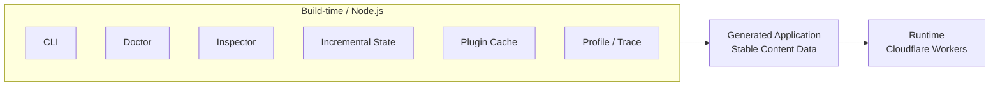
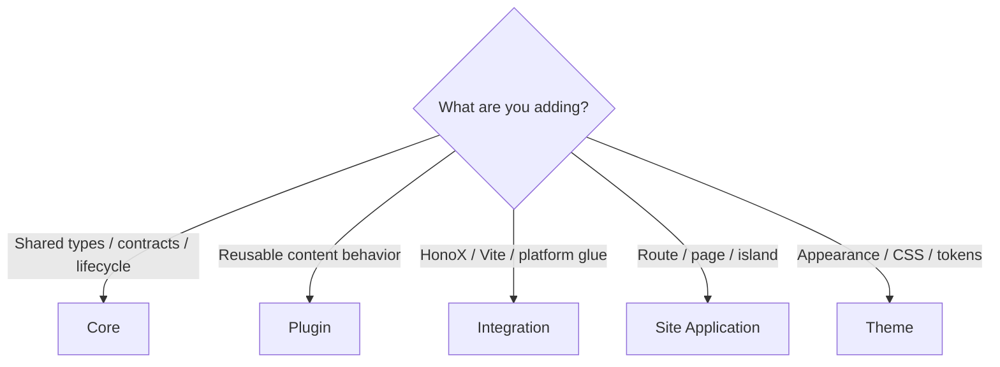

# Boundaries

## Build-time and runtime boundary

Riebeckite separates what is only needed at build time from what the public
site needs at runtime.



The following belong to build time:

- `.riebeckite/build/content-state.json`
- plugin caches
- CLI
- [[glossary/doctor|Doctor]]
- [[framework/inspector|Inspector]]
- profile / trace

The Cloudflare Workers request runtime does not read or write these. Runtime
code consumes generated application output and stable content data, not a
writable `.riebeckite` directory.

The CLI, Inspector, Doctor, profiler traces, incremental state at `.riebeckite/build/content-state.json`, and filesystem plugin caches belong to Node/build time. They are not mutable dependencies of the Cloudflare Workers request runtime.

This boundary keeps deployments reproducible: a failed build does not mutate the previous valid state, and a request cannot depend on local files that do not exist in a Worker.

## Choosing a location

When adding a feature, first decide which package should own it.



The rule of thumb is:

| What you are adding | Where it goes |
| --- | --- |
| A portable type or lifecycle contract | **Core** |
| Reusable content behavior | **Plugin** |
| Vite / HonoX / platform glue | **Integration** |
| A route, page composition, or island | **Site Application** |
| Visual tokens and CSS | **Theme** |

- Add a portable type or lifecycle contract to **Core**.
- Add reusable content behavior to a **plugin**.
- Add Vite, HonoX, or platform glue to an **integration**.
- Add a route, page composition, or island to **`website`**.
- Add visual tokens and CSS only to a **theme**.

If you are unsure, put the feature in **the innermost package that can support
it** — but an inner package must never depend on an outer one. For example,
"I want to display a Plugin Page with HonoX" does not justify adding HonoX code
to Core. Instead, split the responsibilities:

```text
Core
  → a framework-independent Page contract

Plugin
  → provides the Page

HonoX Integration
  → connects the Page to a route

Site
  → renders the final document
```

Keeping this boundary lets Core and plugins be reused without being tied to a
specific site, framework, or platform.

## Dependency rules enforced in CI

`pnpm check:dependencies` checks every workspace package for undeclared
imports, non-exported subpaths, runtime workspace cycles, and forbidden
direction. Type-only imports are allowed from dev dependencies and do not count
as runtime edges; dynamic `import()` and `require()` do.

`pnpm check:source-health` additionally rejects Node builtins and Node-only
packages in Browser/Worker entries and reports directory-level cycles as
advisory findings. Themes may depend only on Core. Plugins may not depend on the
CLI, HonoX, Preview, or Themes, and Plugin-to-Plugin edges are limited to the
reviewed pairs in `scripts/check_dependencies.mjs`.

Core exposes `@riebeckite/core` (all contracts), `@riebeckite/core/client`
(browser-safe client utilities), and `@riebeckite/core/cli` (Plugin CLI
extension API). `packages/core/api.json` is the reviewed public surface.

### Migration from the root CLI exports

Earlier `0.0.x` releases re-exported every CLI helper from the package root.
The command authoring contract and its builders remain in `@riebeckite/core`.
Parser, help, and completion internals are available only from
`@riebeckite/core/cli`: `argumentValueKey`, `commandPathSegments`,
`findCommandByPath`, `formatCommandHelp`, `formatPathHelp`, `formatRootHelp`,
`formatUnknownCommand`, `generateCompletion`, `normalizeCommandId`,
`optionValueKey`, `parseCliShell`, `readArgument`, `readOption`, `ROOT_USAGE`,
`suggest`, `toArgumentKey`, and `toOptionKey`. All CLI types remain in the root
entry point.

The `@riebeckite/test/plugin-contract` export has been removed. Use
`riebeckite plugin verify <path>` instead; the verifier is a production CLI
feature and its engine is not a supported programmatic API.

See [Content system](../content-system.md), [Plugin system](../plugin-system.md), [Theme system](../theme-system.md), and [HonoX integration](../honox-integration.md) before changing a boundary.
