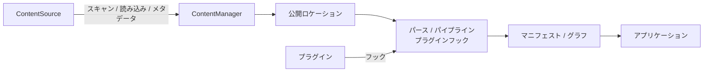
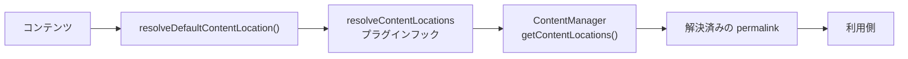
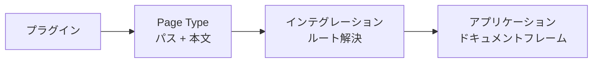

# 処理の流れ

## コンテンツ処理とレンダリングの流れ

コンテンツ処理では、`ContentSource` と `ContentManager` の責務を明確に分けています。



### ContentSource

`ContentSource` は「コンテンツをどこから、どのように読み込むか」を担当します。主に次のようなソース情報を提供します。

- scan
- read
- content identity
- `createdAt`
- `modifiedAt`
- size
- etag
- hash

たとえば、ファイルシステムを扱う[[glossary/content-source|コンテンツソース]]はファイルを読み込みますが、`ContentManager` 自身がファイルシステムを直接走査することはありません。新しいコンテンツソースを追加するときも、この取り決めに従います。

### ContentManager

`ContentManager` は、読み込まれたコンテンツを処理します。主に次の責務を担います。

- 公開ロケーションの解決
- パース
- パイプライン
- プラグインフック
- マニフェスト
- コンテンツグラフ

つまり、役割は次のように分かれます。

```text id="g1g93m"
ContentSource
    ↓
コンテンツを取得する

ContentManager
    ↓
コンテンツを解決・処理する
```

`ContentManager` に独自のファイルシステム走査を追加するのではなく、`ContentSource` の取り決めを利用してください。

## 公開 URL の解決

コンテンツの URL は、ファイルシステムのパスや slug から推測しません。Riebeckite が **公開ロケーション（Public Location）** を明示的に解決します。基本的な流れは次のとおりです。



利用側は、この処理で確定した `permalink` を使います。たとえば、ファイルシステム上のパスが

```text id="ez3dhv"
content/posts/hello.md
```

であっても、それが

```text id="qysr09"
/posts/hello
```

になるとは限りません。プラグインや設定によって、

```text id="i4omv8"
/blog/hello/
```

に解決されているなら、それが正式な公開 URL です。そのため、利用側で

```text id="crklqd"
filesystem path → slug → URL
```

のような再計算をしないでください。

**公開 URL の基準となるのは、解決済みの `permalink` です。**

## Page Type によるページ提供

プラグインは Page Type を使うことで、通常の Markdown コンテンツとは異なるページを提供できます。ただし、Page Type は特定の Web フレームワークに依存しません。



プラグインが提供するのは、主に[[glossary/public-path|公開パス]]とページ本文です。それを実際の URL として扱うのはインテグレーションの役割で、最終的な HTML ドキュメントとして組み立てるのはアプリケーションの役割です。プラグインが HonoX のルートやサイトシェルを所有する必要はありません。詳しくは [Page System](../page-system.ja.md) を参照してください。

プラグインは公開された取り決めを通じて処理を拡張できますが、アプリケーションに隠れた第2の層になることはありません。Page Type が提供するのはフレームワークに依存しない本文と公開パスであり、インテグレーションが汎用のルートを通じてそれを解決し、アプリケーションがドキュメントフレームを保持します。テーマは、テーマ設定、CSS トークン、安定したフック、`data-*` 属性を通じて描画結果のスタイルだけを整えます。Page Type ID によって分岐することはありません。
