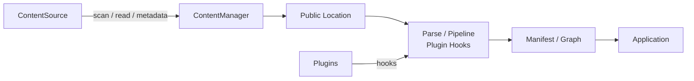
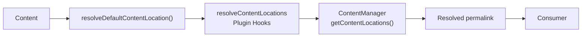
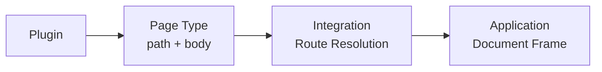

# Flows

## Content and rendering flow

For an overview of the content system architecture including `ContentSource`,
`ContentManager`, pipeline hooks, manifest, and content graph generation, see
[../content-system/sources.md](../content-system/sources.md).



`ContentSource` discovers and reads source material and supplies source metadata.
`ContentManager` interprets that material, resolves each entry's public location,
runs the pipeline and plugin hooks, and creates the manifest and content graph.
Consumers read the resolved `permalink` and never derive a URL from a slug or
filesystem path. For the detailed contracts of these two components, see
[../content-system/sources.md](../content-system/sources.md).

## Resolving public URLs

A content URL is not guessed from a filesystem path or slug. Riebeckite
explicitly resolves a **[[glossary/public-location|Public Location]]**. The basic flow is:



Consumers use the `permalink` that this process settles on. For example, even
if a filesystem path is:

```text
content/posts/hello.md
```

it does not necessarily become:

```text
/posts/hello
```

If a plugin or config resolves it to:

```text
/blog/hello/
```

then that is the canonical public URL. Consumers must not recompute:

```text
filesystem path → slug → URL
```

**The resolved `permalink` is the source of truth for the public URL.**

## Page Types

A plugin can use a Page Type to provide a page that differs from ordinary
Markdown content. A Page Type does not depend on a specific web framework.



A plugin mainly provides a public path and a page body. Turning that into an
actual URL is the integration's job, and assembling the final HTML document is
the application's job. A plugin does not need to own a HonoX route or the site
shell. See [Page system](../page-system.md).

Plugins may extend the process through published contracts; they do not become a hidden second application layer. A Page Type contributes a framework-independent body and public paths, while the integration resolves it through a generic route and the application retains the document frame. Themes only style the rendered result through theme configuration, CSS tokens, stable hooks, and `data-*` attributes; they do not branch on Page Type IDs.
