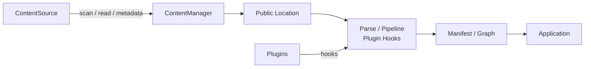
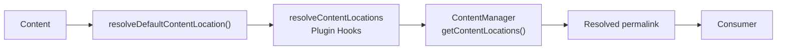
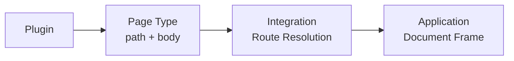

# Flows

## Content and rendering flow

Content processing separates the responsibilities of `ContentSource` and
`ContentManager`.



`ContentSource` discovers and reads source material and supplies source metadata. `ContentManager` interprets that material, resolves each entry's public location, runs the pipeline and plugin hooks, creates the manifest and graph, and coordinates content-related work. Public URLs come from the resolved location (`ContentManager.getContentLocations()`: the Core default resolver, then `resolveContentLocations` plugin hooks); consumers read the resolved `permalink` and never derive a URL from a slug or filesystem path. A feature that needs files should use the source contract rather than adding a second filesystem scanner.

```text
ContentSource -> ContentManager -> resolve public locations
                                      |-> parse/process pipeline
                                      |-> plugin hooks
                                      |-> manifest and content graph
                                      `-> integration/application rendering
```

### ContentSource

`ContentSource` is responsible for "where content comes from and how it is
read". It supplies source information such as:

- scan
- read
- content identity
- `createdAt`
- `modifiedAt`
- size
- etag
- hash

A filesystem-backed content source reads files, but `ContentManager` itself
does not walk the filesystem directly. New content sources are added through
this contract.

### ContentManager

`ContentManager` processes the content that was read. It is responsible for:

- resolving the public location
- parse
- pipeline
- plugin hooks
- manifest
- content graph

The division is:

```text
ContentSource
    ↓
obtain the content

ContentManager
    ↓
resolve and process the content
```

Rather than adding an ad-hoc filesystem scan to `ContentManager`, use the
`ContentSource` contract.

## Resolving public URLs

A content URL is not guessed from a filesystem path or slug. Riebeckite
explicitly resolves a **[[glossary/public-location|Public Location]]**. The basic flow is:



Consumers use the `permalink` that this process settles on. For example, even
if a filesystem path is:

```text
content/posts/hello.md
```

it does not necessarily become:

```text
/posts/hello
```

If a plugin or config resolves it to:

```text
/blog/hello/
```

then that is the canonical public URL. Consumers must not recompute:

```text
filesystem path → slug → URL
```

**The resolved `permalink` is the source of truth for the public URL.**

## Page Types

A plugin can use a Page Type to provide a page that differs from ordinary
Markdown content. A Page Type does not depend on a specific web framework.



A plugin mainly provides a public path and a page body. Turning that into an
actual URL is the integration's job, and assembling the final HTML document is
the application's job. A plugin does not need to own a HonoX route or the site
shell. See [Page system](../page-system.md).

Plugins may extend the process through published contracts; they do not become a hidden second application layer. A Page Type contributes a framework-independent body and public paths, while the integration resolves it through a generic route and the application retains the document frame. Themes only style the rendered result through theme configuration, CSS tokens, stable hooks, and `data-*` attributes; they do not branch on Page Type IDs.
