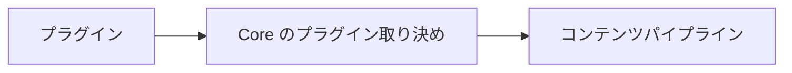

# パッケージ構成

## パッケージの責務

Riebeckite のコードは、責務ごとにパッケージを分けています。

| 場所 | 主な責務 | 所有してはいけないもの |
| --- | --- | --- |
| `packages/core` | 移植可能な取り決め、設定、コンテンツのオーケストレーション、[[glossary/manifest|マニフェスト]]、グラフ、[[glossary/pipeline|パイプライン]]、プラグインランタイム、可観測性、テーマの取り決め | HonoX / Vite の API、特定のプラグイン、アプリケーションの UI |
| `packages/plugins/*` | 再利用可能な Markdown、HTML、メタデータ、アセット、診断、ブラウザ、Page Type の機能 | アプリケーションのルート、フレームワーク固有のルーティング |
| `packages/integrations/*` | フレームワーク / バンドラー / プラットフォームとの接続 | Core がすでに表している再利用可能なドメイン上の方針 |
| `packages/themes/*` | プレゼンテーションの設定と CSS | コンポーネント、ルート、プラグイン、コンテンツの読み込み |
| `packages/cli` | Node 上で動くコマンドとビルドツール | リクエスト実行時のアプリケーションの振る舞い |
| `website` | 実際のルート、[[glossary/island|アイランド]]、アプリケーションコンポーネント、Worker へのデプロイ | 再利用可能なフレームワークの取り決め |

依存関係を要約すると次のとおりです。

```text
Application -> Integration -> Core
Plugin -------------------> Core contracts
Theme ---------------------> Core theme contract
CLI -----------------------> Core and integration APIs
```

Core が HonoX、テーマ、プラグイン、アプリケーションへ逆依存することは決してありません。ある責務は、外側のレイヤーを import せずに所有できる最も内側のレイヤーに置きます。

### Core

```text id="cxz98n"
packages/core
```

Core は、特定の Web フレームワークに依存しない Riebeckite の基盤です。主に次の機能を所有します。

- 設定
- コンテンツのオーケストレーション
- マニフェスト
- [[glossary/content-graph|コンテンツグラフ]]
- パイプライン
- プラグインランタイム
- 可観測性
- テーマの取り決め
- 共通の型とライフサイクルの取り決め

Core は移植性を重視しています。そのため、次のものには依存しません。

```text id="zpfh9w"
HonoX
Vite
Cloudflare
特定の Plugin
Site 固有の UI
```

### プラグイン

```text id="56z84x"
packages/plugins/*
```

プラグインは、複数のサイトで再利用できる機能を追加します。たとえば、次のような機能です。

- Markdown の変換
- HTML の変換
- メタデータの追加
- アセットの生成
- ブラウザ側の動作
- Page Type の提供

プラグインは、Core が公開している取り決めを通じて機能を拡張します。



Core が特定のプラグインの実装を知るような依存関係は作りません。

### インテグレーション

```text id="n94ykv"
packages/integrations/*
```

インテグレーションは、Riebeckite と外部技術を接続します。たとえば `@riebeckite/honox` は、次の2つを接続します。

```text id="ldd2oa"
Riebeckite Core
      ↕
HonoX / Vite
```

フレームワーク、バンドラー、プラットフォームに固有の処理は、Core ではなくインテグレーションに置きます。詳しくは [HonoX Integration](../honox-integration.ja.md) を参照してください。

### テーマ

```text id="1as7cf"
packages/themes/*
```

テーマはサイトの見た目を変更します。主に次の仕組みを利用します。

- CSS
- [[glossary/semantic-token|セマンティックトークン]]
- 安定した CSS フック
- `data-*` 属性
- CSS カスケード

テーマはプレゼンテーションを担当しますが、サイトの構造そのものは所有しません。そのため、次のものを所有することはありません。

- ルート
- Page Type ID
- アプリケーションコンポーネント
- サイトのページ構成

### サイトアプリケーション

```text id="9otuxo"
website
```

`website` は実際の Riebeckite サイトアプリケーションです。主に次のものを所有します。

- ルート
- アプリケーションコンポーネント
- アイランド
- ページ構成
- サイトシェル
- Workers との接続

Core やインテグレーションが「どう表示するか」まで決めるのではなく、最終的なサイトの構造はアプリケーションが決定します。

### CLI

```text id="k0pqbm"
packages/cli
```

CLI は、Node.js 上で実行されるコマンドとビルドツールを担当します。たとえば、次のような入口を提供します。

```sh id="kt0j27"
riebeckite build
riebeckite check
riebeckite doctor
riebeckite inspect
riebeckite profile
```

CLI は必要に応じて Core やインテグレーションの機能を呼び出します。
