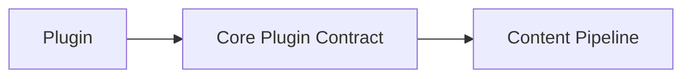

# Packages

## Package ownership

| Area | Owns | Must not own |
| --- | --- | --- |
| `packages/core` | portable contracts, configuration, content orchestration, manifests, graphs, pipelines, plugin runtime, observability, and theme contracts | HonoX/Vite APIs, a named plugin, or application UI |
| `packages/plugins/*` | reusable Markdown, HTML, metadata, asset, diagnostic, browser, and [[glossary/page-type|Page Type]] capabilities | application routes or framework-specific routing |
| `packages/integrations/*` | framework, bundler, and platform adapters | reusable domain policy already represented by Core |
| `packages/themes/*` | presentation configuration and CSS | components, routes, plugins, or content loading |
| `website` | the concrete routes, islands, application components, and Worker deployment | reusable framework contracts |
| `packages/cli` | Node-oriented commands and build tooling | request-time application behavior |

```text
Application -> Integration -> Core
Plugin --------------------> Core contracts
Theme ---------------------> Core theme contract
CLI -----------------------> Core and integration APIs
```

Core must never gain a reverse dependency on HonoX, a theme, a plugin, or the application. Put a concern at the first layer that can own it without importing an outer layer.

## Core

```text
packages/core
```

Core is the Riebeckite foundation, independent of any specific web framework.
It owns:

- config
- content orchestration
- manifest
- content graph
- pipeline
- plugin runtime
- observability
- the theme contract
- shared types and lifecycle contracts

Core is deliberately portable. It does not depend on:

```text
HonoX
Vite
Cloudflare
a specific plugin
site-specific UI
```

## Plugin

```text
packages/plugins/*
```

A plugin adds functionality that can be reused across multiple sites, for
example:

- Markdown transformation
- HTML transformation
- adding metadata
- generating assets
- browser-side behavior
- providing Page Types

A plugin extends functionality through the contracts Core publishes:



Core is never made to know the implementation of a specific plugin.

## Integration

```text
packages/integrations/*
```

An integration connects Riebeckite to an external technology. For example,
`@riebeckite/honox` connects:

```text
Riebeckite Core
      ↕
HonoX / Vite
```

Framework, bundler, and platform-specific work belongs in an integration, not
in Core. See [HonoX Integration](../honox-integration.md).

## Theme

```text
packages/themes/*
```

A theme changes a site's appearance through:

- CSS
- semantic tokens
- stable CSS hooks
- `data-*` attributes
- the CSS cascade

A theme owns presentation, but not the site's structure. A theme never owns:

- routes
- Page Type IDs
- application components
- the site's page composition

## Site Application

```text
website
```

`website` is the concrete Riebeckite site application. It owns:

- routes
- application components
- islands
- page composition
- the site shell
- the connection to Workers

Core and integrations do not decide how things are displayed; the final site
structure is decided by the application.

## CLI

```text
packages/cli
```

The CLI owns the commands and build tooling that run on Node.js, providing
entry points such as:

```sh
riebeckite build
riebeckite check
riebeckite doctor
riebeckite inspect
riebeckite profile
```

The CLI calls Core and integration functionality as needed.
