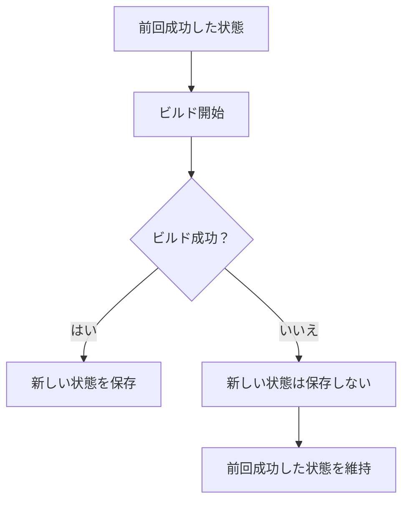

# 増分ビルド

## 増分ビルドの仕組み

毎回すべてのコンテンツを最初から処理すると、サイトが大きくなるほどビルドに時間がかかります。

そこで Riebeckite は、前回のビルドから何が変わったかを確認し、必要な部分だけを処理します。

前回の[[glossary/build-state|ビルド状態]]は、次のファイルに保存されます。

```text
.riebeckite/build/content-state.json
```

この情報はビルドを高速化するためのものであり、サイトを正しく生成するために必須ではありません。

たとえば、次のような場合は無理に再利用せず、必要な処理を最初から行います。

- 前回の情報が存在しない
- 現在のバージョンでは利用できない
- 安全に再利用できるか判断できない

つまり、**高速化のための情報がなくても、同じサイトを正しく生成できること**が前提です。

### フルビルド

前回のビルド情報を使わず、すべてを処理したい場合は `--full` を指定します。

```sh
pnpm exec riebeckite build --full
```

[[glossary/incremental-build|増分ビルド]]の結果に問題がありそうな場合の確認や、ビルド時間の比較に利用できます。

### ビルドに失敗した場合

前回のビルド情報は、**ビルドが正常に完了した場合だけ更新されます**。



buildManifest() が成功しても SSG/出力が失敗した場合、新しいビルド状態は
すでに `buildManifest()` 確定後にコミットされているため、残り込むことがあります。
全体のビルド（SSG含む）が成功しなかった場合にのみ、以前の有効な状態が保持されます。
部分的な失敗で有効な状態が上書きされることがあります。

## 変更の検出方法

Riebeckite は、[[glossary/content-source|コンテンツソース]]が提供するファイル情報を使って、コンテンツが変更されたかを判断します。たとえば、次の情報を利用できます。

- `createdAt`
- `modifiedAt`
- `size`
- `etag`
- ファイル内容から計算したハッシュ

利用できる情報はコンテンツソースによって異なります。更新日時だけに頼るのではなく、利用可能な情報を組み合わせて、前回の結果を安全に再利用できるか判断します。

## 関連するページが変更された場合

ファイル自体を編集していなくても、そのファイルが参照しているページなどが変わると、再生成が必要になることがあります。

たとえば、`a.md` が `b.md` にリンクしているとします。


`b.md` の URL が変わると、`a.md` 自体を編集していなくても、`a.md` に書かれているリンクを更新する必要があります。

そのため Riebeckite は、「ファイルが変わったか」だけでなく、「そのファイルが何を参照しているか」も記録します。

たとえば、次の関係を確認します。

- リンクしているページ
- 使用している画像やファイル
- ページの生成結果に影響するその他の情報

参照先が変わった場合は、その影響を受けるページも再生成します。さらに、そのページを参照している別のページにも影響する場合は、必要な範囲まで再生成します。

### コンテンツの追加・削除

コンテンツの追加や削除は、既存ファイルの編集より広い範囲に影響することがあります。

たとえば、存在しないページへの [[glossary/wikilink|WikiLink]] がある状態で、そのページが新しく追加されたとします。追加前はリンク先を解決できませんが、追加後は正しいページへリンクできるようになります。

コンテンツの追加や削除によってリンクの解決結果が変わった場合も、影響するページを再生成します。

初回ビルドや、前回のビルド情報が存在しない場合は、すべてのコンテンツを処理します。

## コンテンツ処理のキャッシュ

Riebeckite は、Markdown を HTML に変換した結果を次の場所に保存します。

```text
.riebeckite/cache/content/v5
```

これにより、変更されていない Markdown を毎回最初から処理する必要がなくなります。

初めてビルドする場合など、利用できる[[glossary/cache|キャッシュ]]がないビルドを**コールドビルド**（cold build）、前回の処理結果を再利用できるビルドを**ウォームビルド**（warm build）と呼びます。

ウォームビルドでは、変更されていないページの HTML や frontmatter を再利用できます。

ただし、前回の結果を無条件に再利用するわけではありません。Riebeckite は、たとえば次の変更がないか確認します。

- Markdown の内容
- frontmatter
- Riebeckite のバージョン
- プラグインの設定や実行順序
- ページが参照しているコンテンツやファイル

変更があった場合や、安全に再利用できるか判断できない場合は、そのページを通常どおり処理し直します。

プラグインについても、処理結果を安全に再利用できることを確認できない場合はキャッシュを使用しません。

### キャッシュに問題がある場合

このキャッシュもビルドを高速化するためのものであり、サイトの正しさを左右するものではありません。

次のような場合は、キャッシュを使わず通常の処理に戻ります。

- キャッシュが存在しない
- バージョンが合わない
- 保存された情報が壊れている
- 現在のコンテンツや設定と一致しない

キャッシュを完全に作り直したい場合は、次のディレクトリを削除できます。

```text
.riebeckite/cache
```

ビルドログの `Persistent content cache` では、キャッシュがどの程度利用されたかを確認できます。

- `hits`: 再利用できた数
- `misses`: 再処理した数
- `bypasses`: 安全性のためキャッシュを使用しなかった数

あわせて、ビルドログには次の概要も表示されます。

- `Content`: コンテンツの総数、実際に処理した数、再利用によって処理を省略した数
- `Content processing`: コンテンツ処理の所要時間と、その内訳（走査、処理、Markdown 変換、[[glossary/manifest|マニフェスト]]、グラフ）。内訳の span は包含関係にあるため、合計にはなりません
- `Build complete`: ビルド全体の所要時間

### GitHub Actions でのキャッシュ

[[guides/deployment/github-actions|GitHub Actions]] でキャッシュするのは、生成されたサイトそのものではなく、増分ビルドの状態と出力キャッシュです。

```text
.riebeckite/cache
.riebeckite/build/content-state.json
.riebeckite/ssg-output-cache.json
.riebeckite/ssg-output-cache.entries
.riebeckite/ssg-output-cache.fast-path.json
```

`dist/` はキャッシュしません。生成されたワークフローはこれらを実行間で復元するため、CI でもローカルと同じ増分 [[glossary/ssg|SSG]] が働きます。復元した出力キャッシュが整合性やフィンガープリントの検証に通らない場合は破棄し、すべての出力を生成し直します。

Cloudflare 用のワークフローについては [GitHub Actions](../../guides/deployment/github-actions.ja.md) を参照してください。

## 最終出力の再利用

Markdown の処理結果とは別に、Riebeckite は最終的に生成されるページやファイルについても、変更されていないものを再利用できます。

前回のビルドと比較して変更の影響を受けていないページは、再度生成する代わりに、次のファイルに保存された結果を利用します。

```text
.riebeckite/ssg-output-cache.json
```

たとえば Markdown を 1 ファイルだけ変更した場合、サイト内のすべてのページを生成し直すのではなく、その変更の影響を受けるページだけを生成できます。

一方、以前は存在していたものの、現在はサイトから削除されたページやファイルは出力から削除されます。

ビルドログの `SSG outputs` では、この結果を確認できます。

- `rendered`: 今回新しく生成した数
- `reused`: 前回の結果を再利用した数
- `removed`: サイトから削除された数

この仕組みでも、安全に再利用できるか判断できない場合はキャッシュを使用せず、すべてのページを生成します。

たとえば、次のような場合です。

- 前回の情報が存在しない
- バージョンが合わない
- 保存された情報が壊れている
- アプリケーションや設定が変更された
- どのページに影響する変更なのか判断できない

完全に作り直したい場合は、次のファイルを削除できます。

```text
.riebeckite/build/content-state.json
.riebeckite/ssg-output-cache.json
```

なお、`dist/` はキャッシュではありません。

`dist/` は最終的に生成された Web サイトの出力先です。

この最適化はビルドを高速化するだけであり、Cloudflare Workers へのデプロイ方法を変更するものではありません。
