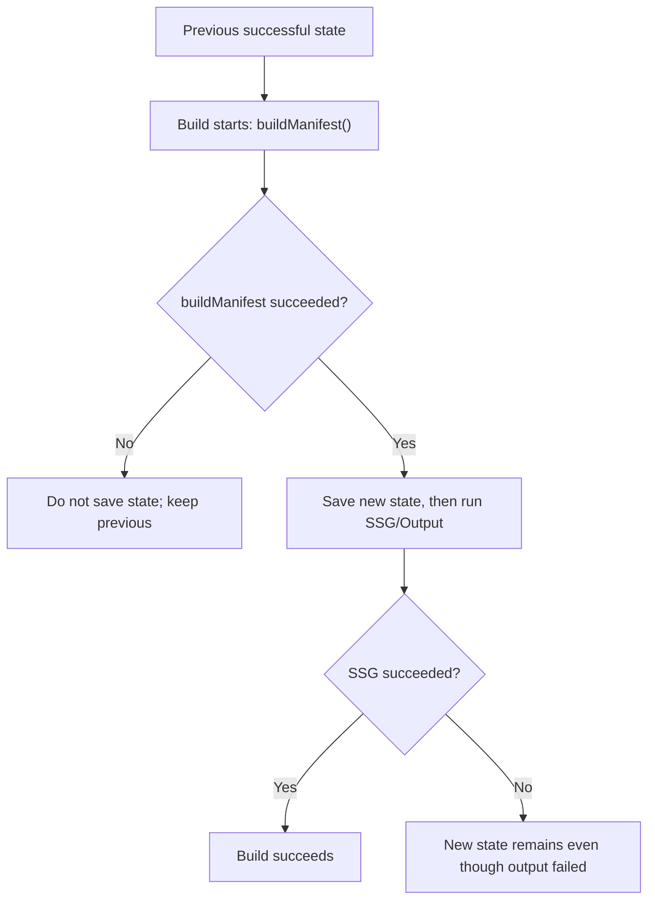
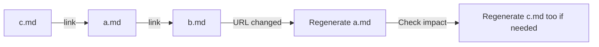

# Incremental builds

## How incremental builds work

Processing every piece of content from scratch on every run makes builds slower
as the site grows.

Riebeckite therefore checks what changed since the previous build and processes
only what is needed.

The previous [[glossary/build-state|build information]] is stored in:

```text
.riebeckite/build/content-state.json
```

This information exists to speed up the build; it is not required to generate
the site correctly.

For example, when:

- the previous information does not exist
- it cannot be used with the current version
- it cannot be determined to be safe to reuse

Riebeckite does not force reuse and runs the necessary work from the beginning.

In other words, the premise is that **the same site can be generated correctly
even without the speed-up information**.

### Full build

Use `--full` to process everything without using the previous build
information.

```sh
pnpm exec riebeckite build --full
```

This is useful for checking when an incremental build result looks suspicious,
or for comparing build times.

### When a build fails

Build state is committed during the SSG phase after `buildManifest()` completes and **before** page output is written.
The SSG `ContentManager` does not pass `commitBuildState:false`, so a later SSG or
output failure can leave new build state behind even if the overall build does not
produce successful output.



If `buildManifest()` fails, the previous state is kept. If it succeeds, the new state
is committed immediately; a later SSG/output failure does not restore the previous
state, so the next build may reuse state that was never paired with successful output.

## When related pages change

Even if a file is not edited itself, it may need to be regenerated when a page
it references changes.

For example, suppose `a.md` links to `b.md`:



If the URL of `b.md` changes, the link written in `a.md` must be updated even
though `a.md` itself was not edited.

Riebeckite therefore records not only "was the file changed" but also "what
does the file reference". For example, it tracks:

- linked pages
- images and files in use
- other information that affects a page's generated output

When a referenced target changes, the affected pages are regenerated. If those
pages are referenced by yet other pages, the affected range is regenerated as
needed.

### Adding and removing content

Adding or removing content can have a wider effect than editing an existing
file.

For example, suppose a [[glossary/wikilink|WikiLink]] points to a page that does not exist yet, and
that page is then added. Before it is added the link cannot resolve; after it is
added the link resolves to the correct page.

When adding or removing content changes how links resolve, the affected pages
are regenerated as well.

On the first build, or when no previous build information exists, all content is
processed.

## Incremental inputs

`ContentSource` metadata may contain `createdAt`, `modifiedAt`, `size`, `etag`, or a hash. Treat `createdAt` as a hint only: timestamp-only comparisons are not sufficient for correctness when metadata can be unreliable. [[glossary/plugin-cache|Plugin cache]] is separate from build state, plugin-scoped, JSON-serializable, regenerable build-time data. Neither may be required at Workers request time.

State tracks each entry's fingerprint together with its dependencies: the notes it links to (whose resolved permalink it may embed) and the assets it references (whose metadata, such as attachment size, it may render). A changed dependency invalidates the dependent entry and, transitively, its dependents. Added or removed entries change which link targets resolve, so entries that reference an affected target are invalidated as well. On the first build, or when no previous state is available, every note is processed. The `.riebeckite` state directory is build-time state, not content, and is never scanned.

## Persistent per-content cache

The processed Markdown result for each note is stored in `.riebeckite/cache/content/v5`. A build without an entry is a **cold build**. Restoring compatible entries before a later build makes it a **warm build**: unchanged notes can reuse their processed HTML and frontmatter while the normal build still generates `dist/`.

An entry key includes its Markdown source, parsed frontmatter, the cache schema, and the processing-pipeline fingerprint. The fingerprint includes content-filter configuration, plugin configuration and order, plugin `cacheVersion` and processed-content cache contracts, and the Core compatibility version. Cached content also records logical content, file, and link dependencies; changed or missing dependencies are misses. Unsafe plugins bypass this cache. [[glossary/cache|Cache]] data contains logical slugs and normalized source paths rather than workspace paths, so it can be copied to a different runner or workspace on the same operating system.

This cache is an optimization, never a correctness dependency. Missing entries, incompatible versions, malformed metadata, fingerprint or dependency mismatches, and corrupted JSON are safe misses. Delete `.riebeckite/cache` to force cold processing; **a filesystem access failure does not fail the build - it is logged as a warning and treated as a miss, consistent with the test `failure_recovery.test.ts:275-313` which asserts a blocked disposable cache must not fail the build.** The build log reports one `Persistent content cache` line with `hits`, `misses`, and `bypasses`, plus a concise `Content` line (total, processed, and reused counts) and the total `Build complete` duration. A `Content processing` line reports the content phase's wall time and its inclusive span breakdown (scan, process, markdown, manifest, graph); because the spans overlap, they do not add up to the total.

### When the cache has problems

This cache also exists to speed up the build; it does not determine whether the
site is correct.

In the following cases Riebeckite falls back to normal processing without using
the cache:

- the cache does not exist
- the version does not match
- the stored information is corrupted
- it does not match the current content or configuration

To rebuild the cache completely, delete:

```text
.riebeckite/cache
```

The `Persistent content cache` line in the build log shows how much the cache
was used:

- `hits`: reused
- `misses`: reprocessed
- `bypasses`: not used because it was not safe to do so

### Caching in GitHub Actions

For [[guides/deployment/github-actions|GitHub Actions]], cache the incremental build state and the output cache — `.riebeckite/cache`, `.riebeckite/build/content-state.json`, `.riebeckite/ssg-output-cache.json`, its `.riebeckite/ssg-output-cache.entries` directory, and the `.riebeckite/ssg-output-cache.fast-path.json` sidecar — but not `dist/`. The generated Cloudflare workflow restores all of these between runs so CI gets the same incremental [[glossary/ssg|SSG]] as a local build. A restored output cache that fails its integrity or fingerprint checks is discarded and every output is re-rendered. See [GitHub Actions](../../guides/deployment/github-actions.md).

## Output-level incremental SSG

Persistent per-content cache reuses Markdown and plugin processing. Output-level incremental SSG separately reuses final routes and generated files. After building the current manifest, Core compares its output descriptors with the previous successful state. HonoX renders only affected content and plugin-page routes, restores unchanged generated output from `.riebeckite/ssg-output-cache.json`, and removes outputs no longer owned by the site. The build log reports an `SSG outputs` line with the `rendered`, `reused`, and `removed` counts. For example, when only one Markdown file changes, Riebeckite generates only the pages affected by that change instead of regenerating every page in the site.

The state and output cache are optimizations. A missing, incompatible, malformed, or incomplete output state, an application/configuration fingerprint change, or an `unknown` output dependency makes HonoX render every output. Delete `.riebeckite/build/content-state.json` and `.riebeckite/ssg-output-cache.json` to force that safe path. `dist/` is not a cache: Vite may recreate it, and unchanged site outputs are re-emitted from the output cache. This is a build optimization only; it does not change Wrangler's Cloudflare Workers deployment protocol.
