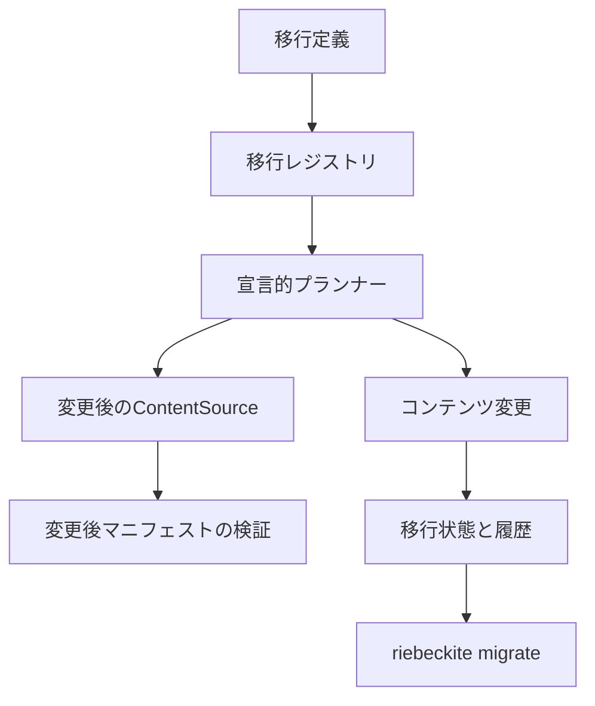

# コンテンツ移行システム

コンテンツ移行システムは、バージョン付きの宣言的な変更をコンテンツへ適用します。
**何を変更するか**は移行が担当し、**どう安全に書き込むか**は
コンテンツ変更システム（Content Mutation）が担当します。

移行がファイルを直接書き換えることはありません。移行はコンテンツ変更の計画を
作り、変更後のマニフェストを検証し、実際の書き込み、競合検出、ジャーナル、
バックアップ、復旧をコンテンツ変更システムへ委譲します。

## アーキテクチャ



各層の責務は分かれています。

| 層 | 責務 |
| --- | --- |
| 移行定義 | ID、バージョン、依存関係、対象選択、ルール、検証 |
| レジストリ | 重複、依存関係、循環、決定的な順序の検査 |
| プランナー | メモリ上のコンテンツにルールを適用し、変更操作を作る |
| 変更後ソース | 計画後のファイルを通常のマニフェスト処理へ渡す |
| コンテンツ変更 | 書き込み、ロック、指紋、ジャーナル、バックアップ、復旧、巻き戻し |
| 移行状態 | どのバージョンを適用したかの記録 |
| 移行履歴 | 計画の同一性、結果、件数、ジャーナル参照の記録 |

移行のメタデータはコンテンツディレクトリ内部の `.riebeckite/migrations` に
保存されます。ビルド出力には書きません。

## 移行定義

`defineContentMigration` で定義し、`createContentMigrationRegistry` で
登録します。

```ts
import {
  createContentMigrationRegistry,
  defineContentMigration,
} from "@riebeckite/core";

const legacy = defineContentMigration({
  id: "legacy-frontmatter",
  version: 1,
  description: "Normalize legacy frontmatter.",
  rules: [
    { kind: "frontmatter-map", key: "category", map: (value) => [value] },
    { kind: "frontmatter-rename", from: "category", to: "tags" },
    {
      kind: "frontmatter-set",
      key: "visibility",
      value: "public",
      when: (content) =>
        content.frontmatter.published === true &&
        content.frontmatter.visibility === undefined,
    },
    { kind: "frontmatter-remove", key: "published" },
  ],
});

const registry = createContentMigrationRegistry([legacy]);
```

定義に含められる項目は次のとおりです。

- `id`: 安定した小文字の識別子。
- `version`: 正の整数。
- `description`: 空でない説明。
- `dependsOn`: 任意の移行 ID。依存先は最新バージョンを使います。
- `select`: 対象コンテンツを絞る任意の述語。
- `rules`: 宣言的な変換ルール。
- `transform`: ルールで表現できない場合の任意のプロジェクト関数。
- `validate`: 変換後の任意の検証。
- `reversible`: 復旧できる内容の任意の説明。

レジストリは ID とバージョンの重複、存在しない依存、自己依存、依存の循環、
不正なパス、不正なルールを拒否します。順序は依存先を先にし、その後に ID と
バージョンで決まります。

同じ ID の複数バージョンを共存させられます。新しいバージョンを適用すると、
適用済みの古いバージョンは `superseded` になります。同じバージョンで定義の
指紋が変わった場合は拒否されるため、バージョンを上げてください。

## 変換ルール

ルールは解析済みのフロントマターと論理的なコンテンツパスを操作します。
Markdown 全体を広い正規表現で置換することはありません。

| ルール | 効果 |
| --- | --- |
| `frontmatter-set` | キーを設定する。関数で値を計算できる |
| `frontmatter-remove` | キーを削除する |
| `frontmatter-rename` | 値を別のキーへ移す |
| `frontmatter-normalize-list` | 文字列を分割し、配列を重複排除する |
| `frontmatter-map` | 既存の値を関数の結果へ置き換える |
| `frontmatter-append` | 値を 1 つ、または配列の要素を追加する |
| `visibility` | `visibility` を public、unlisted、draft に設定する |
| `content-id` | 安定したコンテンツ ID を設定する |
| `permalink` | 明示的なパーマリンクを設定し、以前の URL を保持する |
| `path-rename` | ファイルまたはディレクトリの接頭辞を移動する |

すべてのルールは任意の `when` 述語を受け取ります。同じ値になるルールは何も
しません。対象選択と述語は次の計画でも再評価されるため、適用済みの移行は
再実行しても変更なしになります。

不正な YAML、マッピングでないフロントマター、安全でないパス、不明な選択、
ルールの失敗は診断になります。推測で成功扱いにはしません。

## 計画と適用

`FileSystemContentMigration.plan()` はドライランを行います。

1. 現在のコンテンツソースを読む。
2. 選択した移行を依存順にメモリ上で適用する。
3. 最終状態をコンテンツ変更の操作へ変換する。
4. 仮想 ContentSource から変更後のマニフェストを作る。
5. コンテンツ ID、パーマリンク、リダイレクト、リンク、公開範囲、
   公開指紋、派生データを検証する。
6. 入力コンテンツ指紋、変更指紋、計画指紋、診断、競合、影響量を記録する。

計画作成はユーザーファイルを変更しません。計画に競合がある場合は、適用が
安全でないことを意味します。

適用時は、書き込み前に現在のコンテンツと現在のレジストリに対して計画を
再検証します。その後、指紋が一致するコンテンツ変更計画を既存の実行基盤へ
渡します。移行が `applied` になるのは、変更が成功した後だけです。

## 状態と履歴

移行の状態は次のとおりです。

`pending`、`planned`、`applying`、`applied`、`failed`、
`recovery-required`、`rolled-back`、`superseded`。

`state.json` は最新の適用済み識別情報、計画とコンテンツの指紋、変更計画の
識別情報、ジャーナル位置、変更パス、時刻を記録します。`history.json` は
完了した実行の移行 ID とバージョン、計画の識別情報、件数、結果、復旧状態、
ジャーナル参照を記録します。履歴は上限を持ち、本文、秘密情報、絶対パスを
含みません。

変更ジャーナルがトランザクションの記録です。移行状態は、どの移行がその
ジャーナルを作り、成功したかだけを表します。

## 冪等性

同じバージョンと同じ定義指紋で適用済みの移行はスキップされます。移行済みの
コンテンツに対して計画を作り直しても、各ルールが現在値と望ましい値を比較する
ため、操作は生成されません。

時刻や外部の可変状態に依存する述語を使う場合は、その状態が変わったときに
バージョンと定義指紋も変えてください。

## 再開と巻き戻し

適用中にプロセスが止まった場合、`status` が移行記録と変更ジャーナルを照合します。

- 完了したジャーナルでファイルが一致していれば `applied` に戻す。
- prepared、applying、failed のジャーナルは復旧が必要。
- ジャーナルがなければ `failed` にする。

`recover` はコンテンツ変更の復旧へ委譲します。記録されたトランザクションを
完了させるか、ジャーナルのバックアップを復元します。

`rollback` は、適用済みで完了したジャーナルを持つ移行だけに使えます。復元前
に、現在のすべてのファイルが適用後の指紋と一致すること、すべてのバックアップ
が記録された入力と一致することを検証します。外部編集、バックアップ欠損、
ジャーナル破損は競合となり、コンテンツは変更しません。巻き戻しは、ジャーナル
外の編集を戻す一般的な Undo ではありません。

## CLI

```sh
riebeckite migrate list [--json]
riebeckite migrate plan [--id <migration>] [--out <path>] [--json]
riebeckite migrate apply [--plan <path>] [--id <migration>] [--apply] [--json]
riebeckite migrate status [--json]
riebeckite migrate history [--limit <n>] [--json]
riebeckite migrate rollback <planId|migrationId> --apply [--json]
riebeckite migrate recover [--journal <path>] [--id <migration>] --apply [--json]
```

`plan` は常にドライランです。`apply` も `--apply` を渡すまではドライランです。
CLI は競合を表示し、終了コードを非ゼロにします。JSON 出力は単一のオブジェクト
です。

移行モジュールは `<project>/migrations/index.mjs`（または `.js`、TypeScript
実行時は `.mts`、`.ts`）に置きます。配列または `{ migrations }` を
エクスポートします。実行されるのはプロジェクトのコードだけです。Markdown と
フロントマターはデータであり、JavaScript として評価されません。

CLI は既存ディスパッチャーに限定した `migrate` 分岐を追加します。コマンド
レジストリを作らず、並行開発中の CLI Extension API にも依存しません。後の
統合では `migrate` の引数を `runMigrate` へ渡すだけで済みます。

## 安全性

- 計画作成はユーザーファイルを書き換えない。
- 適用は明示的で、移行ロックで直列化される。
- 同時適用が両方成功することはない。
- 保存済みの計画は適用前に再計画して比較する。
- 移行 ID、バージョン、定義指紋、コンテンツ指紋、計画指紋、
  変更の前提条件を再検証する。
- パストラバーサル、絶対パス、シンボリックリンクのコンテンツは拒否または
  除外する。
- 移行履歴は本文と絶対パスを含まない。
- Draft、Unlisted、Scheduled の公開範囲は、移行が明示的に変えない限り維持する。
- 移行コードは信頼されたプロジェクトコードであり、コンテンツはコードではない。

## 性能

テストスイートは Windows 上で 100 ファイルと 1,000 ファイルを計測します。
参考値では、100 ファイルの計画が約 0.5 秒、適用が約 2.7 秒でした。
1,000 ファイルでは計画が約 5.9 秒、変換が約 75 ミリ秒、適用が約 19 秒、
巻き戻しが約 7.7 秒でした。通常のマニフェスト処理とコンテンツ変更の
ジャーナル書き込みを含む値であり、すべての環境での保証ではありません。

## コンテンツ変更との関係

コンテンツ変更システムが唯一の書き込み経路です。移行はその上に、
バージョン付きの意図、宣言的ルール、依存順序、変更後マニフェストの検証、
トランザクション履歴を追加します。2 つ目のバックアップ機構、ファイル書き込み、
コンテンツパーサーは作りません。安全に変更として表現できない場合は、適用せず
競合として報告します。
