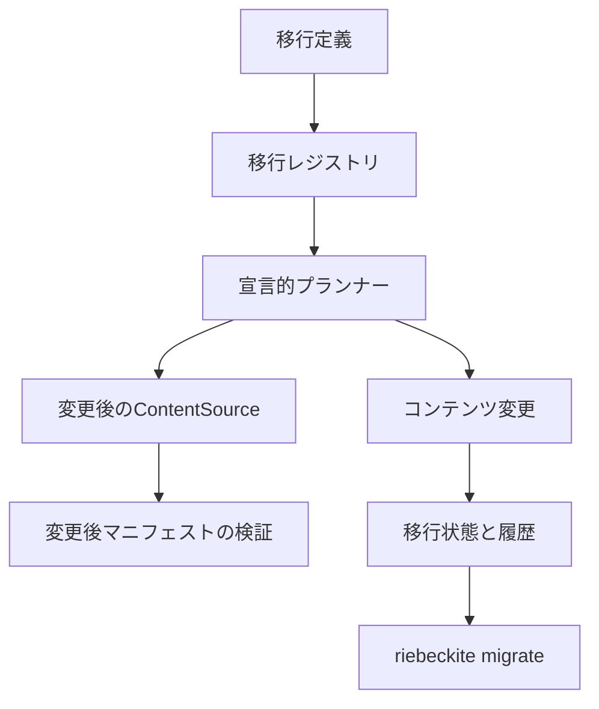

# コンテンツ移行システム

コンテンツ移行は、バージョン付きの宣言的なルールを多数のコンテンツファイルへ一括で
適用します。フロントマターのキー名を変える、タグ表記を統一する、公開状態の表し方を
変える、ディレクトリを移動するといった「サイトの構造を変える作業」を、適用記録と
巻き戻し手段つきで行いたいサイト作者やチーム向けの機能です。

Markdown 版のデータベースマイグレーションと考えてください。番号付きの変更を定義し、
差分をプレビューし、適用し、履歴を残します。単純な検索・置換と違い、ルールは生の
テキストではなく解析済みのフロントマターと論理パスを操作し、書き込み前に変更後の
サイトマニフェストで検証します。

Core に**組み込みの移行プリセットはありません**。移行は `migrations/index.mjs` に
プロジェクトのコードとして定義します。よくあるフロントマターの整理だけが必要なら、
[Frontmatter Transformer](../plugins/frontmatter-transformer.ja.md) Plugin が同じ
エンジンの上に既製のプリセットを提供します。

コンテンツ移行が担当するのは**何を変更するか**です。**どう安全に書き込むか**は
[[content-mutation|コンテンツ変更システム]]が担当し、ファイルを書き込むのは
コンテンツ変更だけです。

## できること

| やりたいこと | 対応する仕組み |
| --- | --- |
| フロントマターのキー名を変える | `frontmatter-rename` |
| フロントマターの値を設定・削除・追加する | `frontmatter-set`、`frontmatter-remove`、`frontmatter-append` |
| 値を関数で変換する | `frontmatter-map` |
| タグなどの文字列リストを正規化する | `frontmatter-normalize-list` |
| 公開範囲を変える | `visibility`（public、unlisted、draft） |
| 安定したコンテンツ ID を割り当てる | `content-id` |
| パーマリンクを設定し、旧 URL を保持する | `permalink` |
| ファイルまたはディレクトリの接頭辞を移動する | `path-rename` |
| ルールの対象ファイルを絞る | `select`、または各ルールの `when` |
| 移行の順序と依存関係を管理する | `dependsOn` |
| プレビュー、保存、適用、確認、巻き戻し、復旧 | CLI と API |

できないこと:

- **Markdown 本文の任意の書き換え。** ルールが変更できるのはフロントマターとパスです。
  正規表現や検索・置換のルールはありません。`path-rename` はコンテンツ変更による
  リンクの再設定を引き起こしますが、それ以外で本文は変更しません。
- **Core の組み込みプリセット。** プリセットは Frontmatter Transformer Plugin の
  機能です。
- **Obsidian の Vault や Quartz サイトの取り込み。** インポーターはありません。
  フロントマターの慣習はルールで表現できますが、書式や本文の変換は対象外です。
- **ビルド中の自動実行。** 移行は明示的な CLI または API 呼び出しです。
- **競合する編集のマージ。** ファイルや定義が変わっていれば競合になります。

## Before / After：キー名の変更とタグの正規化

変更前の `notes/getting-started.md` は、古い `category` キーと真偽値の `published` を
使っています。

```md
---
title: Getting started
category: "#guides, setup"
published: true
---
# Getting started
```

プロジェクトルートの `migrations/index.mjs` に移行を定義します。

```js
import { defineContentMigration } from "@riebeckite/core";

export default [
  defineContentMigration({
    id: "legacy-frontmatter",
    version: 1,
    description: "Normalize legacy frontmatter.",
    rules: [
      { kind: "frontmatter-map", key: "category", map: (value) => [value] },
      { kind: "frontmatter-rename", from: "category", to: "tags" },
      { kind: "frontmatter-normalize-list", key: "tags" },
      {
        kind: "frontmatter-set",
        key: "visibility",
        value: "public",
        when: (content) =>
          content.frontmatter.published === true &&
          content.frontmatter.visibility === undefined,
      },
      { kind: "frontmatter-remove", key: "published" },
    ],
  }),
];
```

結果をプレビューします。

```sh
riebeckite migrate plan
```

```text
Migration plan <plan-id>
Migrations: legacy-frontmatter@1
Changed files: 1
Created: 0, moved: 0, frontmatter: 1
```

まだ何も書き込まれていません。適用します。

```sh
riebeckite migrate apply --apply
```

```text
Applied 1 file change(s); mutation journal <path>.
```

変更後:

```md
---
title: Getting started
tags:
  - guides
  - setup
visibility: public
---
# Getting started
```

本文は変わっていません。`category` の値はリストになり、キー名は `tags` に変わり、
`#` の接頭辞とカンマ区切りが正規化され、`published: true` は `visibility: public` に
なり、古いキーは削除されました。YAML のシリアライズによりキー順や引用符が変わる
ことがあります。重要なのは値です。

## クイックスタート

1. 上の定義で `migrations/index.mjs` を作ります。
2. CLI が認識している移行を一覧します。

   ```sh
   riebeckite migrate list
   ```

   ```text
   legacy-frontmatter@1 pending
   ```

3. プレビューします。

   ```sh
   riebeckite migrate plan
   ```

4. 明示的に適用します。

   ```sh
   riebeckite migrate apply --apply
   ```

5. 記録された状態を確認します。

   ```sh
   riebeckite migrate status
   ```

   ```text
   legacy-frontmatter@1 applied
   History runs: 1
   ```

6. 履歴を見る、または巻き戻します。

   ```sh
   riebeckite migrate history
   riebeckite migrate rollback legacy-frontmatter --apply
   ```

`migrate plan` は常にドライランです。`migrate apply`、`rollback`、`recover` は
`--apply` を渡すまでドライランです。保存した計画は後から適用できます。

```sh
riebeckite migrate plan --out migration-plan.json
riebeckite migrate apply --plan migration-plan.json --apply
```

よくあるフロントマターの整理のために移行コードを書きたくない場合は、
[Frontmatter Transformer](../plugins/frontmatter-transformer.ja.md) Plugin を
インストールしてプリセットを使います。

```sh
riebeckite frontmatter presets
riebeckite frontmatter plan --preset normalize-tags
riebeckite frontmatter apply --preset normalize-tags --apply
```

## 仕組み



各層の責務は分かれています。

| 層 | 責務 |
| --- | --- |
| 移行定義 | ID、バージョン、依存関係、対象選択、ルール、検証 |
| レジストリ | 重複、依存関係、循環、決定的な順序の検査 |
| プランナー | メモリ上のコンテンツにルールを適用し、変更操作を作る |
| 変更後ソース | 計画後のファイルを通常のマニフェスト処理へ渡す |
| コンテンツ変更 | 書き込み、ロック、指紋、ジャーナル、バックアップ、復旧、巻き戻し |
| 移行状態 | どのバージョンを適用したかの記録 |
| 移行履歴 | 計画の同一性、結果、件数、ジャーナル参照の記録 |

`plan()` はドライランを行います。

1. 現在のコンテンツソースを読む。
2. 選択した移行を依存順にメモリ上で適用する。
3. 最終状態をコンテンツ変更の操作へ変換する。
4. 仮想 ContentSource から変更後のマニフェストを作る。
5. コンテンツ ID、パーマリンク、リダイレクト、リンク、公開範囲、
   公開指紋、派生データを検証する。
6. 入力コンテンツ指紋、変更指紋、計画指紋、診断、競合、影響量を記録する。

計画作成はユーザーファイルを変更しません。計画に競合がある場合は、適用が
安全でないことを意味します。

適用時は、書き込み前に現在のコンテンツと現在のレジストリに対して計画を
再検証します。その後、指紋が一致するコンテンツ変更計画を既存の実行基盤へ
渡します。移行が `applied` になるのは、変更が成功した後だけです。

移行のメタデータはコンテンツディレクトリ内部の `.riebeckite/migrations` に
保存されます。ビルド出力には書きません。`state.json` は最新の適用済み識別情報、
計画とコンテンツの指紋、変更計画の識別情報、ジャーナル位置、変更パス、時刻を
記録します。`history.json` は完了した実行の移行 ID とバージョン、計画の識別情報、
件数、結果、復旧状態、ジャーナル参照を記録します。履歴は上限を持ち、本文、
秘密情報、絶対パスを含みません。

変更ジャーナルがトランザクションの記録です。移行状態は、どの移行がその
ジャーナルを作り、成功したかだけを表します。

## 他の機能との関係

- [[content-mutation|コンテンツ変更]]が唯一の書き込み経路です。移行はその上に、
  バージョン付きの意図、宣言的ルール、依存順序、変更後マニフェストの検証、
  トランザクション履歴を追加します。2 つ目のバックアップ機構、ファイル書き込み、
  コンテンツパーサーは作りません。
- **通常の検索・置換**はテキストを対象にします。フロントマターの解析、リンクの
  再設定、変更後マニフェストの検証、ジャーナルの記録は行いません。本文の置換には
  検索・置換を使い、フロントマターやパスの構造変更には移行を使います。
- [Frontmatter Transformer](../plugins/frontmatter-transformer.ja.md) Plugin は、
  よくあるフロントマター整理のためのノーコード経路です。プリセットはバージョン付きの
  コンテンツ移行定義であり、別のエンジンではありません。
- **Obsidian と Quartz** には独自の慣習があります。Riebeckite はその慣習に合わせた
  フロントマターのルールを表現できますが、Vault やサイトを自動で取り込む
  インポーターはありません。

## 制限事項

- ルールが変更できるのはフロントマターとパスだけです。Markdown 本文の任意の
  書き換えはできません。
- Core にプリセットはありません。Frontmatter Transformer Plugin を使うか、
  定義を書いてください。
- Obsidian や Quartz のインポーターはありません。
- 移行がファイルを直接書き換えることはありません。安全な変更として表現できない
  場合は、適用せず競合として報告します。
- 同じ ID、バージョン、定義フィンガープリントの適用はスキップされます。定義を
  変えたらバージョンを上げてください。
- 巻き戻しには、適用済みで完了したジャーナルを持つ移行と、変更されていない現在の
  ファイルが必要です。外部編集、バックアップ欠損、ジャーナル破損は競合となり、
  コンテンツは変更しません。
- 移行コードは信頼されたプロジェクトコードです。サンドボックスではありません。
- スケジューラやビルドへの自動統合はありません。CLI を明示的に実行してください。
- `transform` はスナップショットを受け取り、フロントマターの変更、パス、診断を
  返せます。新しい Markdown 本文を返すことはできません。

## CLI リファレンス

```sh
riebeckite migrate list [--json]
riebeckite migrate plan [--id <migration>] [--out <path>] [--json]
riebeckite migrate apply [--plan <path>] [--id <migration>] [--apply] [--json]
riebeckite migrate status [--json]
riebeckite migrate history [--limit <n>] [--json]
riebeckite migrate rollback <planId|migrationId> --apply [--json]
riebeckite migrate recover [--journal <path>] [--id <migration>] --apply [--json]
```

`plan` は常にドライランです。`apply` も `--apply` を渡すまではドライランです。
CLI は競合を表示し、終了コードを非ゼロにします。JSON 出力は単一のオブジェクト
です。

移行モジュールは `<project>/migrations/index.mjs`（または `.js`、TypeScript
実行時は `.mts`、`.ts`）に置きます。配列または `{ migrations }` を
エクスポートします。実行されるのはプロジェクトのコードだけです。Markdown と
フロントマターはデータであり、JavaScript として評価されません。

`migrate` は組み込みコマンドと同じ型付きの[[reference/cli-extension|CLI コマンド
レジストリ]]に登録されます。各アクションが独自の定義、ヘルプ、JSON 対応、終了
コードを持ち、移行専用のパーサーやディスパッチャーの分岐はありません。
`runMigrate` はそれらの定義の実装です。

## API リファレンス

### 定義

`defineContentMigration` で定義し、`createContentMigrationRegistry` で登録します。

```ts
import {
  createContentMigrationRegistry,
  defineContentMigration,
} from "@riebeckite/core";

const legacy = defineContentMigration({
  id: "legacy-frontmatter",
  version: 1,
  description: "Normalize legacy frontmatter.",
  rules: [
    { kind: "frontmatter-map", key: "category", map: (value) => [value] },
    { kind: "frontmatter-rename", from: "category", to: "tags" },
    {
      kind: "frontmatter-set",
      key: "visibility",
      value: "public",
      when: (content) =>
        content.frontmatter.published === true &&
        content.frontmatter.visibility === undefined,
    },
    { kind: "frontmatter-remove", key: "published" },
  ],
});

const registry = createContentMigrationRegistry([legacy]);
```

定義に含められる項目は次のとおりです。

- `id`: 安定した小文字の識別子。
- `version`: 正の整数。
- `description`: 空でない説明。
- `dependsOn`: 任意の移行 ID。依存先は最新バージョンを使います。
- `select`: 対象コンテンツを絞る任意の述語。
- `rules`: 宣言的な変換ルール。
- `transform`: ルールで表現できない場合の任意のプロジェクト関数。
- `validate`: 変換後の任意の検証。
- `reversible`: 復旧できる内容の任意の説明。

レジストリは ID とバージョンの重複、存在しない依存、自己依存、依存の循環、
不正なパス、不正なルールを拒否します。順序は依存先を先にし、その後に ID と
バージョンで決まります。

同じ ID の複数バージョンを共存させられます。新しいバージョンを適用すると、
適用済みの古いバージョンは `superseded` になります。同じバージョンで定義の
指紋が変わった場合は拒否されるため、バージョンを上げてください。

### 変換ルール

ルールは解析済みのフロントマターと論理的なコンテンツパスを操作します。
Markdown 全体を広い正規表現で置換することはありません。

| ルール | 効果 |
| --- | --- |
| `frontmatter-set` | キーを設定する。関数で値を計算できる |
| `frontmatter-remove` | キーを削除する |
| `frontmatter-rename` | 値を別のキーへ移す |
| `frontmatter-normalize-list` | 文字列を分割し、配列を重複排除する |
| `frontmatter-map` | 既存の値を関数の結果へ置き換える |
| `frontmatter-append` | 値を 1 つ、または配列の要素を追加する |
| `visibility` | `visibility` を public、unlisted、draft に設定する |
| `content-id` | 安定したコンテンツ ID を設定する |
| `permalink` | 明示的なパーマリンクを設定し、以前の URL を保持する |
| `path-rename` | ファイルまたはディレクトリの接頭辞を移動する |

すべてのルールは任意の `when` 述語を受け取ります。同じ値になるルールは何も
しません。対象選択と述語は次の計画でも再評価されるため、適用済みの移行は
再実行しても変更なしになります。

不正な YAML、マッピングでないフロントマター、安全でないパス、不明な選択、
ルールの失敗は診断になります。推測で成功扱いにはしません。

### API

定義と計画の API は `@riebeckite/core` からエクスポートされます。

| API | 用途 |
| --- | --- |
| `defineContentMigration(definition)` | 1 つの移行定義を検証して正規化する。 |
| `createContentMigrationRegistry(migrations)` | 重複、依存関係、循環、決定的な順序を検査する。 |
| `migrationKey(id, version)` | 状態と履歴が使う安定キー。 |
| `fingerprintContentMigrationDefinition(definition)` | 再検証用に定義をフィンガープリント化する。 |
| `planContentMigrationBatch({ migrations, files, ... })` | 定義をメモリ上で適用し、計画済みバッチを作る。 |
| `applyContentMigration(content, migration)` | 1 つの変換を解析済みコンテンツへ適用する。 |
| `parseMigrationContent(path, markdown)` | 移行用に Markdown とフロントマターを解析する。 |
| `diffFrontmatter(before, after)` | 2 つのフロントマターを比較する。 |
| `isSafeContentPath(path)` | 共通の論理パス規則を適用する。 |
| `appendContentMigrationHistory` / `parseContentMigrationState` / `parseContentMigrationHistory` | 保存状態を検証し、上限内に収める。 |

ファイルシステム実行層は `@riebeckite/node` からエクスポートされます。

```ts
import { FileSystemContentMigration } from "@riebeckite/node";

const migration = new FileSystemContentMigration({
  contentDirectory,
  registry,
});
```

| メソッド | 動作 |
| --- | --- |
| `plan({ ids? })` | ドライラン。読み込み、変換、変更後マニフェストの構築、検証を行い、計画を返す。 |
| `savePlan(plan, path?)` / `loadPlan(path)` | 計画を保存または読み込む。 |
| `apply({ planPath?, ids? })` | 再検証し、コンテンツ変更経由で適用する。 |
| `status()` | 状態と変更ジャーナルを突き合わせ、移行ごとの状態を返す。 |
| `list()` | 定義と適用状態の一覧を返す。 |
| `history({ limit? })` | 上限付きの実行履歴を返す。 |
| `rollback({ planId?, migrationId? })` | 適用済みの移行をコンテンツ変更経由で巻き戻す。 |
| `recover({ journal?, migrationId? })` | 中断した変更ジャーナルを復旧する。 |

`FileSystemContentMigrationOptions` は、変更後マニフェストを独自ビルドに
合わせるための `config`、`plugins`、`buildTime`、`exclude`、`redirectField` も
受け取ります。

## 冪等性

同じバージョンと同じ定義指紋で適用済みの移行はスキップされます。移行済みの
コンテンツに対して計画を作り直しても、各ルールが現在値と望ましい値を比較する
ため、操作は生成されません。

時刻や外部の可変状態に依存する述語を使う場合は、その状態が変わったときに
バージョンと定義指紋も変えてください。

## 再開と巻き戻し

適用中にプロセスが止まった場合、`status` が移行記録と変更ジャーナルを照合します。

- 完了したジャーナルでファイルが一致していれば `applied` に戻す。
- prepared、applying、failed のジャーナルは復旧が必要。
- ジャーナルがなければ `failed` にする。

`recover` はコンテンツ変更の復旧へ委譲します。記録されたトランザクションを
完了させるか、ジャーナルのバックアップを復元します。

`rollback` は、適用済みで完了したジャーナルを持つ移行だけに使えます。復元前に、
現在のすべてのファイルが適用後の指紋と一致すること、すべてのバックアップが
記録された入力と一致することを検証します。外部編集、バックアップ欠損、
ジャーナル破損は競合となり、コンテンツは変更しません。巻き戻しは、ジャーナル
外の編集を戻す一般的な Undo ではありません。

移行の状態は `pending`、`planned`、`applying`、`applied`、`failed`、
`recovery-required`、`rolled-back`、`superseded` です。

## 安全性

- 計画作成はユーザーファイルを書き換えない。
- 適用は明示的で、移行ロックで直列化される。
- 同時適用が両方成功することはない。
- 保存済みの計画は適用前に再計画して比較する。
- 移行 ID、バージョン、定義指紋、コンテンツ指紋、計画指紋、
  変更の前提条件を再検証する。
- パストラバーサル、絶対パス、シンボリックリンクのコンテンツは拒否または
  除外する。
- 移行履歴は本文と絶対パスを含まない。
- Draft、Unlisted、Scheduled の公開範囲は、移行が明示的に変えない限り維持する。
- 移行コードは信頼されたプロジェクトコードであり、コンテンツはコードではない。

## トラブルシューティング

- **`migrate list` に何も出ない**: ローダーはプロジェクトルートの
  `migrations/index.mjs`、`.js`、`.mts`、`.ts` を読みます。配列または
  `{ migrations }` をエクスポートしているか確認してください。
- **`status` に「definition changed」と出る**: 登録済み定義のフィンガープリントが
  適用済み記録と一致していません。定義を戻すか、`version` を上げてください。
- **適用がスキップされる**: 同じ ID、バージョン、定義フィンガープリントが適用済み
  です。新しい変更にはバージョンを上げてください。
- **`recovery-required` になる**: 変更ジャーナルが中断しています。次の適用の前に
  `migrate recover --apply` を実行してください。
- **巻き戻しが競合を報告する**: 移行後にファイルが変わった、バックアップがない、
  またはジャーナルが壊れています。巻き戻しはコンテンツを変更しないので、競合した
  パスを確認してください。
- **保存した計画を適用できない**: 計画は作成時のコンテンツとレジストリの
  フィンガープリントに結び付いています。JSON を編集せず、計画し直してください。
- **ルールが効かない**: `select` と `when` を確認し、ファイルに実際にそのキーが
  あるか確かめてください。同じ値になるルールは仕様どおり何もしません。
- **YAML の形が変わった**: シリアライズはバイト単位の保持ではありません。
  差分を確認してください。

## 性能

テストスイートは Windows 上で 100 ファイルと 1,000 ファイルを計測します。
参考値では、100 ファイルの計画が約 0.5 秒、適用が約 2.7 秒でした。
1,000 ファイルでは計画が約 5.9 秒、変換が約 75 ミリ秒、適用が約 19 秒、
巻き戻しが約 7.7 秒でした。通常のマニフェスト処理とコンテンツ変更の
ジャーナル書き込みを含む値であり、すべての環境での保証ではありません。
