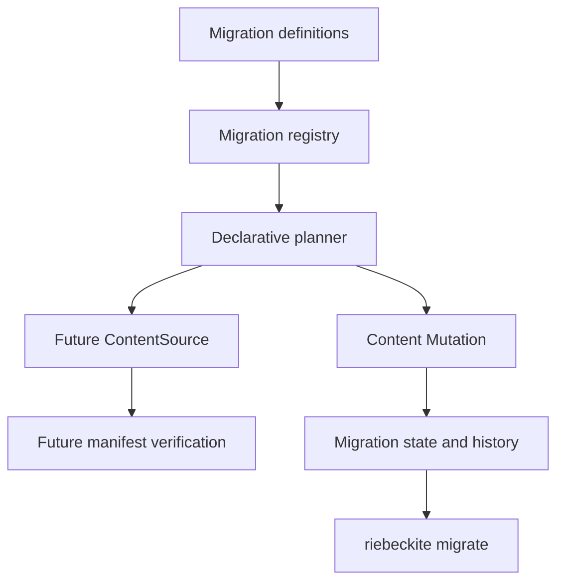

# Content Migration System

The Content Migration System applies versioned, declarative changes to content.
It owns the question of **what to change**. The Content Mutation system owns
**how to write the change safely**.

A migration never writes files directly. It produces a Content Mutation plan,
verifies the future content manifest, and delegates the actual write,
conflict detection, journal, backups, and recovery to Content Mutation.

## Architecture



The layers have separate responsibilities:

| Layer | Responsibility |
| --- | --- |
| Migration definition | ID, version, dependencies, selection, rules, validation |
| Registry | Duplicate, dependency, cycle, and deterministic order checks |
| Planner | Apply rules to in-memory content and produce mutation operations |
| Future source | Present the planned files to the normal manifest pipeline |
| Mutation | Write, lock, fingerprint, journal, back up, recover, roll back |
| Migration state | Record which migration version was applied |
| Migration history | Record plan identity, result, counts, and journal reference |

Migration metadata is stored under the content directory's internal
`.riebeckite/migrations` directory. It is not written to the build output.

## Migration Definition

Call `defineContentMigration` and register the result with
`createContentMigrationRegistry`.

```ts
import {
  createContentMigrationRegistry,
  defineContentMigration,
} from "@riebeckite/core";

const legacy = defineContentMigration({
  id: "legacy-frontmatter",
  version: 1,
  description: "Normalize legacy frontmatter.",
  rules: [
    { kind: "frontmatter-map", key: "category", map: (value) => [value] },
    { kind: "frontmatter-rename", from: "category", to: "tags" },
    {
      kind: "frontmatter-set",
      key: "visibility",
      value: "public",
      when: (content) =>
        content.frontmatter.published === true &&
        content.frontmatter.visibility === undefined,
    },
    { kind: "frontmatter-remove", key: "published" },
  ],
});

const registry = createContentMigrationRegistry([legacy]);
```

A definition contains:

- `id`: stable lower-case identifier.
- `version`: positive integer.
- `description`: non-empty explanation.
- `dependsOn`: optional migration IDs. The latest version of a dependency is used.
- `select`: optional predicate for the content a migration targets.
- `rules`: declarative transformations.
- `transform`: optional project function for cases that rules cannot express.
- `validate`: optional post-transform validation.
- `reversible`: optional description of what can be recovered.

The registry rejects duplicate ID/version pairs, missing dependencies, self
dependencies, dependency cycles, invalid paths, and invalid rule shapes. Ordering
is deterministic: dependencies first, then ID and version.

Multiple versions of the same ID may coexist. Applying a newer version marks the
older applied version as `superseded`. Applying the same version with a different
definition fingerprint is rejected; bump the version instead.

## Transformation Rules

Rules operate on parsed frontmatter and the logical content path. Markdown is
never rewritten with a broad regular expression.

| Rule | Effect |
| --- | --- |
| `frontmatter-set` | Set a key; a function may compute the value |
| `frontmatter-remove` | Remove a key |
| `frontmatter-rename` | Move a value to another key |
| `frontmatter-normalize-list` | Split strings and deduplicate arrays |
| `frontmatter-map` | Replace an existing value with a function result |
| `frontmatter-append` | Add one value or array entry |
| `visibility` | Set `visibility` to public, unlisted, or draft |
| `content-id` | Set the stable content ID |
| `permalink` | Set an explicit permalink and preserve the previous one |
| `path-rename` | Move a file or directory prefix |

Every rule accepts an optional `when` predicate. A rule that would produce the
same value performs no operation. Selectors and predicates run again on later
plans, so an applied migration is a no-op when re-evaluated.

Invalid YAML, non-mapping frontmatter, unsafe paths, unknown selectors, and rule
failures become diagnostics. They are not guessed into a successful transform.

## Plan and Apply

`FileSystemContentMigration.plan()` performs a dry run:

1. Read the current content source.
2. Apply the selected migrations in dependency order in memory.
3. Convert the final state into Content Mutation operations.
4. Build the future content manifest through a virtual ContentSource.
5. Verify content IDs, permalinks, redirects, links, visibility, publication
   fingerprints, and derived data.
6. Record the input content fingerprint, mutation fingerprint, plan fingerprint,
   diagnostics, conflicts, and estimated impact.

Planning does not modify user files. A plan conflict means the change is not
safe to apply.

Apply revalidates the plan against the current content and the current registry
before writing. It then calls the Content Mutation executor with a mutation plan
whose fingerprint must match the migration plan. The migration is marked
`applied` only after the mutation reports success.

## State and History

Migration states are:

`pending`, `planned`, `applying`, `applied`, `failed`,
`recovery-required`, `rolled-back`, and `superseded`.

`state.json` records the latest applied identity, plan and content fingerprints,
mutation plan identity, journal location, changed paths, and timestamps.
`history.json` records completed runs with migration ID/version, plan identity,
counts, result, recovery state, and a journal reference. History is bounded and
contains no content bodies, secrets, or absolute paths.

The mutation journal is the transaction record. Migration state only describes
which migration produced the journal and whether the migration succeeded.

## Idempotency

A migration that has already been applied with the same version and definition
fingerprint is skipped. Re-running a plan on migrated content produces no
operations because every rule compares the desired value with the current value.

Do not use a predicate that depends on time or external mutable state unless the
version and definition fingerprint change when that state changes.

## Resume and Rollback

If the process stops while applying, `status` reconciles the migration record
with the mutation journal:

- A complete journal whose files still match is reconciled to `applied`.
- A prepared, applying, or failed journal requires recovery.
- A missing journal becomes `failed`.

`recover` delegates to Content Mutation recovery. It either completes the
recorded transaction or restores the journal backups.

`rollback` is available only for an applied migration with a completed journal.
Before restoring, Content Mutation verifies that every current file still matches
the applied fingerprint and that every backup matches the recorded input. An
external edit, missing backup, or corrupt journal produces a conflict and leaves
the content untouched. Rollback is not a general undo system for edits made
outside the journal.

## CLI

```sh
riebeckite migrate list [--json]
riebeckite migrate plan [--id <migration>] [--out <path>] [--json]
riebeckite migrate apply [--plan <path>] [--id <migration>] [--apply] [--json]
riebeckite migrate status [--json]
riebeckite migrate history [--limit <n>] [--json]
riebeckite migrate rollback <planId|migrationId> --apply [--json]
riebeckite migrate recover [--journal <path>] [--id <migration>] --apply [--json]
```

`plan` and `apply` are dry runs unless `--apply` is passed to `apply`. The CLI
prints conflicts and exits with a non-zero status. JSON output is a single object.

Migration modules live at `<project>/migrations/index.mjs` (or `.js`, `.mts`,
`.ts` under a TypeScript runner). They export an array or `{ migrations }`.
Only project code is executed. Markdown and frontmatter are data and are never
evaluated as JavaScript.

The CLI adds a narrow `migrate` branch to the existing dispatcher. It does not
create a command registry or depend on the parallel CLI Extension API. A later
integration only needs to forward `migrate` arguments to `runMigrate`.

## Safety

- Planning never writes user files.
- Apply is explicit and serialized with a migration lock.
- Concurrent applies cannot both succeed.
- Saved plans are re-planned and compared before apply.
- Migration ID, version, definition fingerprint, content fingerprint, plan
  fingerprint, and mutation preconditions are revalidated.
- Path traversal, absolute paths, and symlinked content are rejected or skipped.
- Migration history omits content bodies and absolute paths.
- Draft, unlisted, and scheduled visibility is preserved unless a migration
  explicitly changes it.
- Migration code is trusted project code; content is not trusted code.

## Performance

The test suite measures 100 and 1,000 Markdown files on Windows. On the reference
run, 100 files planned in about 0.5 seconds and applied in about 2.7 seconds.
1,000 files planned in about 5.9 seconds, transformed in about 75 milliseconds,
applied in about 19 seconds, and rolled back in about 7.7 seconds. These numbers
include the normal manifest pipeline and Content Mutation journal writes; they
are not a promise for every machine.

## Relationship to Content Mutation

Content Mutation remains the only write path. Migration adds versioned intent,
declarative rules, dependency ordering, future-manifest verification, and
transaction history above it. There is no second backup engine, file writer, or
content parser. If a change cannot be expressed safely as a mutation, the
migration reports a conflict instead of applying it.
