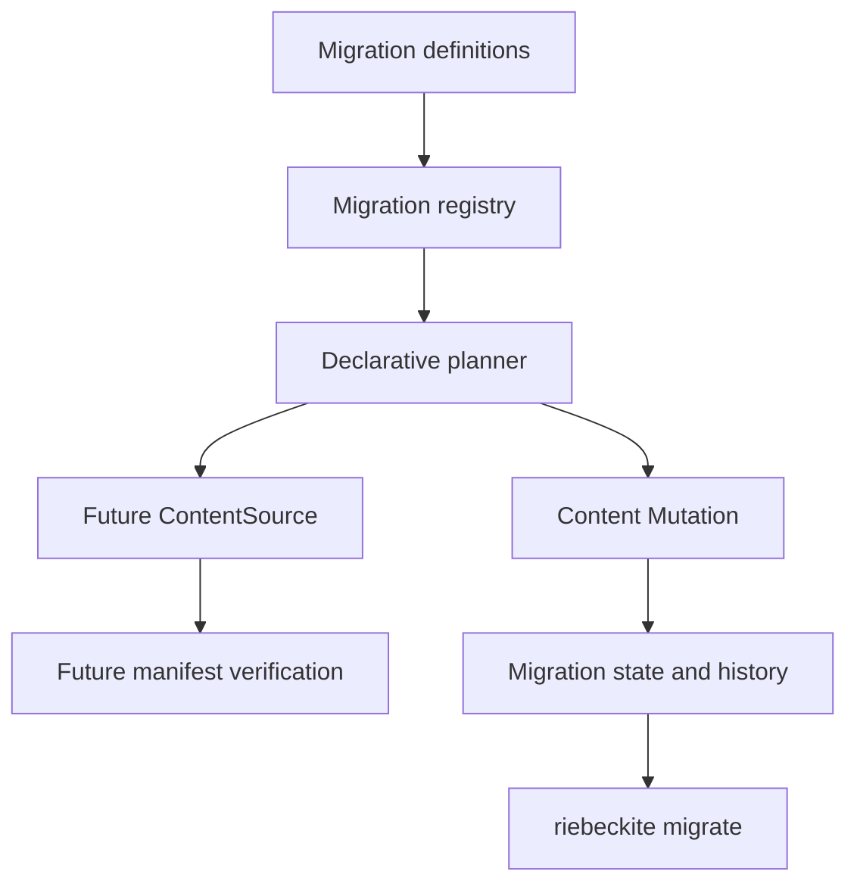

# Content Migration System

Content Migration applies versioned, declarative rules to many content files at
once. It is for site authors and teams that need to change the structure of a
site — renaming a Frontmatter key, normalizing tags, changing how publication is
expressed, or moving a directory — and want a record of what was applied and a
way to roll it back.

Think of it as a database migration for Markdown. You define a numbered change,
preview the diff, apply it, and keep history. Unlike find-and-replace, rules
operate on parsed Frontmatter and logical paths, not raw text, and the result is
verified against the future site manifest before anything is written.

Core has **no built-in migration presets**. You define migrations as project code
in `migrations/index.mjs`. If you only need common Frontmatter cleanups, the
[Frontmatter Transformer](../plugins/frontmatter-transformer.md) plugin ships
ready-made presets on top of the same engine.

Content Migration owns **what to change**. The
[[content-mutation|Content Mutation system]] owns **how to write the change
safely**, and is the only component that writes files.

## What you can do

| Task | Supported |
| --- | --- |
| Rename a Frontmatter key | `frontmatter-rename` |
| Set, remove, or append a Frontmatter value | `frontmatter-set`, `frontmatter-remove`, `frontmatter-append` |
| Transform a value with a function | `frontmatter-map` |
| Normalize tags or other string lists | `frontmatter-normalize-list` |
| Change publication visibility | `visibility` (public, unlisted, draft) |
| Assign a stable content ID | `content-id` |
| Set a permalink and preserve the old URL | `permalink` |
| Move a file or a directory prefix | `path-rename` |
| Limit which files a rule touches | `select`, or `when` on any rule |
| Order migrations and share dependencies | `dependsOn` |
| Preview, save, apply, inspect, roll back, recover | CLI and API |

What it cannot do:

- **Rewrite arbitrary Markdown body text.** Rules change Frontmatter and paths.
  There is no regex or find-and-replace rule. A `path-rename` can make Content
  Mutation retarget links, but the body is otherwise left alone.
- **Provide built-in presets in core.** Presets belong to the Frontmatter
  Transformer plugin.
- **Import an Obsidian vault or a Quartz site.** There is no importer. You can
  express Frontmatter conventions as rules, but format and body conversion are
  out of scope.
- **Run automatically during a build.** Migration is an explicit CLI or API call.
- **Merge conflicting edits.** A changed file or definition is a conflict.

## Before and after: rename a key and normalize tags

Before, `notes/getting-started.md` uses a legacy `category` key and a boolean
`published` flag:

```md
---
title: Getting started
category: "#guides, setup"
published: true
---
# Getting started
```

Define the migration in `migrations/index.mjs` at the project root:

```js
import { defineContentMigration } from "@riebeckite/core";

export default [
  defineContentMigration({
    id: "legacy-frontmatter",
    version: 1,
    description: "Normalize legacy frontmatter.",
    rules: [
      { kind: "frontmatter-map", key: "category", map: (value) => [value] },
      { kind: "frontmatter-rename", from: "category", to: "tags" },
      { kind: "frontmatter-normalize-list", key: "tags" },
      {
        kind: "frontmatter-set",
        key: "visibility",
        value: "public",
        when: (content) =>
          content.frontmatter.published === true &&
          content.frontmatter.visibility === undefined,
      },
      { kind: "frontmatter-remove", key: "published" },
    ],
  }),
];
```

Preview the result:

```sh
riebeckite migrate plan
```

```text
Migration plan <plan-id>
Migrations: legacy-frontmatter@1
Changed files: 1
Created: 0, moved: 0, frontmatter: 1
```

Nothing has been written yet. Apply it:

```sh
riebeckite migrate apply --apply
```

```text
Applied 1 file change(s); mutation journal <path>.
```

After:

```md
---
title: Getting started
tags:
  - guides
  - setup
visibility: public
---
# Getting started
```

The body is unchanged. The `category` value became a list, the key became `tags`,
the `#` prefix and comma separator were normalized away, `published: true` became
`visibility: public`, and the old key was removed. YAML serialization may change
key order or quoting; the values are what matter.

## Quick start

1. Create `migrations/index.mjs` with the definition above.
2. List what the CLI can see:

   ```sh
   riebeckite migrate list
   ```

   ```text
   legacy-frontmatter@1 pending
   ```

3. Preview:

   ```sh
   riebeckite migrate plan
   ```

4. Apply explicitly:

   ```sh
   riebeckite migrate apply --apply
   ```

5. Confirm the recorded state:

   ```sh
   riebeckite migrate status
   ```

   ```text
   legacy-frontmatter@1 applied
   History runs: 1
   ```

6. Inspect or undo:

   ```sh
   riebeckite migrate history
   riebeckite migrate rollback legacy-frontmatter --apply
   ```

`migrate plan` is always a dry run. `migrate apply`, `rollback`, and `recover`
are dry runs until `--apply` is passed. A saved plan can be applied later:

```sh
riebeckite migrate plan --out migration-plan.json
riebeckite migrate apply --plan migration-plan.json --apply
```

If you do not want to write migration code for common Frontmatter cleanup, install
the [Frontmatter Transformer](../plugins/frontmatter-transformer.md) plugin and
use its presets:

```sh
riebeckite frontmatter presets
riebeckite frontmatter plan --preset normalize-tags
riebeckite frontmatter apply --preset normalize-tags --apply
```

## How it works



The layers have separate responsibilities:

| Layer | Responsibility |
| --- | --- |
| Migration definition | ID, version, dependencies, selection, rules, validation |
| Registry | Duplicate, dependency, cycle, and deterministic order checks |
| Planner | Apply rules to in-memory content and produce mutation operations |
| Future source | Present the planned files to the normal manifest pipeline |
| Mutation | Write, lock, fingerprint, journal, back up, recover, roll back |
| Migration state | Record which migration version was applied |
| Migration history | Record plan identity, result, counts, and journal reference |

`plan()` performs a dry run:

1. Read the current content source.
2. Apply the selected migrations in dependency order in memory.
3. Convert the final state into Content Mutation operations.
4. Build the future content manifest through a virtual ContentSource.
5. Verify content IDs, permalinks, redirects, links, visibility, publication
   fingerprints, and derived data.
6. Record the input content fingerprint, mutation fingerprint, plan fingerprint,
   diagnostics, conflicts, and estimated impact.

Planning does not modify user files. A plan conflict means the change is not safe
to apply.

Apply revalidates the plan against the current content and the current registry
before writing. It then calls the Content Mutation executor with a mutation plan
whose fingerprint must match the migration plan. The migration is marked
`applied` only after the mutation reports success.

Migration metadata is stored under the content directory's internal
`.riebeckite/migrations` directory. It is not written to the build output.
`state.json` records the latest applied identity, plan and content fingerprints,
mutation plan identity, journal location, changed paths, and timestamps.
`history.json` records completed runs with migration ID/version, plan identity,
counts, result, recovery state, and a journal reference. History is bounded and
contains no content bodies, secrets, or absolute paths.

The mutation journal is the transaction record. Migration state only describes
which migration produced the journal and whether the migration succeeded.

## Relationship to other features

- [[content-mutation|Content Mutation]] is the only write path. Migration adds
  versioned intent, declarative rules, dependency ordering, future-manifest
  verification, and transaction history above it. There is no second backup
  engine, file writer, or content parser.
- **Ordinary find-and-replace** works on text. It does not parse Frontmatter,
  retarget links, verify the future manifest, or keep a journal. Use it for body
  text; use Migration for structural Frontmatter and path changes.
- The [Frontmatter Transformer](../plugins/frontmatter-transformer.md) plugin is
  the no-code path for common Frontmatter cleanup. Its presets are versioned
  Content Migration definitions, not a separate engine.
- **Obsidian and Quartz** have their own conventions. Riebeckite can express
  Frontmatter rules that match those conventions, but there is no automated
  vault or site importer.

## Limitations

- Rules change Frontmatter and paths only. Arbitrary Markdown body rewriting is
  not supported.
- Core ships no presets. Use the Frontmatter Transformer plugin or write a
  definition.
- There is no Obsidian or Quartz importer.
- A migration never writes files directly; if the change cannot be expressed as a
  safe mutation, it reports a conflict instead of applying it.
- Applying the same ID, version, and definition fingerprint twice is skipped.
  Change the version when the definition changes.
- Rollback requires an applied migration with a completed journal and unchanged
  current files. External edits, missing backups, or a corrupt journal produce a
  conflict and leave content untouched.
- Migration code is trusted project code. It is not sandboxed.
- There is no scheduler or automatic build integration. Run the CLI explicitly.
- `transform` receives a snapshot and may return Frontmatter changes, a path, and
  diagnostics. It cannot return a new Markdown body.

## CLI reference

```sh
riebeckite migrate list [--json]
riebeckite migrate plan [--id <migration>] [--out <path>] [--json]
riebeckite migrate apply [--plan <path>] [--id <migration>] [--apply] [--json]
riebeckite migrate status [--json]
riebeckite migrate history [--limit <n>] [--json]
riebeckite migrate rollback <planId|migrationId> --apply [--json]
riebeckite migrate recover [--journal <path>] [--id <migration>] --apply [--json]
```

`plan` and `apply` are dry runs unless `--apply` is passed to `apply`. The CLI
prints conflicts and exits with a non-zero status. JSON output is a single object.

Migration modules live at `<project>/migrations/index.mjs` (or `.js`, `.mts`,
`.ts` under a TypeScript runner). They export an array or `{ migrations }`. Only
project code is executed. Markdown and Frontmatter are data and are never
evaluated as JavaScript.

`migrate` is registered in the same typed [[reference/cli-extension|CLI command
registry]] as the built-in commands. Each action has its own definition, help
metadata, JSON support, and exit code; there is no separate migration parser or
dispatcher branch. `runMigrate` remains the implementation behind those
definitions.

## API reference

### Definition

Call `defineContentMigration` and register the result with
`createContentMigrationRegistry`.

```ts
import {
  createContentMigrationRegistry,
  defineContentMigration,
} from "@riebeckite/core";

const legacy = defineContentMigration({
  id: "legacy-frontmatter",
  version: 1,
  description: "Normalize legacy frontmatter.",
  rules: [
    { kind: "frontmatter-map", key: "category", map: (value) => [value] },
    { kind: "frontmatter-rename", from: "category", to: "tags" },
    {
      kind: "frontmatter-set",
      key: "visibility",
      value: "public",
      when: (content) =>
        content.frontmatter.published === true &&
        content.frontmatter.visibility === undefined,
    },
    { kind: "frontmatter-remove", key: "published" },
  ],
});

const registry = createContentMigrationRegistry([legacy]);
```

A definition contains:

- `id`: stable lower-case identifier.
- `version`: positive integer.
- `description`: non-empty explanation.
- `dependsOn`: optional migration IDs. The latest version of a dependency is used.
- `select`: optional predicate for the content a migration targets.
- `rules`: declarative transformations.
- `transform`: optional project function for cases that rules cannot express.
- `validate`: optional post-transform validation.
- `reversible`: optional description of what can be recovered.

The registry rejects duplicate ID/version pairs, missing dependencies, self
dependencies, dependency cycles, invalid paths, and invalid rule shapes. Ordering
is deterministic: dependencies first, then ID and version.

Multiple versions of the same ID may coexist. Applying a newer version marks the
older applied version as `superseded`. Applying the same version with a different
definition fingerprint is rejected; bump the version instead.

### Transformation rules

Rules operate on parsed Frontmatter and the logical content path. Markdown is
never rewritten with a broad regular expression.

| Rule | Effect |
| --- | --- |
| `frontmatter-set` | Set a key; a function may compute the value |
| `frontmatter-remove` | Remove a key |
| `frontmatter-rename` | Move a value to another key |
| `frontmatter-normalize-list` | Split strings and deduplicate arrays |
| `frontmatter-map` | Replace an existing value with a function result |
| `frontmatter-append` | Add one value or array entry |
| `visibility` | Set `visibility` to public, unlisted, or draft |
| `content-id` | Set the stable content ID |
| `permalink` | Set an explicit permalink and preserve the previous one |
| `path-rename` | Move a file or directory prefix |

Every rule accepts an optional `when` predicate. A rule that would produce the
same value performs no operation. Selectors and predicates run again on later
plans, so an applied migration is a no-op when re-evaluated.

Invalid YAML, non-mapping Frontmatter, unsafe paths, unknown selectors, and rule
failures become diagnostics. They are not guessed into a successful transform.

### API

The definition and planning API is exported from `@riebeckite/core`:

| API | Purpose |
| --- | --- |
| `defineContentMigration(definition)` | Validate and normalize one migration definition. |
| `createContentMigrationRegistry(migrations)` | Check duplicates, dependencies, cycles, and deterministic order. |
| `migrationKey(id, version)` | Stable key used by state and history. |
| `fingerprintContentMigrationDefinition(definition)` | Fingerprint the definition for revalidation. |
| `planContentMigrationBatch({ migrations, files, ... })` | Apply definitions in memory and produce the planned batch. |
| `applyContentMigration(content, migration)` | Apply one transformation to parsed content. |
| `parseMigrationContent(path, markdown)` | Parse Markdown and Frontmatter for a migration. |
| `diffFrontmatter(before, after)` | Compare two Frontmatter maps. |
| `isSafeContentPath(path)` | Apply the shared logical-path rules. |
| `appendContentMigrationHistory` / `parseContentMigrationState` / `parseContentMigrationHistory` | Validate and bound persisted state. |

The filesystem executor is exported from `@riebeckite/node`:

```ts
import { FileSystemContentMigration } from "@riebeckite/node";

const migration = new FileSystemContentMigration({
  contentDirectory,
  registry,
});
```

| Method | Behavior |
| --- | --- |
| `plan({ ids? })` | Dry run: read, transform, build the future manifest, verify, and return a plan. |
| `savePlan(plan, path?)` / `loadPlan(path)` | Persist or load a plan. |
| `apply({ planPath?, ids? })` | Revalidate and apply through Content Mutation. |
| `status()` | Reconcile state with the mutation journal and return per-migration status. |
| `list()` | List definitions with their applied status. |
| `history({ limit? })` | Return bounded run history. |
| `rollback({ planId?, migrationId? })` | Roll back an applied migration through Content Mutation. |
| `recover({ journal?, migrationId? })` | Recover an interrupted mutation journal. |

`FileSystemContentMigrationOptions` also accepts `config`, `plugins`,
`buildTime`, `exclude`, and `redirectField` when the future manifest must match
a custom build.

## Idempotency

A migration that has already been applied with the same version and definition
fingerprint is skipped. Re-running a plan on migrated content produces no
operations because every rule compares the desired value with the current value.

Do not use a predicate that depends on time or external mutable state unless the
version and definition fingerprint change when that state changes.

## Resume and rollback

If the process stops while applying, `status` reconciles the migration record
with the mutation journal:

- A complete journal whose files still match is reconciled to `applied`.
- A prepared, applying, or failed journal requires recovery.
- A missing journal becomes `failed`.

`recover` delegates to Content Mutation recovery. It either completes the
recorded transaction or restores the journal backups.

`rollback` is available only for an applied migration with a completed journal.
Before restoring, Content Mutation verifies that every current file still matches
the applied fingerprint and that every backup matches the recorded input. An
external edit, missing backup, or corrupt journal produces a conflict and leaves
the content untouched. Rollback is not a general undo system for edits made
outside the journal.

Migration states are `pending`, `planned`, `applying`, `applied`, `failed`,
`recovery-required`, `rolled-back`, and `superseded`.

## Safety

- Planning never writes user files.
- Apply is explicit and serialized with a migration lock.
- Concurrent applies cannot both succeed.
- Saved plans are re-planned and compared before apply.
- Migration ID, version, definition fingerprint, content fingerprint, plan
  fingerprint, and mutation preconditions are revalidated.
- Path traversal, absolute paths, and symlinked content are rejected or skipped.
- Migration history omits content bodies and absolute paths.
- Draft, unlisted, and scheduled visibility is preserved unless a migration
  explicitly changes it.
- Migration code is trusted project code; content is not trusted code.

## Troubleshooting

- **`migrate list` shows nothing**: the loader reads `migrations/index.mjs`,
  `.js`, `.mts`, or `.ts` from the project root. Confirm the file exports an array
  or `{ migrations }`.
- **"definition changed" in `status`**: the registered definition fingerprint no
  longer matches the applied record. Restore the definition or bump `version`.
- **Apply is skipped**: the same ID, version, and definition fingerprint was
  already applied. Bump the version for a new change.
- **`recovery-required`**: the mutation journal was interrupted. Run
  `migrate recover --apply` before another apply.
- **Rollback reports a conflict**: a file changed after the migration, a backup is
  missing, or the journal is corrupt. Rollback leaves the content untouched;
  inspect the conflict path.
- **A saved plan cannot be applied**: plans are bound to the content and registry
  fingerprint at planning time. Re-plan instead of editing the JSON.
- **A rule has no effect**: check `select` and `when`, and confirm the file
  actually has the key. A rule that produces the same value is a no-op by design.
- **YAML changed shape**: serialization is not byte-preserving. Review the diff.

## Performance

The test suite measures 100 and 1,000 Markdown files on Windows. On the reference
run, 100 files planned in about 0.5 seconds and applied in about 2.7 seconds.
1,000 files planned in about 5.9 seconds, transformed in about 75 milliseconds,
applied in about 19 seconds, and rolled back in about 7.7 seconds. These numbers
include the normal manifest pipeline and Content Mutation journal writes; they
are not a promise for every machine.
