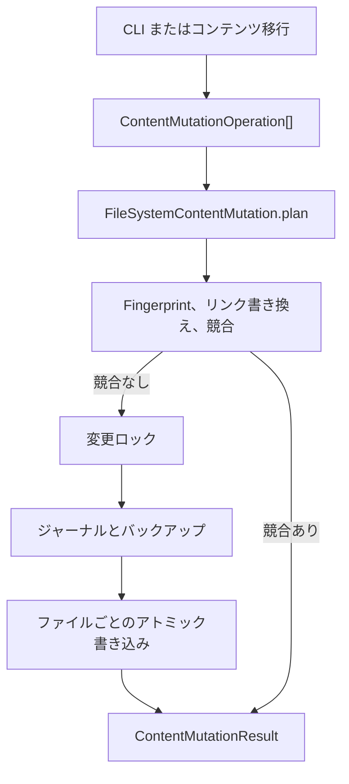

# コンテンツ変更システム

コンテンツ変更は、コンテンツファイルの変更を「レビューできるトランザクション」として
実行するビルド時のツールです。ファイルの作成、本文の置き換え、移動、名前変更、削除、
フロントマターのキーの設定・削除ができます。主な利用者は次の 2 種類です。

- **サイト作者**：CLI からコンテンツを変更する人。スクリプトや CI での実行も含みます。
- **Plugin・ツール開発者**：TypeScript から同じ安全性を必要とする人。

この機能が解決するのは「ファイルを書くこと」そのものではありません。普通のエディタや
`mv` コマンドは、移動したノートを指している WikiLink や Markdown リンクを把握できず、
計画後に他の人がファイルを編集したことにも気づけません。複数ファイルの変更が途中で
失敗しても、復旧用の記録が残りません。コンテンツ変更は、まず計画を作って変更対象を
すべて示し、影響が証明できるリンクを書き換え、ジャーナルとバックアップを伴って
書き込みます。

これは**ブラウザーのエディタではありません**。公開済みサイトの訪問者がこれを使って
コンテンツを編集することはできません。作者のマシンまたは CI で、ビルドの前に実行し、
コンテンツディレクトリの中だけを書き換えます。

コンテンツ変更が担当するのは**安全に書き込む方法**です。**何を変更するか**は
[[content-migration|コンテンツ移行システム]]が担当し、書き込み層としてコンテンツ変更を
使います。

## できること

| やりたいこと | CLI | TypeScript API |
| --- | --- | --- |
| ノートやアセットを作る | `content create` | `create`、`asset-create` |
| ファイル本文を置き換える | `content edit` | `update`、`asset-update` |
| ファイルを削除する | `content delete` | `delete`、`asset-delete` |
| ファイルを移動・名前変更する | `content move` | `move`、`rename`、`asset-move` |
| フロントマターのキーを設定・削除する | —（API のみ） | `frontmatter` |
| 複数の変更を 1 つの計画にまとめる | —（API のみ） | `batch` |
| 書き込まずにプレビューする | `--apply` を付けない | `plan()` |
| レビュー用に計画を保存する | `content plan ... --out` | `savePlan()` / `loadPlan()` |
| 中断した書き込みを復旧する | `content recover` | `recover()` |
| 完了した書き込みを巻き戻す | —（API のみ） | `rollback()` |

コンテンツ変更は Markdown から意図を推測しません。呼び出し側が操作を明示し、
変更が安全だと証明できた場合だけ書き込みます。証明できない場合は競合として報告します。

## Before / After：ノートを移動する

次の 2 ファイルから始めます。

```text
notes/
  index.md
  old.md
```

`notes/index.md` には WikiLink があります。

```md
See [[old]].
```

`notes/old.md` の本文は `# Old note` です。

まず移動をプレビューします。`--apply` がなければ何も書き込みません。

```sh
riebeckite content move notes/old.md notes/new.md
```

```text
Plan <plan-id>
  update notes/index.md
  create notes/new.md
  delete notes/old.md
Dry run. Re-run with --apply to write changes.
```

同じ操作を適用します。

```sh
riebeckite content move notes/old.md notes/new.md --apply
```

変更後は次のようになります。

```text
notes/
  index.md
  new.md
```

`notes/index.md` は次の内容になります。

```md
See [[notes/new]].
```

WikiLink は `.md` を除いたコンテンツパスへ書き換わります。`old.md` のような相対
Markdown リンクのリンク先は `new.md` へ書き換わります。元のファイルは存在しません。

リンクの書き換え対象は、Markdown リンク、Markdown 画像、参照リンクと参照定義、
WikiLink、Wiki 埋め込みです。任意のテキスト、コードブロック、外部 URL は書き換え
ません。書き換え後にリンク先が曖昧になる、または解決できなくなる場合は、書き込み前に
計画が失敗します。

## クイックスタート

どのコマンドも、`--apply` を付けるまではドライランです。次の手順では 1 つのノートを
作成し、本文を置き換え、移動し、削除します。

```sh
riebeckite content create notes/hello.md "# Hello" --apply
riebeckite content edit notes/hello.md "# Hello, world" --apply
riebeckite content move notes/hello.md notes/welcome.md --apply
riebeckite content delete notes/welcome.md --apply
```

`edit` は本文全体を置き換えます。一部分だけを置き換えるコマンドはありません。
新しい本文を組み立てる場合は TypeScript API を使ってください。

書き込む前に計画を確認したい場合は、計画を保存します。

```sh
riebeckite content plan move notes/hello.md notes/welcome.md --out move-hello.json
riebeckite content apply move-hello.json --apply
```

保存した計画は `<content>/.riebeckite/mutations/plans` に置かれます。`<content>` は
設定したコンテンツディレクトリです。`--out` に指定できるのはこのディレクトリ内の
名前で、任意のファイルシステムパスではありません。

計画に競合があれば、CLI は競合を表示して非ゼロで終了します。

```text
Conflict: source.md: The link target is ambiguous around the mutation: ...
The plan cannot be applied.
```

ファイルを削除しても、そのファイルを指すリンクは削除されません。計画は警告を出して
成功します（警告はドライランと保存した計画に表示されます）。

```text
Warning: A link to deleted content remains: old.md
```

## 仕組み



`plan()` はコンテンツツリーを読み、操作をメモリ上で適用し、影響するリンクを
書き換えて、現在のファイルとの差分を返します。コンテンツファイルは書き込みません。
`apply()` は計画を再検証し、ロックを取得し、ジャーナルとバックアップを書いてから、
各ファイルをアトミックに書き込みます。

責務は層ごとに分かれています。

| 層 | パッケージ | 責務 |
| --- | --- | --- |
| 操作と計画の型 | `@riebeckite/core` | `ContentMutationOperation`、`ContentMutationPlan`、問題と結果の型 |
| リンク再設定 | `@riebeckite/core` | `planContentLinkUpdates` が影響を受ける Markdown リンクを書き換える |
| ファイル実行 | `@riebeckite/node` | `FileSystemContentMutation` が計画、適用、復旧、巻き戻し、計画の保存と読み込みを行う |
| CLI | `@riebeckite/cli` | `riebeckite content` がシェル引数を操作へ変換する |

Core はファイルシステムに触れません。コンテンツファイルを書き込むのは Node の
実行層だけです。

内部状態は設定項目ではありません。コンテンツルートの下に置かれます。

| パス | 内容 |
| --- | --- |
| `<content>/.riebeckite/mutations/lock` | 書き込みや復旧の実行中だけ存在する排他ロック |
| `<content>/.riebeckite/mutations/<planId>/journal.json` | トランザクション状態とファイルごとのフィンガープリント |
| `<content>/.riebeckite/mutations/<planId>/backups/` | 変更前のファイル内容。パスを Base64URL で名付ける |
| `<content>/.riebeckite/mutations/plans/` | `content plan --out` で保存した計画 |

コンテンツ変更に `riebeckite.config.ts` の設定項目はありません。`.riebeckite` は
ビルド時の状態で、このリポジトリでは Git の対象外です。ジャーナルとバックアップには
ファイル本文が入るため、非公開のデータとして扱ってください。

## 他の機能との関係

- [[content-migration|コンテンツ移行]]は、同梱される唯一の移行操作の生成元です。
  ファイルを直接書き換えず、変更計画を作り、変更後のマニフェストを検証してから、
  書き込みと巻き戻しをコンテンツ変更へ委譲します。
- [Frontmatter Transformer](../plugins/frontmatter-transformer.ja.md) Plugin は、
  名前付きプリセットと `frontmatter` CLI 名前空間をコンテンツ移行の上に追加します。
  2 つ目の書き込み機構は作りません。
- [[content-system|コンテンツシステム]]とリンクインデックスが、どのリンク先が
  一意に解決できるかを定義します。変更は 2 つ目の Markdown パーサーを作らず、
  同じ解決規則を再利用します。
- [[reference/cli|CLI]] は `content` を raw コマンドとして公開します。独自に引数を
  解析したあと、プログラムから呼ぶ場合と同じ実行層を使います。
- [[build-system|ビルドシステム]]は次のビルドで生成されたファイルを読みます。
  変更はビルド状態の更新も出力の生成も行いません。
- コンテンツ変更はデプロイ、公開状態の変更、Git 履歴の変更を行いません。

## 制限事項

- ビルド時のツールであり、ブラウザーや公開サイトの編集機能ではありません。
- `frontmatter` 操作には、Markdown ファイルに既存の YAML フロントマターが必要です。
  ない場合は `The Markdown file has no YAML frontmatter.` で失敗します。
- フロントマターは再シリアライズされます。YAML が許す範囲でコメントとキー順は
  維持されますが、書式は変わる可能性があります。`frontmatter-formatting` の警告は
  想定どおりです。
- ファイルを削除しても、そのファイルを指すリンクは残ります。警告コードは
  `broken-link` で、リンクは自動削除されません。
- 書き込みはファイル単位でアトミックです。バッチ全体にまたがるトランザクションでは
  ないため、クラッシュすると `recover` が動くまで一部だけ適用された状態が残ることが
  あります。
- `apply` の失敗後に自動で巻き戻すことはありません。復旧は明示的な操作です。
- マージや三者間の競合解決はありません。前提条件が変われば常に競合なので、
  操作を計画し直してください。
- 巻き戻しには完了済みのジャーナルと、変更されていない現在のファイルが必要です。
  ジャーナル外の編集を戻す一般的な undo ではありません。
- リンク書き換えの対象は、コンテンツモデルが扱う Markdown と WikiLink のリンク先
  です。任意のテキスト、コードブロック、外部 URL は書き換えません。
- ロックはローカルファイルシステム向けです。ネットワークボリュームを共有する
  複数マシン向けの分散ロックではありません。
- ジャーナルとバックアップのディレクトリは自動削除されません。復旧に不要になった
  計画ディレクトリは手動で削除してください。
- コンテンツ変更は、公開準備、移行状態、レンダリング結果を検証しません。それらは
  ビルド、移行、公開の各システムが担当します。

## CLI リファレンス

```sh
riebeckite content <create|edit|delete|move> ... [--apply] [--json]
riebeckite content plan <create|edit|delete|move> ... [--out <name>] [--json]
riebeckite content apply <plan> --apply [--json]
riebeckite content recover <journal> --apply [--json]
```

| アクション | 引数 | 動作 |
| --- | --- | --- |
| `create` | `<path> [body]` | ファイルを作成する。本文の既定値は空文字列。 |
| `edit` | `<path> <body>` | ファイル本文全体を置き換える。 |
| `delete` | `<path>` | ファイルを削除する。内向きのリンクは残り、警告になる。 |
| `move` | `<from> <to>` | ファイルを移動・名前変更し、影響するリンクを再設定する。 |
| `plan` 接頭辞 | 上と同じ | 適用せずに計画を保存する。`--out` で名前を指定し、省略時は計画 ID を使う。 |
| `apply` | `<plan>` | 保存した計画を適用する。`--apply` は必須。 |
| `recover` | `<journal>` | 中断したジャーナルを復旧する。`--apply` は必須。 |

`--body <text>` も使えます。2 番目の位置引数と同じ意味です。`--json` は計画または
結果を JSON で出力します。`--apply` を付けない変更コマンドは計画を表示するだけで
何も書き込みません。`apply` と `recover` は `--json` がなくても結果を JSON で
出力します。

## API リファレンス

### 操作

`ContentMutationOperation` は判別可能なユニオンです。

```ts
type ContentMutationOperation =
  | { kind: "create" | "asset-create"; path: string; content: string | Uint8Array }
  | { kind: "update" | "asset-update"; path: string; content: string | Uint8Array }
  | { kind: "delete" | "asset-delete"; path: string }
  | { kind: "move" | "rename" | "asset-move"; from: string; to: string }
  | {
      kind: "frontmatter";
      path: string;
      set?: Readonly<Record<string, unknown>>;
      remove?: readonly string[];
    }
  | { kind: "batch"; operations: readonly ContentMutationOperation[] };
```

`create` と `update` はテキストまたはバイト列を受け取ります。`asset-*` は
バイナリであることを明示する別名で、検証内容は同じです。`frontmatter` は
Markdown のパスだけを受け付け、`"meta.added"` のようなネストしたキーも指定できます。
`batch` は計画前に平坦化されるため、ネストしても記述順に実行されます。

`flattenContentMutationOperations(operations)` は batch を取り除いた実効的な操作
リストを返します。

### 計画と結果の型

```ts
type ContentMutationPlan = {
  readonly schemaVersion: 1;
  readonly id: string;
  readonly operations: readonly ContentMutationOperation[];
  readonly changes: readonly ContentMutationFileChange[];
  readonly preconditions: readonly ContentMutationPrecondition[];
  readonly warnings: readonly ContentMutationIssue[];
  readonly conflicts: readonly ContentMutationIssue[];
};

type ContentMutationResult = {
  readonly planId: string;
  readonly applied: boolean;
  readonly journalPath?: string;
  readonly appliedPaths: readonly string[];
  readonly conflicts: readonly ContentMutationIssue[];
};
```

`ContentMutationFileChange` は `beforeFingerprint`、`afterFingerprint`、最終的な
バイト列を保持します。`preconditions` は
`{ path, fingerprint: beforeFingerprint }` の集合です。問題は `severity`、
`code`、`message`、任意の `path` を持ちます。

`recover` と `rollback` はそれぞれ `ContentMutationRecoveryResult` と
`ContentMutationRollbackResult` を返します。どちらも `conflicts` を報告し、
rollback は巻き戻し済みの場合に `skipped` も報告します。

### `FileSystemContentMutation`

```ts
import { FileSystemContentMutation } from "@riebeckite/node";

const mutation = new FileSystemContentMutation(contentRoot);
const plan = await mutation.plan([
  { kind: "frontmatter", path: "notes/hello.md", set: { draft: false } },
]);
if (plan.conflicts.length === 0) {
  const result = await mutation.apply(plan);
}
```

| メソッド | 動作 |
| --- | --- |
| `plan(operations)` | コンテンツツリーを読み、操作をメモリ上で適用し、影響するリンクを書き換えて計画を返す。コンテンツファイルは書き込まない。 |
| `apply(plan)` | 計画を再検証し、ロックを取得し、ジャーナルとバックアップを書いてから各ファイルをアトミックに適用する。 |
| `recover(journalPath)` | 中断したジャーナルを巻き戻す。中断後にファイルが変わっていれば競合を報告する。 |
| `rollback(journalPath)` | 完了した変更を、現在の全ファイルが適用後のフィンガープリントと一致する場合だけ復元する。 |
| `savePlan(plan, path?)` | シリアライズした計画を `<content>/.riebeckite/mutations/plans` に保存する。 |
| `loadPlan(path)` | 保存した計画を読み込んで検証する。 |

コンストラクタの第 2 引数には `beforeWrite`、`beforeRecoveryRestore`、
`afterRecoveryCapture` のコールバックを渡せます。テストや障害注入用で、通常の
利用では不要です。

### その他の例

ノートを移動してリンクを更新する:

```ts
const plan = await mutation.plan([
  { kind: "move", from: "notes/old.md", to: "notes/new.md" },
]);
const result = await mutation.apply(plan);
```

移動すると、旧パスを指していたすべての Markdown ファイルの WikiLink と
Markdown リンクが再設定されます。書き換えたファイルにも同じフィンガープリント
検査が適用されるため、同時編集は黙って上書きされず競合になります。

名前変更とフロントマター変更をまとめる:

```ts
const plan = await mutation.plan([
  {
    kind: "batch",
    operations: [
      { kind: "frontmatter", path: "notes/a.md", set: { category: "guide" } },
      { kind: "rename", from: "notes/a.md", to: "guides/a.md" },
    ],
  },
]);
```

書き込み前に最終的なバイト列を計算します。ジャーナルには、リンク更新を含む
影響対象のパスごとに 1 件の変更を記録します。

レビューしてから適用する:

```ts
const saved = await mutation.savePlan(plan);
const loaded = await mutation.loadPlan(saved);
const result = await mutation.apply(loaded);
```

`apply` は操作を再計画し、正規化した結果を比較します。`savePlan` の後に
コンテンツツリーが変わっていれば、`stale-plan` の競合になります。

## エラー処理

`plan` は利用者レベルの競合では例外を投げません。エラーを `conflicts` に入れ、
他の問題の収集を続けます。`apply` は計画が古い場合、前提条件が変わった場合、
または計画に競合が含まれる場合に `applied: false` を返します。

主な競合コードは次のとおりです。

| コード | 意味 |
| --- | --- |
| `invalid-operation` | 存在しないファイル、既存の移動先、未対応の種類を指定した |
| `unsafe-path` | 絶対パス、親ディレクトリ参照、予約名、非正規化、シンボリックリンク、ディレクトリ以外のパス |
| `case-collision` | 大文字小文字だけが異なるパスが 2 つある |
| `invalid-markdown-encoding` | Markdown が正しい UTF-8 ではない |
| `link-target-ambiguous` | 変更後のリンク先が複数に解決される |
| `link-target-missing` / `link-broken` | 書き換えたリンクが解決できない |
| `link-target-changed` / `link-rewrite-conflict` | リンク先が移動した、または決定的に書き換えられない |
| `concurrent-modification` | ファイルが計画時のフィンガープリントと一致しない |
| `stale-plan` | 保存した計画が、同じ操作の再計画結果と一致しない |
| `unsupported-plan` | 保存した計画のスキーマバージョンが不明 |

警告は書き込みを止めません。`frontmatter-formatting` は、YAML の許容範囲で
キーの順序や書式が変わる可能性を警告します。`broken-link` は、削除したファイルに
内向きのリンクが残っていることを警告します。

`apply` が失敗すると、ジャーナルに `state: "failed"` を書いて例外を投げます。
失敗前に書き込まれたファイルは、`recover` が復元するまで残ります。失敗時の
自動巻き戻しはなく、復旧は明示的な操作です。

## セキュリティと信頼境界

- すべてのパスは相対的な論理コンテンツパスです。絶対パス、`..`、空のセグメント、
  末尾のドットや空白、Windows の予約デバイス名、コンテンツルートの外へ出るパスは
  拒否されます。
- 既存の親ディレクトリは `lstat` で検査します。途中にシンボリックリンクや
  ディレクトリ以外があれば `unsafe-path` の競合になります。コンテンツツリーの
  走査でもシンボリックリンクは除外します。
- 計画は読み取り専用です。ロック、ジャーナル、バックアップ、計画を書くのは、
  明示的な apply、save、recover、rollback だけです。
- `<content>/.riebeckite/mutations/lock` が書き込みを直列化します。所有プロセスが消えた
  ロックは回収し、5 秒以上前の壊れたロックも古いものとして扱います。
- 書き込みはファイル単位でアトミックです。複数ファイルにまたがるファイルシステム
  トランザクションではないため、クラッシュすると復旧まで一部だけ適用された状態が
  残ることがあります。
- コンテンツはデータです。Markdown、フロントマター、ファイル内容を JavaScript として
  評価することはありません。
- ジャーナルとバックアップにはファイル本文が入ります。ローカル専用で、公開も
  コミットもしてはいけません。
- 変更が書き込むのはコンテンツディレクトリの中だけです。デプロイ、公開状態の更新、
  Git 履歴の変更は行いません。

## トラブルシューティング

- **「Another content mutation is already applying or requires recovery」**:
  以前のプロセスが異常終了しています。失敗した実行が示したジャーナルに対して
  `riebeckite content recover <journal> --apply` を実行してください。ロックは、
  所有プロセスがないことを確認してから削除します。
- **「The file no longer matches the planned fingerprint」**: 編集後に計画し直して
  ください。新しく編集した内容へ古い計画を適用しないでください。
- **「The saved plan no longer matches a fresh validation」**: 計画を再生成して
  ください。保存した計画はスナップショットであり、リベースできるパッチではありません。
- **「Content path traverses a symbolic link」**: シンボリックリンクを実ディレクトリに
  置き換えるか、別のパスを選んでください。変更は意図的にリンクを辿りません。
- **「The link target is ambiguous」**: リンク元のノートでリンクを一意にするか、
  他の対象と衝突しないパスへ変更してください。
- **「The Markdown file has no YAML frontmatter」**: `frontmatter` 操作を使う前に
  `---` ブロックを追加するか、`update` で本文全体を置き換えてください。
- **フロントマターのキー順が変わった**: YAML のシリアライズはバイト単位の保持では
  ありません。警告は想定どおりなので、コミット前に差分を確認してください。
