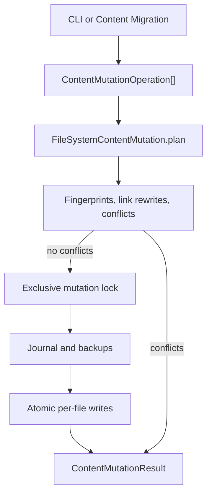

# Content Mutation System

The Content Mutation System is the only supported path for writing content files.
It turns an explicit operation list into a verified plan, writes the plan with a
journal and backups, and can recover an interrupted write. It owns **how to write
the change safely**. The [[content-migration|Content Migration system]] owns
**what to change**.

Content Mutation never infers intent from Markdown or Frontmatter. A caller
states the create, update, delete, move, or frontmatter operation, and Mutation
either proves the change is safe or reports a conflict.

## Architecture



The contracts are split by responsibility:

| Layer | Package | Responsibility |
| --- | --- | --- |
| Operation and plan types | `@riebeckite/core` | `ContentMutationOperation`, `ContentMutationPlan`, issue and result types |
| Link retargeting | `@riebeckite/core` | `planContentLinkUpdates` rewrites affected Markdown links |
| File executor | `@riebeckite/node` | `FileSystemContentMutation` plans, applies, recovers, rolls back, saves and loads plans |
| CLI | `@riebeckite/cli` | `riebeckite content` maps shell arguments to operations |

Core does not touch the filesystem. The Node executor is the only component that
writes content files.

## Getting started

Plan first. Without `--apply`, the command prints the changes and writes nothing:

```sh
riebeckite content create notes/hello.md --body "Hello"
riebeckite content move notes/hello.md notes/welcome.md
```

Apply the change explicitly:

```sh
riebeckite content create notes/hello.md --body "Hello" --apply
```

A plan whose links would become ambiguous fails before any write:

```sh
riebeckite content create other/note.md
# Conflict: source.md: The link target is ambiguous ...
# The plan cannot be applied.
```

Use a saved plan when the change must be reviewed or applied later:

```sh
riebeckite content plan move notes/hello.md notes/welcome.md --out move-hello.json
riebeckite content apply move-hello.json --apply
```

Saved plans live under `.riebeckite/mutations/plans`. The `--out` value is a
name inside that directory, not an arbitrary filesystem path.

## Configuration

There is no `riebeckite.config.ts` option for Content Mutation. It operates on
the resolved content root and uses internal state only:

| Path | Contents |
| --- | --- |
| `.riebeckite/mutations/lock` | Exclusive lock while a write or recovery runs |
| `.riebeckite/mutations/<planId>/journal.json` | Transaction state and per-file fingerprints |
| `.riebeckite/mutations/<planId>/backups/` | Previous file contents, named by a Base64URL path |
| `.riebeckite/mutations/plans/` | Saved plans from `content plan --out` |

`.riebeckite` is build-time state and is ignored by Git in this repository. The
journal and backup directory contain content bodies, so treat it as private data.

## API reference

### Operations

`ContentMutationOperation` is a discriminated union:

```ts
type ContentMutationOperation =
  | { kind: "create" | "asset-create"; path: string; content: string | Uint8Array }
  | { kind: "update" | "asset-update"; path: string; content: string | Uint8Array }
  | { kind: "delete" | "asset-delete"; path: string }
  | { kind: "move" | "rename" | "asset-move"; from: string; to: string }
  | {
      kind: "frontmatter";
      path: string;
      set?: Readonly<Record<string, unknown>>;
      remove?: readonly string[];
    }
  | { kind: "batch"; operations: readonly ContentMutationOperation[] };
```

`create` and `update` accept text or bytes. The `asset-*` variants are aliases
that make the binary intent explicit; all variants share the same validation.
`frontmatter` accepts only Markdown paths and permits nested keys such as
`"meta.added"`. `batch` is flattened before planning, so nested batches run in
source order.

`flattenContentMutationOperations(operations)` removes batch nodes and is
exported for callers that need the effective operation list.

### Plan and result types

```ts
type ContentMutationPlan = {
  readonly schemaVersion: 1;
  readonly id: string;
  readonly operations: readonly ContentMutationOperation[];
  readonly changes: readonly ContentMutationFileChange[];
  readonly preconditions: readonly ContentMutationPrecondition[];
  readonly warnings: readonly ContentMutationIssue[];
  readonly conflicts: readonly ContentMutationIssue[];
};

type ContentMutationResult = {
  readonly planId: string;
  readonly applied: boolean;
  readonly journalPath?: string;
  readonly appliedPaths: readonly string[];
  readonly conflicts: readonly ContentMutationIssue[];
};
```

`ContentMutationFileChange` records `beforeFingerprint`, `afterFingerprint`, and
the final bytes. `preconditions` is the same set as
`{ path, fingerprint: beforeFingerprint }`. An issue has `severity`, `code`,
`message`, and an optional `path`.

`recover` and `rollback` return `ContentMutationRecoveryResult` and
`ContentMutationRollbackResult`. Both report `conflicts`; rollback also reports
`skipped` when the journal is already rolled back.

### `FileSystemContentMutation`

```ts
import { FileSystemContentMutation } from "@riebeckite/node";

const mutation = new FileSystemContentMutation(contentRoot);
const plan = await mutation.plan([
  { kind: "frontmatter", path: "notes/hello.md", set: { draft: false } },
]);
if (plan.conflicts.length === 0) {
  const result = await mutation.apply(plan);
}
```

| Method | Behavior |
| --- | --- |
| `plan(operations)` | Reads the content tree, applies the operations in memory, rewrites affected links, and returns a plan. Writes no content files. |
| `apply(plan)` | Revalidates the plan, takes the lock, writes the journal and backups, then applies each file atomically. |
| `recover(journalPath)` | Rolls an interrupted journal back, or reports a conflict if a file changed after the interruption. |
| `rollback(journalPath)` | Restores a completed mutation only after every current file still matches its applied fingerprint. |
| `savePlan(plan, path?)` | Writes a serialized plan under `.riebeckite/mutations/plans`. |
| `loadPlan(path)` | Reads and validates a saved plan. |

The constructor accepts an optional second argument:
`beforeWrite`, `beforeRecoveryRestore`, and `afterRecoveryCapture` callbacks for
tests and fault injection. They are not needed for normal use.

## Examples

### Move a note and update its links

```ts
const plan = await mutation.plan([
  { kind: "move", from: "notes/old.md", to: "notes/new.md" },
]);
const result = await mutation.apply(plan);
```

A move retargets resolving WikiLinks and Markdown links in every Markdown file
that pointed at the old path. The same fingerprint checks apply to the rewritten
files, so a concurrent edit is a conflict instead of a silent overwrite.

### Batch a rename with frontmatter changes

```ts
const plan = await mutation.plan([
  {
    kind: "batch",
    operations: [
      { kind: "frontmatter", path: "notes/a.md", set: { category: "guide" } },
      { kind: "rename", from: "notes/a.md", to: "guides/a.md" },
    ],
  },
]);
```

The final bytes are computed before writing. The journal records one change per
affected path, including link updates.

### Review, then apply

```ts
const saved = await mutation.savePlan(plan);
const loaded = await mutation.loadPlan(saved);
const result = await mutation.apply(loaded);
```

`apply` re-plans the operations and compares the canonical result. If the content
tree changed after `savePlan`, the result is a `stale-plan` conflict.

## Integration

- [[content-migration|Content Migration]] is the only bundled producer of
  migration operations. It never writes files directly; it builds a mutation
  plan, verifies the future manifest, then delegates the write and rollback to
  Content Mutation.
- [[content-system|Content system]] and the link index define which link targets
  are unambiguous. Mutation reuses the same resolution rules instead of a second
  Markdown parser.
- [[reference/cli|CLI]] exposes `content` as a raw command. It parses its own
  arguments and then uses the same executor as programmatic callers.
- The [[build-system|build system]] reads the resulting files on the next build.
  Mutation does not update build state or emit output.

## Error handling

`plan` never throws for a user-level conflict. It returns errors in `conflicts`
and continues collecting other issues. `apply` returns `applied: false` when the
plan is stale, a precondition changed, or the plan already contains conflicts.

Conflict codes include:

| Code | Meaning |
| --- | --- |
| `invalid-operation` | The operation targets a missing file, an existing destination, or an unsupported kind |
| `unsafe-path` | Absolute, traversal, reserved, non-normalized, symlinked, or non-directory path |
| `case-collision` | Two paths differ only by case |
| `invalid-markdown-encoding` | A Markdown file is not valid UTF-8 |
| `link-target-ambiguous` | A link would resolve to more than one target after the mutation |
| `link-target-missing` / `link-broken` | A rewritten link no longer resolves |
| `link-target-changed` / `link-rewrite-conflict` | The link target moved or could not be rewritten deterministically |
| `concurrent-modification` | A file no longer matches its planned fingerprint |
| `stale-plan` | A saved plan no longer matches a fresh plan of the same operations |
| `unsupported-plan` | The saved plan has an unknown schema version |

Warnings do not block a write. `frontmatter-formatting` warns that serializing
the YAML document may reorder or reformat keys where YAML permits it.

A failed `apply` writes `state: "failed"` to the journal and throws. Files
written before the failure remain on disk until `recover` restores them. There is
no automatic rollback on failure; recovery is explicit.

## Security and trust boundaries

- All paths are relative logical content paths. Absolute paths, `..`, empty
  segments, trailing dots or spaces, Windows device names, and paths that escape
  the content root are rejected.
- Existing parent directories are checked with `lstat`. A symlink or
  non-directory in the path is an `unsafe-path` conflict. Symlinks are also
  skipped when the content tree is scanned.
- Planning is read-only. The lock, journal, backups, and plans are written only
  by explicit apply, save, recover, or rollback calls.
- A single `.riebeckite/mutations/lock` serializes writers. A lock whose owning
  process is gone is recovered; a malformed lock older than five seconds is also
  treated as stale.
- Every write is atomic per file. This is not a cross-file filesystem
  transaction: a crash can leave a partially applied batch until recovery.
- Content is data. Mutation never evaluates Markdown, Frontmatter, or file
  content as JavaScript.
- The journal and backups contain file contents. They are local, not published,
  and must not be committed or served.
- Mutation only writes inside the content directory. It does not deploy, update
  publication state, or change Git history.

## Limitations

- There is no merge or three-way conflict resolution. A changed precondition is
  always a conflict; re-plan the operation.
- Rollback requires a completed journal and unchanged current files. It is not a
  general undo for edits made outside the journal.
- An interrupted apply must be recovered before another apply can proceed.
- Journal and backup directories are not garbage-collected. Remove old plan
  directories manually when they are no longer needed for recovery.
- Link rewriting covers the content model's supported Markdown and WikiLink
  destinations. It does not rewrite arbitrary text, code blocks, or external
  URLs.
- The lock is intended for local filesystems. It is not a distributed lock for
  multiple machines sharing a network volume.
- Content Mutation does not validate publication readiness, migration state, or
  the rendered site. Those belong to the build, migration, and publication
  systems.

## Troubleshooting

- **"Another content mutation is already applying or requires recovery"**: a
  previous process died. Run `riebeckite content recover <journal> --apply` with
  the journal reported by the failed run, or remove the lock only after
  verifying that no process owns it.
- **"The file no longer matches the planned fingerprint"**: edit and plan again.
  Do not apply an old plan to newly edited content.
- **"The saved plan no longer matches a fresh validation"**: regenerate the plan.
  Saved plans are snapshots, not patches that can be rebased.
- **"Content path traverses a symbolic link"**: replace the symlink with a real
  directory or choose another path. Mutation deliberately does not follow it.
- **"The link target is ambiguous"**: disambiguate the link in the source note,
  or rename to a path that does not collide with another target.
- **Frontmatter keys changed order**: YAML serialization is not byte-preserving.
  The warning is expected; review the diff before committing.
