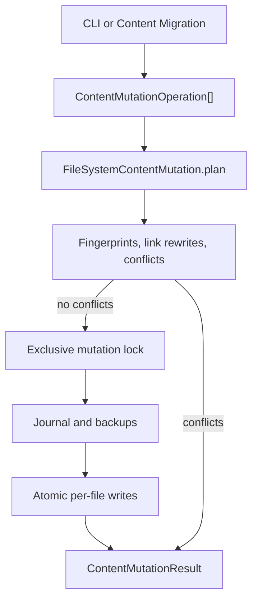

# Content Mutation System

Content Mutation is a build-time tool for changing content files as a reviewable
transaction. It creates, replaces, moves, renames, and deletes files, and it can
set or remove Frontmatter keys. It is meant for two groups:

- **Site authors** who change content from the CLI, including in scripts and CI.
- **Plugin and tool authors** who need the same safety guarantees from
  TypeScript.

The problem it solves is not "writing a file". A plain editor or `mv` command
does not know which WikiLinks and Markdown links point at a moved note, does not
notice that someone else edited the file since you planned the change, and leaves
no recovery record if a batch fails halfway. Content Mutation plans the change
first, shows every file that would change, rewrites the links it can prove are
affected, and writes through a journal with backups.

It is **not** a browser editor. Visitors cannot edit a published site with it. It
runs on the author's machine or in CI, before a build, and it only writes inside
the content directory.

Content Mutation owns **how to write safely**. The
[[content-migration|Content Migration system]] owns **what to change** and uses
Content Mutation as its write layer.

## What you can do

| Task | CLI | TypeScript API |
| --- | --- | --- |
| Create a note or asset | `content create` | `create`, `asset-create` |
| Replace a file body | `content edit` | `update`, `asset-update` |
| Delete a file | `content delete` | `delete`, `asset-delete` |
| Move or rename a file | `content move` | `move`, `rename`, `asset-move` |
| Set or remove Frontmatter keys | — (API only) | `frontmatter` |
| Apply several changes as one plan | — (API only) | `batch` |
| Preview without writing | omit `--apply` | `plan()` |
| Save a plan for review | `content plan ... --out` | `savePlan()` / `loadPlan()` |
| Recover an interrupted write | `content recover` | `recover()` |
| Roll back a completed write | — (API only) | `rollback()` |

Content Mutation never infers intent from Markdown. You state the operation, and
Mutation either proves it is safe or reports a conflict.

## Before and after: move a note

Start with two files:

```text
notes/
  index.md
  old.md
```

`notes/index.md` contains a WikiLink:

```md
See [[old]].
```

`notes/old.md` contains `# Old note`.

Preview the move. Without `--apply`, nothing is written:

```sh
riebeckite content move notes/old.md notes/new.md
```

```text
Plan <plan-id>
  update notes/index.md
  create notes/new.md
  delete notes/old.md
Dry run. Re-run with --apply to write changes.
```

Apply the same operation:

```sh
riebeckite content move notes/old.md notes/new.md --apply
```

After the write:

```text
notes/
  index.md
  new.md
```

`notes/index.md` now contains:

```md
See [[notes/new]].
```

The WikiLink is rewritten to the content path without `.md`. A relative Markdown
link destination such as `old.md` would be rewritten to `new.md`. The old file no
longer exists.

Link rewriting covers Markdown links, Markdown images, reference links and
definitions, WikiLinks, and Wiki embeds. It does not rewrite arbitrary text, code
blocks, or external URLs. If a rewrite would become ambiguous or stop resolving,
the plan fails before any write.

## Quick start

Every command is a dry run until you add `--apply`. This sequence creates,
rewrites, moves, and deletes one note:

```sh
riebeckite content create notes/hello.md "# Hello" --apply
riebeckite content edit notes/hello.md "# Hello, world" --apply
riebeckite content move notes/hello.md notes/welcome.md --apply
riebeckite content delete notes/welcome.md --apply
```

`edit` replaces the whole body, not just a fragment. There is no partial text
replacement command; use the TypeScript API to compute the new body.

To review a plan before writing, save it:

```sh
riebeckite content plan move notes/hello.md notes/welcome.md --out move-hello.json
riebeckite content apply move-hello.json --apply
```

Saved plans live under `<content>/.riebeckite/mutations/plans`, where `<content>`
is the configured content directory. The `--out` value is a name inside that
directory, not an arbitrary filesystem path.

If a plan conflicts, the CLI prints the conflict and exits non-zero:

```text
Conflict: source.md: The link target is ambiguous around the mutation: ...
The plan cannot be applied.
```

Deleting a file does not remove links that point to it. The plan succeeds with a
warning instead (shown in the dry run and the saved plan):

```text
Warning: A link to deleted content remains: old.md
```

## How it works



`plan()` reads the content tree, applies the operations in memory, rewrites
affected links, and compares the result with the current files. It writes no
content files. `apply()` revalidates the plan, takes the lock, writes the journal
and backups, then writes each file atomically.

The contracts are split by responsibility:

| Layer | Package | Responsibility |
| --- | --- | --- |
| Operation and plan types | `@riebeckite/core` | `ContentMutationOperation`, `ContentMutationPlan`, issue and result types |
| Link retargeting | `@riebeckite/core` | `planContentLinkUpdates` rewrites affected Markdown links |
| File executor | `@riebeckite/node` | `FileSystemContentMutation` plans, applies, recovers, rolls back, saves and loads plans |
| CLI | `@riebeckite/cli` | `riebeckite content` maps shell arguments to operations |

Core does not touch the filesystem. The Node executor is the only component that
writes content files.

Internal state is not configuration. It lives under the content root:

| Path | Contents |
| --- | --- |
| `<content>/.riebeckite/mutations/lock` | Exclusive lock while a write or recovery runs |
| `<content>/.riebeckite/mutations/<planId>/journal.json` | Transaction state and per-file fingerprints |
| `<content>/.riebeckite/mutations/<planId>/backups/` | Previous file contents, named by a Base64URL path |
| `<content>/.riebeckite/mutations/plans/` | Saved plans from `content plan --out` |

There is no `riebeckite.config.ts` option for Content Mutation. `.riebeckite` is
build-time state and is ignored by Git in this repository. The journal and backup
directory contain content bodies, so treat it as private data.

## Relationship to other features

- [[content-migration|Content Migration]] is the only bundled producer of
  migration operations. It never writes files directly; it builds a mutation
  plan, verifies the future manifest, then delegates the write and rollback to
  Content Mutation.
- The [Frontmatter Transformer](../plugins/frontmatter-transformer.md) plugin
  adds named presets and a `frontmatter` CLI namespace on top of Content
  Migration. It does not add a second writer.
- [[content-system|Content system]] and the link index define which link targets
  are unambiguous. Mutation reuses the same resolution rules instead of a second
  Markdown parser.
- [[reference/cli|CLI]] exposes `content` as a raw command. It parses its own
  arguments and then uses the same executor as programmatic callers.
- The [[build-system|build system]] reads the resulting files on the next build.
  Mutation does not update build state or emit output.
- Content Mutation does not deploy, change publication state, or touch Git
  history.

## Limitations

- It is a build-time tool, not a browser or public-site editing feature.
- The `frontmatter` operation requires existing YAML Frontmatter in a Markdown
  file. A file without Frontmatter fails with
  `The Markdown file has no YAML frontmatter.`
- Frontmatter is re-serialized. Comments and key order are kept where YAML
  permits, but formatting can change. A `frontmatter-formatting` warning is
  expected.
- Deleting a file leaves inbound links in place. The warning code is
  `broken-link`; no link is removed automatically.
- Writes are atomic per file, not across the whole batch. A crash can leave a
  partially applied batch until `recover` runs.
- There is no automatic rollback after a failed `apply`. Recovery is explicit.
- There is no merge or three-way conflict resolution. A changed precondition is
  always a conflict; re-plan the operation.
- Rollback requires a completed journal and unchanged current files. It is not a
  general undo for edits made outside the journal.
- Link rewriting covers the content model's supported Markdown and WikiLink
  destinations. It does not rewrite arbitrary text, code blocks, or external
  URLs.
- The lock is intended for local filesystems. It is not a distributed lock for
  multiple machines sharing a network volume.
- Journal and backup directories are not garbage-collected. Remove old plan
  directories manually when they are no longer needed for recovery.
- Content Mutation does not validate publication readiness, migration state, or
  the rendered site. Those belong to the build, migration, and publication
  systems.

## CLI reference

```sh
riebeckite content <create|edit|delete|move> ... [--apply] [--json]
riebeckite content plan <create|edit|delete|move> ... [--out <name>] [--json]
riebeckite content apply <plan> --apply [--json]
riebeckite content recover <journal> --apply [--json]
```

| Action | Arguments | Behavior |
| --- | --- | --- |
| `create` | `<path> [body]` | Creates a file. The body defaults to an empty string. |
| `edit` | `<path> <body>` | Replaces the whole file body. |
| `delete` | `<path>` | Deletes the file. Inbound links remain and produce a warning. |
| `move` | `<from> <to>` | Moves or renames a file and retargets affected links. |
| `plan` prefix | same as above | Saves the plan instead of applying it. `--out` names the file; otherwise the plan ID is used. |
| `apply` | `<plan>` | Applies a saved plan. `--apply` is mandatory. |
| `recover` | `<journal>` | Restores an interrupted journal. `--apply` is mandatory. |

`--body <text>` is also accepted and is equivalent to the second positional
argument. `--json` prints the plan or result as JSON. Without `--apply`, a
mutation command prints the plan and writes nothing. `apply` and `recover` print
their result as JSON even without `--json`.

## API reference

### Operations

`ContentMutationOperation` is a discriminated union:

```ts
type ContentMutationOperation =
  | { kind: "create" | "asset-create"; path: string; content: string | Uint8Array }
  | { kind: "update" | "asset-update"; path: string; content: string | Uint8Array }
  | { kind: "delete" | "asset-delete"; path: string }
  | { kind: "move" | "rename" | "asset-move"; from: string; to: string }
  | {
      kind: "frontmatter";
      path: string;
      set?: Readonly<Record<string, unknown>>;
      remove?: readonly string[];
    }
  | { kind: "batch"; operations: readonly ContentMutationOperation[] };
```

`create` and `update` accept text or bytes. The `asset-*` variants are aliases
that make the binary intent explicit; all variants share the same validation.
`frontmatter` accepts only Markdown paths and permits nested keys such as
`"meta.added"`. `batch` is flattened before planning, so nested batches run in
source order.

`flattenContentMutationOperations(operations)` removes batch nodes and is
exported for callers that need the effective operation list.

### Plan and result types

```ts
type ContentMutationPlan = {
  readonly schemaVersion: 1;
  readonly id: string;
  readonly operations: readonly ContentMutationOperation[];
  readonly changes: readonly ContentMutationFileChange[];
  readonly preconditions: readonly ContentMutationPrecondition[];
  readonly warnings: readonly ContentMutationIssue[];
  readonly conflicts: readonly ContentMutationIssue[];
};

type ContentMutationResult = {
  readonly planId: string;
  readonly applied: boolean;
  readonly journalPath?: string;
  readonly appliedPaths: readonly string[];
  readonly conflicts: readonly ContentMutationIssue[];
};
```

`ContentMutationFileChange` records `beforeFingerprint`, `afterFingerprint`, and
the final bytes. `preconditions` is the same set as
`{ path, fingerprint: beforeFingerprint }`. An issue has `severity`, `code`,
`message`, and an optional `path`.

`recover` and `rollback` return `ContentMutationRecoveryResult` and
`ContentMutationRollbackResult`. Both report `conflicts`; rollback also reports
`skipped` when the journal is already rolled back.

### `FileSystemContentMutation`

```ts
import { FileSystemContentMutation } from "@riebeckite/node";

const mutation = new FileSystemContentMutation(contentRoot);
const plan = await mutation.plan([
  { kind: "frontmatter", path: "notes/hello.md", set: { draft: false } },
]);
if (plan.conflicts.length === 0) {
  const result = await mutation.apply(plan);
}
```

| Method | Behavior |
| --- | --- |
| `plan(operations)` | Reads the content tree, applies the operations in memory, rewrites affected links, and returns a plan. Writes no content files. |
| `apply(plan)` | Revalidates the plan, takes the lock, writes the journal and backups, then applies each file atomically. |
| `recover(journalPath)` | Rolls an interrupted journal back, or reports a conflict if a file changed after the interruption. |
| `rollback(journalPath)` | Restores a completed mutation only after every current file still matches its applied fingerprint. |
| `savePlan(plan, path?)` | Writes a serialized plan under `<content>/.riebeckite/mutations/plans`. |
| `loadPlan(path)` | Reads and validates a saved plan. |

The constructor accepts an optional second argument:
`beforeWrite`, `beforeRecoveryRestore`, and `afterRecoveryCapture` callbacks for
tests and fault injection. They are not needed for normal use.

### More examples

Move a note and update its links:

```ts
const plan = await mutation.plan([
  { kind: "move", from: "notes/old.md", to: "notes/new.md" },
]);
const result = await mutation.apply(plan);
```

A move retargets resolving WikiLinks and Markdown links in every Markdown file
that pointed at the old path. The same fingerprint checks apply to the rewritten
files, so a concurrent edit is a conflict instead of a silent overwrite.

Batch a rename with frontmatter changes:

```ts
const plan = await mutation.plan([
  {
    kind: "batch",
    operations: [
      { kind: "frontmatter", path: "notes/a.md", set: { category: "guide" } },
      { kind: "rename", from: "notes/a.md", to: "guides/a.md" },
    ],
  },
]);
```

The final bytes are computed before writing. The journal records one change per
affected path, including link updates.

Review, then apply:

```ts
const saved = await mutation.savePlan(plan);
const loaded = await mutation.loadPlan(saved);
const result = await mutation.apply(loaded);
```

`apply` re-plans the operations and compares the canonical result. If the content
tree changed after `savePlan`, the result is a `stale-plan` conflict.

## Error handling

`plan` never throws for a user-level conflict. It returns errors in `conflicts`
and continues collecting other issues. `apply` returns `applied: false` when the
plan is stale, a precondition changed, or the plan already contains conflicts.

Conflict codes include:

| Code | Meaning |
| --- | --- |
| `invalid-operation` | The operation targets a missing file, an existing destination, or an unsupported kind |
| `unsafe-path` | Absolute, traversal, reserved, non-normalized, symlinked, or non-directory path |
| `case-collision` | Two paths differ only by case |
| `invalid-markdown-encoding` | A Markdown file is not valid UTF-8 |
| `link-target-ambiguous` | A link would resolve to more than one target after the mutation |
| `link-target-missing` / `link-broken` | A rewritten link no longer resolves |
| `link-target-changed` / `link-rewrite-conflict` | The link target moved or could not be rewritten deterministically |
| `concurrent-modification` | A file no longer matches its planned fingerprint |
| `stale-plan` | A saved plan no longer matches a fresh plan of the same operations |
| `unsupported-plan` | The saved plan has an unknown schema version |

Warnings do not block a write. `frontmatter-formatting` warns that serializing
the YAML document may reorder or reformat keys where YAML permits it.
`broken-link` warns that a deleted file still has inbound links.

A failed `apply` writes `state: "failed"` to the journal and throws. Files
written before the failure remain on disk until `recover` restores them. There is
no automatic rollback on failure; recovery is explicit.

## Security and trust boundaries

- All paths are relative logical content paths. Absolute paths, `..`, empty
  segments, trailing dots or spaces, Windows device names, and paths that escape
  the content root are rejected.
- Existing parent directories are checked with `lstat`. A symlink or
  non-directory in the path is an `unsafe-path` conflict. Symlinks are also
  skipped when the content tree is scanned.
- Planning is read-only. The lock, journal, backups, and plans are written only
  by explicit apply, save, recover, or rollback calls.
- A single `<content>/.riebeckite/mutations/lock` serializes writers. A lock whose owning
  process is gone is recovered; a malformed lock older than five seconds is also
  treated as stale.
- Every write is atomic per file. This is not a cross-file filesystem
  transaction: a crash can leave a partially applied batch until recovery.
- Content is data. Mutation never evaluates Markdown, Frontmatter, or file
  content as JavaScript.
- The journal and backups contain file contents. They are local, not published,
  and must not be committed or served.
- Mutation only writes inside the content directory. It does not deploy, update
  publication state, or change Git history.

## Troubleshooting

- **"Another content mutation is already applying or requires recovery"**: a
  previous process died. Run `riebeckite content recover <journal> --apply` with
  the journal reported by the failed run, or remove the lock only after
  verifying that no process owns it.
- **"The file no longer matches the planned fingerprint"**: edit and plan again.
  Do not apply an old plan to newly edited content.
- **"The saved plan no longer matches a fresh validation"**: regenerate the plan.
  Saved plans are snapshots, not patches that can be rebased.
- **"Content path traverses a symbolic link"**: replace the symlink with a real
  directory or choose another path. Mutation deliberately does not follow it.
- **"The link target is ambiguous"**: disambiguate the link in the source note,
  or rename to a path that does not collide with another target.
- **"The Markdown file has no YAML frontmatter"**: add a `---` block before using
  the `frontmatter` operation, or use `update` with a complete new body.
- **Frontmatter keys changed order**: YAML serialization is not byte-preserving.
  The warning is expected; review the diff before committing.
