# コンテンツシステム

コンテンツシステムは、Markdown や画像などのファイルを、Riebeckite がサイトとして扱えるコンテンツへ変換する仕組みです。

Markdown を HTML に変換するだけではありません。Riebeckite は次の問いに答える必要があります。

- このファイルは何の記事か
- 公開してよいか
- どの URL で公開するか
- 他の記事とどうつながっているか
- プラグインが何を追加・変更したか

コンテンツシステムはこれらの問いを解決し、サイト全体から同じ情報を利用できる状態にします。

## 全体像

コンテンツシステムの処理は、大きく次の流れで進みます。

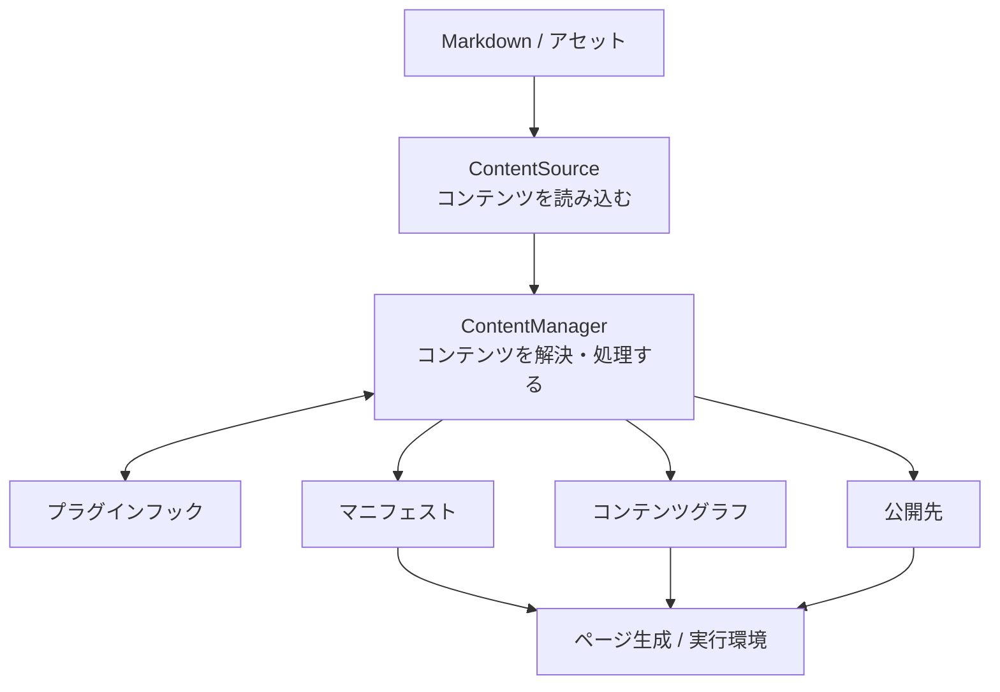

中心となるのは `ContentSource` と `ContentManager` です。役割は次のように分かれます。

```text id="a4xsh7"
ContentSource
  = どこからコンテンツを読むか

ContentManager
  = 読み込んだコンテンツをどう扱うか
```

## ContentSource

`ContentSource` は、Markdown やアセットを**どこから、どのように読み込むか**を抽象化した API です。

通常は、`content.directory` で指定されたディレクトリから読み込みます。たとえば、次のとおりです。

```text id="9u1ygf"
content/
```

ただし、コンテンツシステムは、コンテンツが必ずサイトリポジトリ内にあるとは想定していません。

たとえば、サイトリポジトリ、外部リポジトリ、Obsidian Vault のいずれから取得する場合でも、最終的には同じ `ContentSource` インターフェースを通して `ContentManager` に渡します。

```text id="eynh5j"
Site Repository
└─ content/

External Repository
└─ notes/

Obsidian Vault
└─ notes/
```

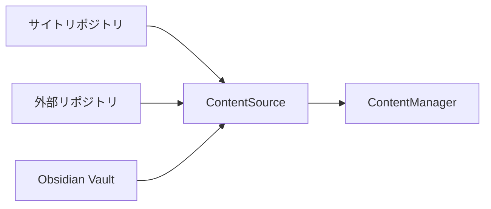

これにより、コンテンツの保存場所が変わっても、以降の処理を同じ仕組みで扱えます。

### 3種類の「場所」

コンテンツシステムを理解するうえで重要なのは、次の3つを区別することです。

| 種類 | 意味 |
| --- | --- |
| ファイルシステム上のパス | 実際にファイルが保存されている場所 |
| 論理パス | コンテンツルートから見たコンテンツの識別子 |
| 公開先 | Web サイト上の URL |

たとえば、`C:\projects\garden\content\posts\hello.md` というファイルがあっても、Riebeckite の内部では `posts/hello.md` という論理パスとして扱えます。

```text id="dfblcr"
C:\projects\garden\content\posts\hello.md
```

```text id="ej2j1k"
posts/hello.md
```

さらに、実際の公開先は `/blog/hello/` かもしれません。

```text id="dkv7ak"
/blog/hello/
```

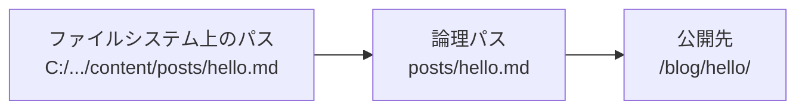

3つを分離しておけば、コンテンツリポジトリを別のリポジトリへ移しても、サイト側の URL やコンテンツ処理を同じ規則で扱えます。

## ContentManager

`ContentManager` は、`ContentSource` から受け取ったコンテンツを管理し、サイトで利用できる状態へ変換します。

主な責務は次のとおりです。

- Markdown の frontmatter と本文を読み込む
- コンテンツを公開するか判断する
- slug、permalink、content ID を整理する
- プラグインのフックを実行する
- 公開先を解決する
- マニフェストを生成する
- コンテンツグラフを生成する
- クエリ用のインデックスを用意する

つまり、`ContentManager` はコンテンツシステムの中心で処理全体を統括するオーケストレーターです。

### プラグインが処理に参加する

プラグインは `ContentManager` のライフサイクルにフックできます。代表的なフックは次のとおりです。

```text id="l0z0fr"
onContentLoaded
onPostParsed
onPostProcessed
onManifestCreated
```

処理の流れは次のとおりです。

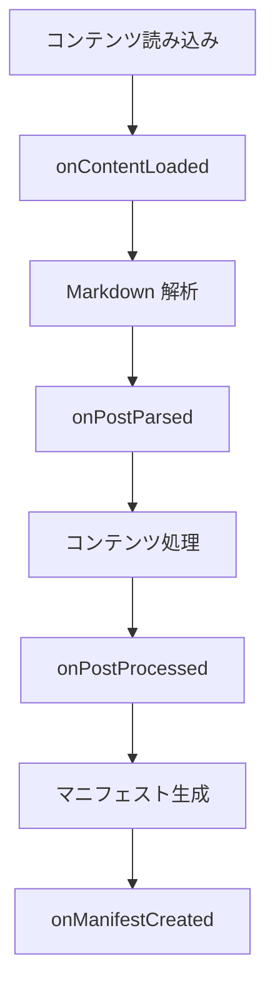

プラグインはこのライフサイクルを利用して、コンテンツを拡張します。

## slug・permalink・コンテンツID

3つは似ていますが、役割は異なります。

| 名前 | 表すもの | 例 |
| --- | --- | --- |
| `slug` | コンテンツの短い名前 | `hello-world` |
| `permalink` | サイト上の公開 URL | `/blog/hello-world/` |
| content ID | コンテンツ自体を安定して識別する ID | `article-01` |

特に、**slug と公開 URL は同じものではありません**。

たとえば、次の3つはそれぞれ別の目的を持ちます。

```text id="73lmb5"
slug
  hello-world

permalink
  /blog/hello-world/

content ID
  019abc...
```

### 安定したコンテンツID

コンテンツIDは、コンテンツの出所が任意で付ける安定した識別子です。`ContentManifestEntry.contentId` として公開され、`ContentManifest.byContentId` から引けます。slug や公開 URL とは独立しており、URL を変更しても同じコンテンツを指し続けます。URL が必要な場合は slug やファイルパスから組み立てず、`ContentManifestEntry.permalink`（`entry.publicLocation` でも参照できます）を読んでください。

### デフォルトの公開先

デフォルトでは、`resolveDefaultContentLocation` が公開先を解決します。基本的な対応は次のとおりです。

```text id="olpxjg"
index
  ↓
/

その他
  ↓
/{slug}
```

ただし、これはあくまでデフォルトのリゾルバーです。プラグインは次のフックを使って、公開先を追加・変更できます。

```text id="sc5pbi"
resolveContentLocations
```

## ContentPublicLocation

`ContentPublicLocation` は、コンテンツが**サイト上のどこで公開されるか**を表します。

通常、1つの記事には1つの正規の公開先があります。

```text id="ul2l2c"
Article
   ↓
/blog/article/
```

ただし、プラグインによって別名の URL やリダイレクトが追加される場合があります。

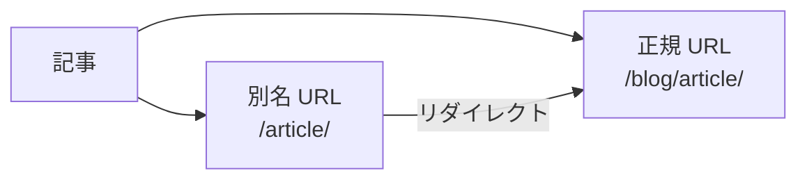

公開先はページ生成だけで使う情報ではありません。次のような機能も公開先を参照します。

- サイト内リンク
- リダイレクト
- サイトマップ
- 検索インデックス
- 言語切り替え
- コンテンツグラフ

そのため Riebeckite では、URL を単なる文字列として各機能が独自に計算するのではなく、`ContentPublicLocation` として明示的に管理します。

## マニフェスト

マニフェストは、**ビルド時に確定したコンテンツの一覧**です。各エントリには、たとえば次の情報が含まれます。

- 論理パス
- メタデータ
- 公開先
- プラグインによる処理結果
- 増分ビルドに必要な情報

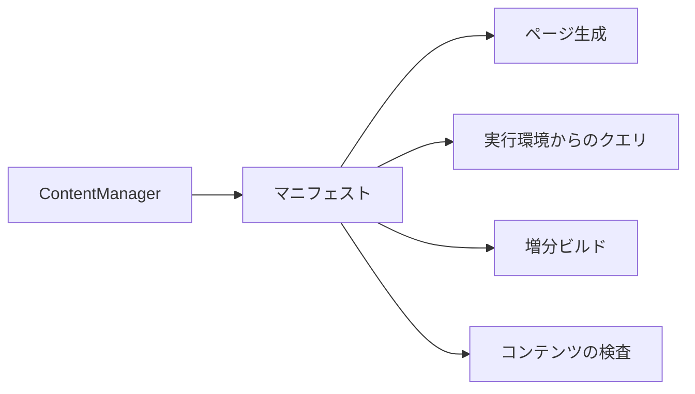

マニフェストは、コンテンツシステムが解決した結果を他の仕組みへ渡す境界です。各利用側が Markdown を読み直して同じ情報を再計算するのではなく、解決済みのマニフェストを利用します。

## コンテンツグラフ

[[content-graph|コンテンツグラフ]]は、コンテンツ同士の関係を表します。たとえば、次の WikiLink があれば、記事 A から記事 B への関係が成り立ちます。

```markdown id="9o2p6a"
[[Article B]]
```

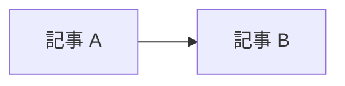

この情報からバックリンクも扱えます。

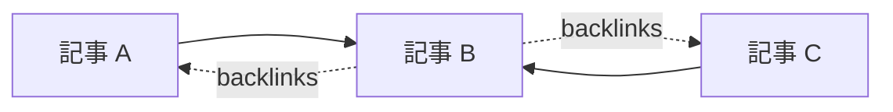

コンテンツグラフは、単なるグラフ表示用のデータではありません。たとえば、次の機能の基盤として利用できます。

- WikiLink
- Markdown リンク
- バックリンク
- タクソノミー
- シリーズ
- 関連記事
- ローカルグラフ
- Garden Explorer

プラグインは、次のフックを使ってグラフへ情報を追加できます。

```text id="g5uz6h"
extendContentGraph
```

## コンテンツクエリ

ビルド後のコンテンツを検索・整理するために、クエリ API が用意されています。代表的な API は次のとおりです。

```text id="5yib25"
queryContentEntries
queryContentPage
groupContentEntries
```

これらは**ファイルを検索する API ではありません**。

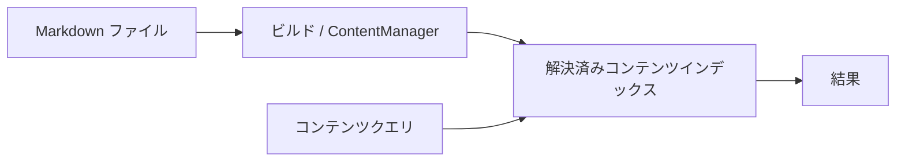

クエリは、ビルド時にすでに解決されたインデックスに対して実行します。実行環境やプラグインが Markdown を直接読み直し、独自に状態を再構築することは避けてください。

## コンテンツコレクション

`buildContentCollections` は、複数のコンテンツを一覧として扱うための仕組みです。たとえば、次のような処理に利用できます。

```text id="63ph8a"
すべての記事
     ↓
日付順に並べる
     ↓
タグごとに分類する
     ↓
ページ単位に分割する
```

`pageSize` を指定すると、ページネーションも扱えます。

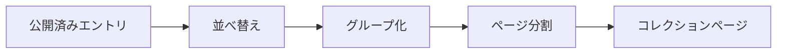

プラグインやサイトアプリケーションは、この仕組みを使って記事一覧やタグ一覧などを作成できます。

## アセット

画像や添付ファイルは、Markdown 本文とは別のエントリとして扱います。たとえば、次のような構成があるとします。

```text id="0yuczl"
content/
├─ article.md
└─ images/
   └─ example.png
```

この場合、Riebeckite はアセットの論理パスを保ちながら、サイト上で利用できる URL へ対応付けます。

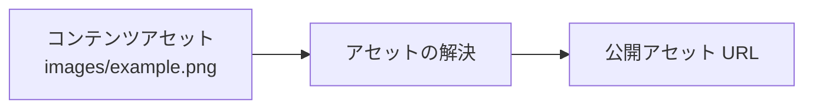

実際の URL 形式は、プラグインや設定によって変わる場合があります。

重要なのは、コンテンツルートの外にある任意のファイルを公開 URL に変換しないことです。コンテンツシステムの公開境界を通して、公開対象を安全に決定します。

## コンテンツリポジトリを分離する場合

サイトとコンテンツを別々のリポジトリに置いても、コンテンツシステムの基本的な流れは変わりません。

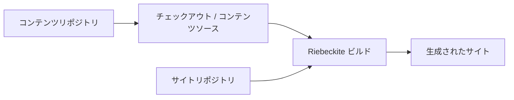

コンテンツリポジトリはコンテンツを提供します。最終的に、次の項目を決めるのはサイトリポジトリ側のビルドです。

- 何を公開するか
- どのプラグインを使うか
- どの URL で公開するか
- どのサイトを生成するか

このため、コンテンツリポジトリが分離されていても、`ContentManager` やプラグインがファイルシステムの配置を特別扱いする必要はありません。

## コンテンツシステムを変更するときの原則

コンテンツシステムを変更するときは、次の原則を維持してください。

| 原則 | 理由 |
| --- | --- |
| `content.directory` は `appRoot` 基準で解決する | サイトごとに安定した基準を持つため |
| プラグインはファイルシステムのパスに依存しない | コンテンツソースを交換可能にするため |
| 公開判定は `publishStrategy` と frontmatter に従う | 公開境界を一元化するため |
| 公開先は `ContentPublicLocation` として登録する | 各機能が URL を独自に計算しないため |
| 実行環境はビルド済みのインデックスを利用する | 実行環境をソースのファイルシステムから分離するため |
| サイトのビルドが最終的な公開状態を決める | コンテンツリポジトリとサイトの責務を分離するため |

全体として、次の境界を崩さないことが重要です。

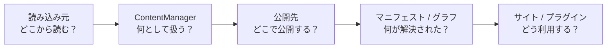

**`ContentSource` は読み込み方、`ContentManager` はコンテンツの解決、公開先はサイト上の公開位置、マニフェスト / グラフは解決結果を表します**。

各機能がファイルシステムや Markdown を独自に読み直すのではなく、コンテンツシステムを通して同じ解決結果を共有します。これが Riebeckite のコンテンツアーキテクチャの基本です。

### 関連ページ

- [設定](../reference/configuration.ja.md)
- [プラグイン API](../reference/plugin-api.ja.md)
- [コンテンツリポジトリ](../guides/content-repositories.ja.md)
- [コンテンツリポジトリの分離](../guides/deployment/separate-content-repository.ja.md)
