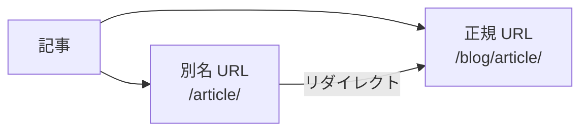

# IDとURL

## slug・permalink・コンテンツID

3つは似ていますが、役割は異なります。

| 名前 | 表すもの | 例 |
| --- | --- | --- |
| `slug` | コンテンツの短い名前 | `hello-world` |
| `permalink` | サイト上の公開 URL | `/blog/hello-world/` |
| content ID | コンテンツ自体を安定して識別する ID | `article-01` |

特に、**slug と公開 URL は同じものではありません**。

たとえば、次の3つはそれぞれ別の目的を持ちます。

```text id="73lmb5"
slug
  hello-world

permalink
  /blog/hello-world/

content ID
  019abc...
```

### 安定したコンテンツID

[[glossary/content-id|コンテンツ ID]]は、コンテンツの出所が任意に付ける安定した識別子です。`ContentManifestEntry.contentId` として公開され、`ContentManifest.byContentId` から引けます。slug や公開 URL とは独立しており、URL を変更しても同じコンテンツを指し続けます。URL が必要な場合は slug やファイルパスから組み立てず、`ContentManifestEntry.permalink`（`entry.publicLocation` でも参照できます）を読んでください。

値は 160 文字以内の非空白トリム済み文字列であり、制御文字を含んではなりません。マニフェスト内で一意である必要があります。無効または重複した ID は、サイレントにアイデンティティを選択するのではなく、マニフェスト ビルドでエラーとなります。

### デフォルトの公開先

デフォルトでは、`resolveDefaultContentLocation` が公開先を解決します。基本的な対応は次のとおりです。

```text id="olpxjg"
index
  ↓
/

その他
  ↓
/{slug}
```

ただし、これはあくまでデフォルトのリゾルバーです。プラグインは次のフックを使って、公開先を追加・変更できます。

```text id="sc5pbi"
resolveContentLocations
```

## ContentPublicLocation

`ContentPublicLocation` は、コンテンツが**サイト上のどこで公開されるか**を表します。

通常、1つの記事には1つの正規の公開先があります。

```text id="ul2l2c"
Article
   ↓
/blog/article/
```

ただし、プラグインによって別名の URL や[[glossary/redirect|リダイレクト]]が追加される場合があります。



公開先はページ生成だけで使う情報ではありません。次のような機能も公開先を参照します。

- サイト内リンク
- リダイレクト
- [[glossary/sitemap|サイトマップ]]
- 検索インデックス
- 言語切り替え
- コンテンツグラフ

そのため、Riebeckite では、URL を単なる文字列として各機能が独自に計算するのではなく、`ContentPublicLocation` として明示的に管理します。
