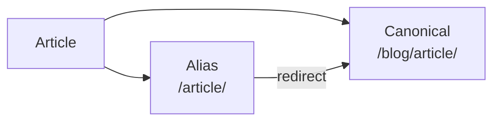

# IDs and URLs

## Public location and URLs

A content entry separates three notions of identity:

- **slug** — the internal lookup key used by `contentIndex`, the manifest `bySlug` map, the content graph, and application-level selection keys such as `/explore?note=<slug>`.
- **permalink** — the resolved canonical public URL used in article links, feeds, sitemaps, and metadata.
- **content ID** — an optional, source-authored stable identity exposed as `ContentManifestEntry.contentId` and indexed by `ContentManifest.byContentId`. It is independent of both the slug and all public locations.

| Name | What it represents | Example |
| --- | --- | --- |
| `slug` | A short name for the content | `hello-world` |
| `permalink` | The public URL on the site | `/blog/hello-world/` |
| content ID | A stable identifier for the content itself | `article-01` |

In particular, **a slug and a public URL are not the same thing**. Each has a
different purpose:

```text
slug
  hello-world

permalink
  /blog/hello-world/

content ID
  019abc...
```

They are distinct. A consumer that needs a public URL reads `ContentManifestEntry.permalink` (also available as `entry.publicLocation`); it must not build a URL from a slug or filesystem path. Turning a slug into a URL is the Core default resolver's job alone.

### Default public location

By default, `resolveDefaultContentLocation` resolves public locations:

```text
index
  ↓
/

everything else
  ↓
/{slug}
```

This is the default resolver, not a compatibility fallback. Plugins can add or
change public locations through the `resolveContentLocations` hook.

Resolution is a single, stateless pipeline:

1. Core seeds every entry with the official default resolver, `resolveDefaultContentLocation(content)`, where `content` is a `ContentLocationInput` (`slug`, `path`, `markdown`). The default policy is `index` -> `/` and every other entry -> `/{slug}`. This is the Core default public-location policy, not a compatibility fallback.
2. Each enabled plugin may replace locations through the optional `resolveContentLocations` hook, which receives the `ContentLocationInput` list and returns `ContentPublicLocation` values. Plugin-specific URL strategies stay inside the plugin.
3. `ContentManager.getContentLocations()` returns the resolved `ReadonlyMap<string, ContentPublicLocation>`. A `ContentPublicLocation` carries the canonical `permalink`, optional `redirects`, and optional opaque `metadata` that Core does not interpret.

The manifest stores the resolved result: `ContentManifestEntry.permalink` and `.publicLocation`, plus the `byPermalink` index and the `redirects` map. The content graph and `readOnlyContentGraph(source, locations)` consume those resolved entries rather than deriving URLs. If a public location is not resolved for an entry, Core raises an explicit error instead of falling back to a slug-derived URL.

### ContentPublicLocation

`ContentPublicLocation` represents **where content is published on the site**.
Normally one article has one canonical public location:

```text
Article
   ↓
/blog/article/
```

A plugin may add an alias URL or a redirect:



Public locations are not used only for page generation. They are also referenced
by:

- In-site links
- Redirects
- Sitemaps
- [[glossary/search|Search]] indexes
- The language switcher
- The content graph

Riebeckite therefore manages URLs explicitly as `ContentPublicLocation` rather
than letting each feature compute its own URL string.

### Stable content IDs

Set the standard `id` frontmatter field when content needs an identity that
survives a rename, permalink change, alias, or redirect. IDs are optional, so
existing content without `id` has no generated substitute and keeps its current
behavior. Core never uses a slug, path, permalink, alias, or redirect as a
stable ID.

```yaml
---
id: note-7f4e9b
---
```

Values must be non-empty, trimmed strings of at most 160 characters, without
control characters, and each explicit ID must be unique within a manifest;
invalid or duplicate IDs fail the manifest build rather than silently selecting
an identity.
