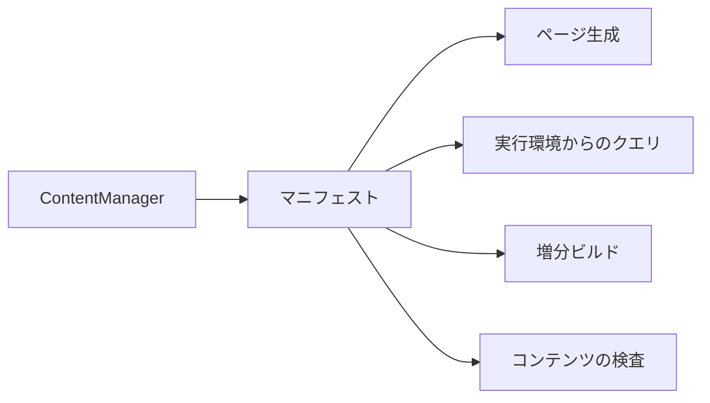
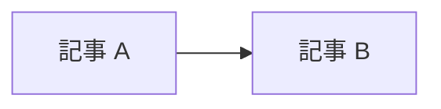
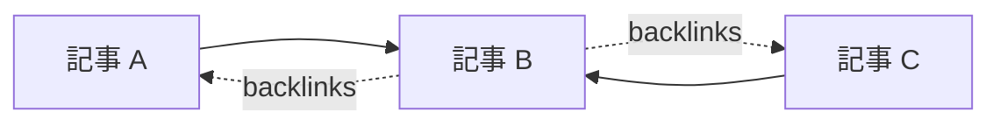
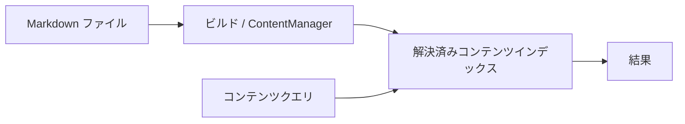
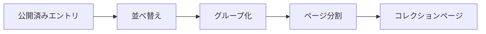
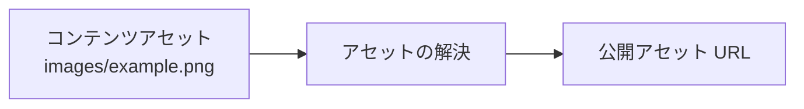

# マニフェスト

マニフェストは、**ビルド時に確定したコンテンツの一覧**です。各エントリには、たとえば次の情報が含まれます。

- 論理パス
- メタデータ
- 公開先
- プラグインによる処理結果
- [[glossary/incremental-build|増分ビルド]]に必要な情報



マニフェストは、コンテンツシステムが解決した結果を他の仕組みへ渡す境界です。各利用側が Markdown を読み直して同じ情報を再計算するのではなく、解決済みのマニフェストを利用します。

## コンテンツグラフ

[[content-graph|コンテンツグラフ]]は、コンテンツ同士の関係を表します。たとえば、次の [[glossary/wikilink|WikiLink]] があれば、記事 A から記事 B への関係が成り立ちます。

```markdown id="9o2p6a"
[[Article B]]
```



この情報から[[glossary/backlink|バックリンク]]も扱えます。



コンテンツグラフは、単なるグラフ表示用のデータではありません。たとえば、次の機能の基盤として利用できます。

- WikiLink
- Markdown リンク
- バックリンク
- [[glossary/taxonomy|タクソノミー]]
- [[glossary/series|シリーズ]]
- 関連記事
- ローカルグラフ
- Garden Explorer

プラグインは、次のフックを使ってグラフへ情報を追加できます。

```text id="g5uz6h"
extendContentGraph
```

## コンテンツクエリ

ビルド後のコンテンツを検索・整理するために、クエリ API が用意されています。代表的な API は次のとおりです。

```text id="5yib25"
queryContentEntries
queryContentPage
groupContentEntries
```

これらは**ファイルを[[glossary/search|検索]]する API ではありません**。



クエリは、ビルド時にすでに解決されたインデックスに対して実行します。実行環境やプラグインが Markdown を直接読み直し、独自に状態を再構築することは避けてください。

## コンテンツコレクション

`buildContentCollections` は、複数のコンテンツを一覧として扱うための仕組みです。たとえば、次のような処理に利用できます。

```text id="63ph8a"
すべての記事
     ↓
日付順に並べる
     ↓
タグごとに分類する
     ↓
ページ単位に分割する
```

`pageSize` を指定すると、ページネーションも扱えます。



プラグインやサイトアプリケーションは、この仕組みを使って記事一覧やタグ一覧などを作成できます。

## アセット

画像や添付ファイルは、Markdown 本文とは別のエントリとして扱います。たとえば、次のような構成があるとします。

```text id="0yuczl"
content/
├─ article.md
└─ images/
   └─ example.png
```

この場合、Riebeckite はアセットの論理パスを保ちながら、サイト上で利用できる URL へ対応付けます。



実際の URL 形式は、プラグインや設定によって変わる場合があります。

コンテンツルートの外にある任意のファイルを公開 URL に変換しないことが重要です。コンテンツシステムの[[glossary/publication-boundary|公開境界]]を通して、公開対象を安全に決定します。
