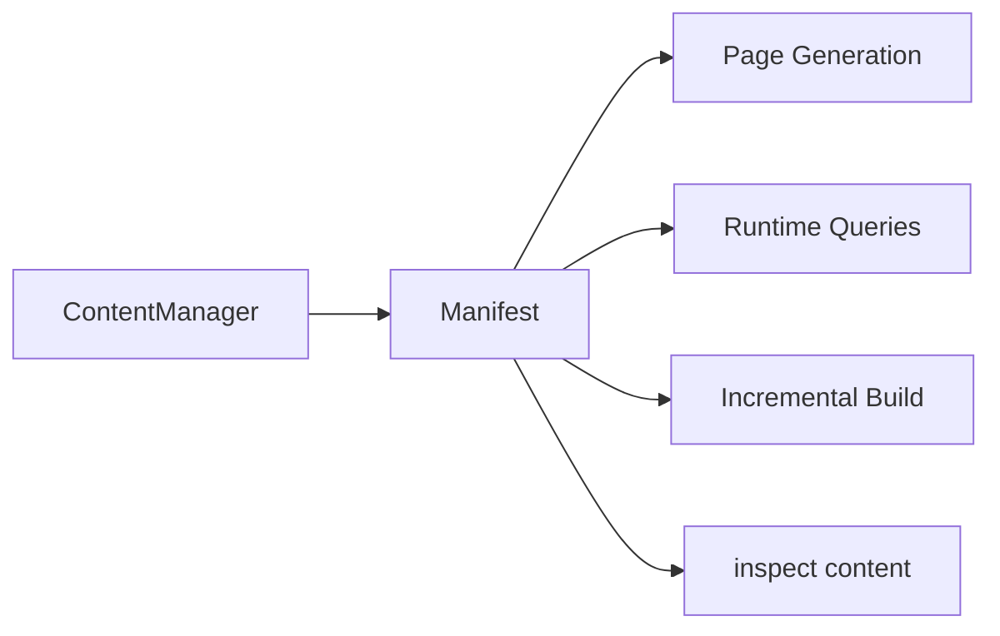
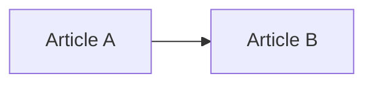
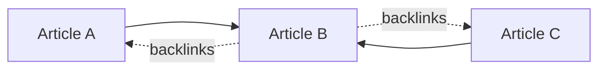
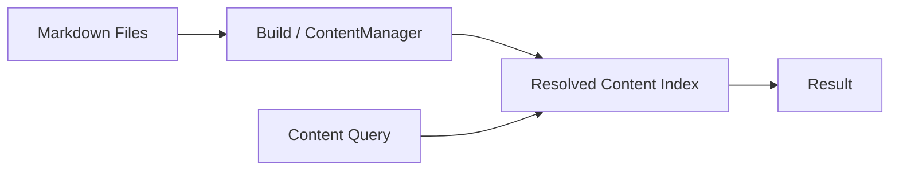
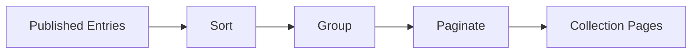
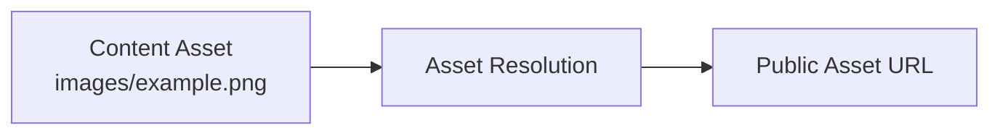

# Manifest

## Processing model

```text
scan/read source
  -> resolve public locations        (default resolver + plugin hooks)
  -> parse post -> process post -> create manifest -> graph
                        |
                        `--- plugin lifecycle/content hooks ---'
```

Public locations are resolved before any content that needs a URL is processed, so a consumer never has to invent one. [[glossary/plugin|Plugin]] hooks observe or extend defined phases such as configuration resolution, content loaded, parsed/processed posts, manifest creation, and build start/end. Keep source I/O, semantic interpretation, and rendering distinct so a remote source can replace the filesystem source without changing Core policy.

## Manifest, graph, and runtime

The manifest is the generated content representation used by the application. The content graph represents relationships and can be extended through the plugin graph contract. Reading a runtime manifest is not an explicit build. Incremental build state belongs only to the explicit build path and is never a mutable Worker runtime dependency.

The manifest is the list of content finalized at build time. Each entry carries,
for example, its logical path, metadata, public location, plugin results, and the
information incremental build needs.



The manifest is the boundary that passes the Content System's resolved result to
other parts of the system. Consumers read the resolved manifest instead of
re-reading Markdown and recomputing the same information.

### Content graph

The content graph represents relationships between content. A [[glossary/wikilink|WikiLink]] such as

```markdown
[[Article B]]
```

creates the relationship:



The graph also supports backlinks:



The content graph is not only for graph displays. It is the basis for features
such as:

- WikiLinks
- Markdown links
- Backlinks
- [[glossary/taxonomy|Taxonomy]]
- [[glossary/series|Series]]
- Related posts
- Local graph
- Garden explorer

Plugins can add information to the graph through `extendContentGraph`.

## Content queries

Core exposes a portable query layer over resolved manifest entries:

- `queryContentEntries(entries, spec)` filters by tags, folder, frontmatter, and date range, applies one or more sort keys, and slices the result with `limit`/`offset`.
- `queryContentPage(entries, spec)` applies the same selection and returns the page slice together with `page` metadata (`page`, `pageCount`, `hasPrevious`, `hasNext`); `resolveContentQueryPagination(total, spec)` computes that metadata alone.
- `groupContentEntries(entries, groupBy, options)` runs the same selection and groups the result by tags, folder, date granularity (`year`/`month`/`day`), or a frontmatter field.

Both functions operate on `ContentManifestEntry` values, so links use the resolved `permalink`; a query never builds a public content URL from a slug. Applications and plugins compose these functions to build listing pages and taxonomy views, while Core keeps ownership of manifest and graph construction rather than routing.

The representative APIs are `queryContentEntries`, `queryContentPage`, and
`groupContentEntries`. These are **not APIs that search files**. A query runs
against the index already resolved at build time:



At runtime, plugins and applications should not re-read Markdown and rebuild
their own state.

## Content collections

`buildContentCollections(entries, definitions)` turns the same query selection into listing collections. A definition declares a `kind`, a `groupBy` (tags, folder, date, or a frontmatter field), a site-local `basePath`, optional `filter`/`sort`/`order` values, and optional `resolveTitle`/`resolvePath` builders. Every generated `ContentCollection` carries the group `value`, the resolved `path`, a `title`, and its `entries` in query order.

This is the shared mechanism behind taxonomy, folder, and archive listings. A `tag` definition groups by `tags` under `/tags`; an `archive` definition groups by date under `/archive`; both are produced by the same call. Routing stays in the application, while the collection contract and the query engine stay in Core. Listing entries still link through `ContentManifestEntry.permalink` and never construct a URL from a slug.

It can, for example, take all articles, sort them by date, classify them by tag,
and split them into pages.

A definition may set `pageSize` to split a collection across pages. Each page is emitted as its own `ContentCollection` whose `path` is the collection path plus `/page/<n>` for later pages, and its `page` metadata carries `current`, `count`, `size`, `total`, `previousPath`, and `nextPath` for building navigation.



Plugins and site applications use this mechanism to build article lists, tag
lists, and similar views.

## Assets

Images and attachments are handled as entries separate from the Markdown body.
For example, with:

```text
content/
├─ article.md
└─ images/
   └─ example.png
```

Riebeckite maps the asset to a URL that can be used on the site while preserving
its logical path:



The exact URL form can depend on plugins and configuration. What matters is that
arbitrary files outside the content root are not turned into public URLs. The
Content System's publication boundary decides what is safe to publish.
