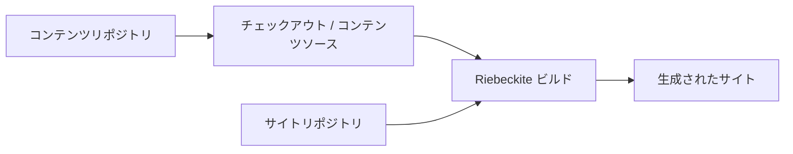
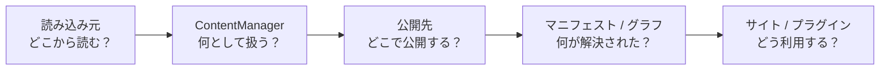

# 運用

## コンテンツリポジトリを分離する場合

サイトとコンテンツを別々のリポジトリに置いても、コンテンツシステムの基本的な流れは変わりません。

コンテンツリポジトリはコンテンツを提供します。最終的に、次の項目を決めるのはサイトリポジトリ側のビルドです。

- 何を公開するか
- どのプラグインを使うか
- どの URL で公開するか
- どのサイトを生成するか

このため、コンテンツリポジトリが分離されていても、`ContentManager` やプラグインがファイルシステムの配置を特別扱いする必要はありません。

## コンテンツの変更

`riebeckite content` は、書き込む前に変更計画を作ります。`create`、`edit`、`delete`、`move` は計画を表示するだけです。`--apply` を付けたときにだけ書き込みます。`content plan` は計画を保存し（名前は `--out` で指定）、`content apply <plan> --apply` は再検証してから適用します。`content recover <journal> --apply` は中断した適用を巻き戻します。

計画の作成ではコンテンツを書き込みません。適用時は保存された操作を再計画し、全ファイルのフィンガープリント、親ディレクトリのシンボリックリンク、ロックを確認してから書き込みます。各書き込みと削除の直前にも、計画時のフィンガープリントと一致するかを確認します。書き込みはジャーナルを経由し、復旧では適用後の状態がまだ一致するファイルを戻します。ジャーナルへの記録前に中断した書き込みも対象です。並行して変更されたファイルは上書きせず、競合として報告します。復旧では、復元前にすべてのバックアップを検証します。ジャーナルの前後の状態のどちらにも一致しないファイルは上書きせず、競合として報告します。ロックは変更処理どうしを調停しますが、ロックに参加しない外部エディタの書き込みはフィンガープリントで検出するだけで、排除できません。

### リンク

パスを変更すると、そのパスを指すリンクも更新します。リンクの出現位置は UTF-16 の正確な範囲として取り出し、マニフェストと同じコンテンツインデックスと別名を使って解決します。書き換えるのはリンク先の範囲だけです。Markdown 文書全体を置換することはありません。

- WikiLink と埋め込みは、ソースファイルの場所に依存せず解決します。
- 相対 Markdown リンクと画像は、ソースファイルのディレクトリを起点に解決します。
- 複数のファイルが同じ短い名前を持つ場合は曖昧とみなし、書き換えません。
- ファイルを移動すると、そのファイル内の相対 Markdown リンクも新しい場所に合わせます。
- 連続した移動ではリンクを最終的な移動先に合わせ、パーセントエンコードされたリンク先は解決前にデコードします。
- リンク先のファイルを削除すると、`broken-link` 警告を残します。
- リンクを壊す変更や、リンク先が黙って変わる変更は、競合として拒否します。

参照形式のリンクを使っている箇所は編集せず、参照定義のリンク先だけを更新します。Markdown 以外のファイルはバイト列のまま移動し、リンク先にはなっても変更対象にはなりません。

## コンテンツシステムを変更するときの原則

コンテンツシステムを変更するときは、次の原則を維持してください。

| 原則 | 理由 |
| --- | --- |
| `content.directory` は `appRoot` 基準で解決する | サイトごとに安定した基準を持つため |
| プラグインはファイルシステムのパスに依存しない | [[glossary/content-source|コンテンツソース]]を交換可能にするため |
| 公開判定は `publishStrategy` と frontmatter に従う | 公開境界を一元化するため |
| 公開先は `ContentPublicLocation` として登録する | 各機能が URL を独自に計算しないため |
| 実行環境はビルド済みのインデックスを利用する | 実行環境をソースのファイルシステムから分離するため |
| サイトのビルドが最終的な公開状態を決める | コンテンツリポジトリとサイトの責務を分離するため |

全体として、次の境界を崩さないことが重要です。

**`ContentSource` は読み込み方、`ContentManager` はコンテンツの解決、公開先はサイト上の公開位置、マニフェスト / グラフは解決結果を表します**。

各機能がファイルシステムや Markdown を独自に読み直すのではなく、コンテンツシステムを通して同じ解決結果を共有します。これが Riebeckite のコンテンツアーキテクチャの基本です。

### 関連ページ

- [設定](../../reference/configuration.ja.md)
- [プラグイン API](../../reference/plugin-api.ja.md)
- [コンテンツリポジトリ](../../guides/content-repositories.ja.md)
- [コンテンツリポジトリの分離](../../guides/deployment/separate-content-repository.ja.md)
