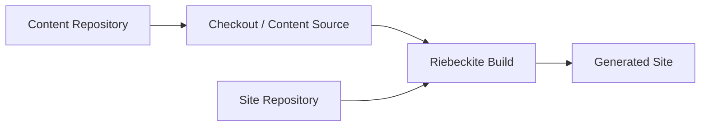
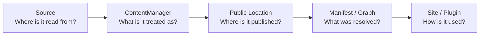

# Operations

## Separating the content repository

Placing the site and the content in different repositories does not change the
basic Content System flow:

The content repository provides content. The site repository's build decides
what is published, which plugins are used, at which URLs content is published,
and which site is generated. Because of this, `ContentManager` and plugins do not
need to special-case the filesystem layout even when the content repository is
separate.

## Content mutation

`riebeckite content` plans changes before writing. `create`, `edit`, `delete`,
and `move` only print a plan; `--apply` writes it. `content plan` stores the
plan (name it with `--out`), `content apply <plan> --apply` revalidates and
applies it, and `content recover <journal> --apply` rolls back an interrupted
apply.

Planning never writes content. Apply re-plans the stored operations, compares
every file fingerprint, checks parent symlinks, and takes a lock before
writing. Each write and deletion is checked against the planned fingerprint
immediately before it happens. Writes go through a journal, and recovery rolls
back files that still match their intended after-state, including a write
interrupted before its journal mark. Concurrent edits are reported instead of
overwritten. Recovery validates every backup before restoring anything, and a
file that matches neither side of the journal is reported as a conflict rather
than overwritten.
The lock coordinates mutation processes; fingerprint checks detect an external
edit, but they cannot exclude an editor that keeps writing without taking the
lock.

### Links

Mutating a path updates the links that resolve to it. The system extracts link
occurrences with exact UTF-16 source ranges, resolves them through the same
content index and aliases used by the manifest, and rewrites only the
destination range. It never replaces a whole Markdown document.

- WikiLinks and embeds resolve independently of the source file location.
- Relative Markdown links and images resolve from the source directory.
- A short name shared by multiple files is ambiguous and is never rewritten.
- Moving a file also re-relativizes its relative Markdown links for the new
  location.
- Chained moves resolve links to the final destination, and percent-encoded
  destinations are decoded before resolution.
- Deleting a linked file leaves a `broken-link` warning.
- A mutation that would break a link or silently change its target is refused
  with a conflict.

Reference-style usages are not edited; the reference definition's destination
is updated. Non-Markdown files are moved byte-for-byte and are link targets
only, not mutation sources.

## Correctness rules

- Preserve canonical content identity across source, manifest, and graph.
- Treat slug and permalink as separate concepts: obtain public URLs only from the resolved `ContentPublicLocation`.
- Treat source metadata as change evidence, not universally reliable truth.
- Make publication/exclusion policy visible in configuration.
- Return diagnostics for recoverable user-facing problems; do not silently omit content.
- Keep graph extensions deterministic for identical inputs.

When changing the Content System, keep the following principles:

| Principle | Reason |
| --- | --- |
| Resolve `content.directory` against `appRoot` | Gives each site a stable base |
| Plugins do not depend on filesystem paths | Keeps the content source exchangeable |
| Publication follows `publishStrategy` and frontmatter | Centralizes the publication boundary |
| Register public locations as `ContentPublicLocation` | Prevents each feature from computing its own URL |
| Runtime uses the build-time index | Separates runtime from the source filesystem |
| The site build decides the final published state | Separates the content repository from the site |

Overall, keep this boundary intact:

**Source is how content is read, [[glossary/content-manager|ContentManager]] is how content is resolved,
[[glossary/public-location|Public Location]] is where it is published, and [[glossary/manifest|Manifest]] / Graph are the resolved
result.** Features should not re-read the filesystem or Markdown on their own;
sharing the same resolved result through the Content System is the basis of
Riebeckite's content architecture.

See [Configuration](../../reference/configuration.md), [Build system](../build-system.md), and [Plugin system](../plugin-system.md).
