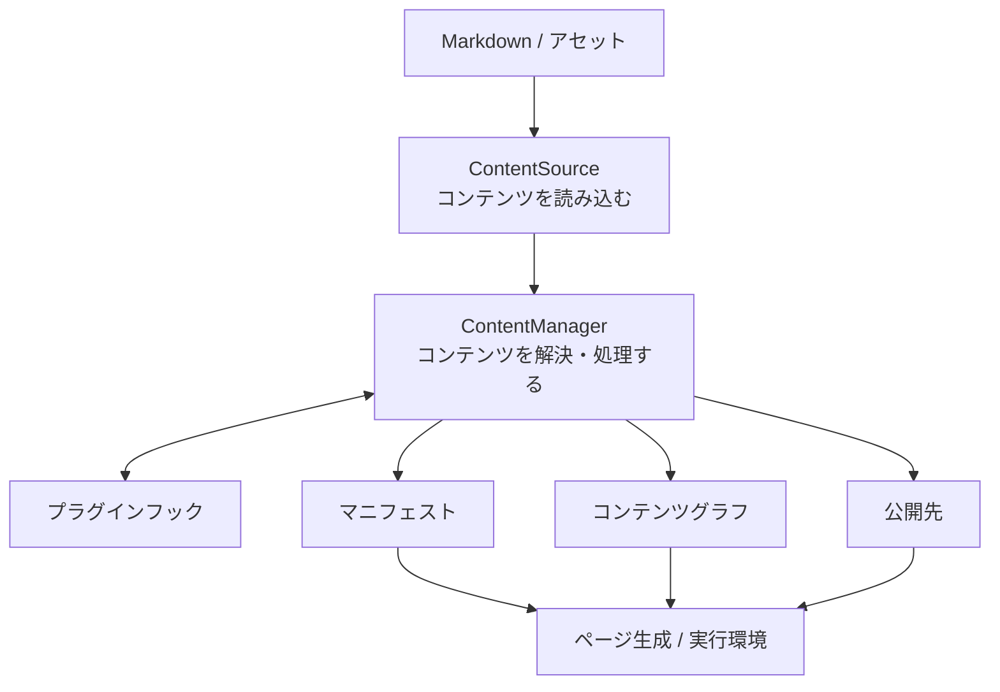
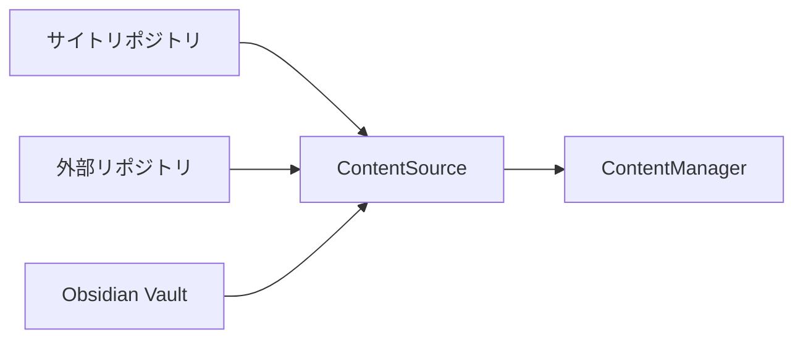
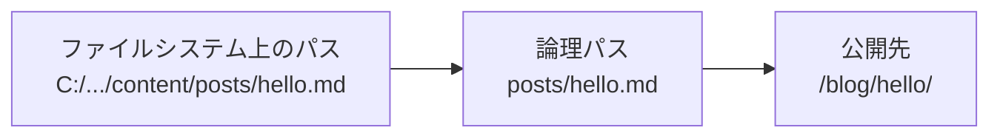
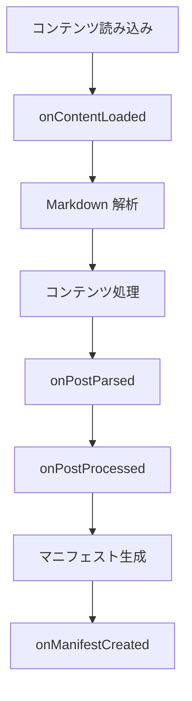

# ソースと管理

## 全体像

コンテンツシステムの処理は、大きく次の流れで進みます。



中心となるのは `ContentSource` と `ContentManager` です。役割は次のように分かれます。

```text id="a4xsh7"
ContentSource
  = どこからコンテンツを読むか

ContentManager
  = 読み込んだコンテンツをどう扱うか
```

## ContentSource

`ContentSource` は、Markdown やアセットを**どこから、どのように読み込むか**を抽象化した API です。

通常は、`@riebeckite/node` の `FileSystemContentSource` を通じて、`content.directory` で指定されたディレクトリから読み込みます。たとえば、次のとおりです。

```text id="9u1ygf"
content/
```

ただし、コンテンツシステムは、コンテンツが必ずサイトリポジトリ内にあるとは想定していません。

たとえば、サイトリポジトリ、外部リポジトリ、[[glossary/obsidian-vault|Obsidian Vault]] のいずれから取得する場合でも、最終的には同じ `ContentSource` インターフェースを通して `ContentManager` に渡します。

```text id="eynh5j"
Site Repository
└─ content/

External Repository
└─ notes/

Obsidian Vault
└─ notes/
```



これにより、コンテンツの保存場所が変わっても、以降の処理を同じ仕組みで扱えます。

### 3種類の「場所」

コンテンツシステムを理解するうえでは、次の3つを区別することが重要です。

| 種類 | 意味 |
| --- | --- |
| ファイルシステム上のパス | 実際にファイルが保存されている場所 |
| [[glossary/logical-path|論理パス]] | コンテンツルートから見たコンテンツの識別子 |
| [[glossary/public-location|公開先]] | Web サイト上の URL |

たとえば、`C:\projects\garden\content\posts\hello.md` というファイルがあっても、Riebeckite の内部では `posts/hello.md` という論理パスとして扱えます。

```text id="dfblcr"
C:\projects\garden\content\posts\hello.md
```

```text id="ej2j1k"
posts/hello.md
```

さらに、実際の公開先は `/blog/hello/` かもしれません。

```text id="dkv7ak"
/blog/hello/
```



3つを分離しておけば、コンテンツリポジトリを別のリポジトリへ移しても、サイト側の URL やコンテンツ処理を同じ規則で扱えます。

## ContentManager

`ContentManager` は、`ContentSource` から受け取ったコンテンツを管理し、サイトで利用できる状態へ変換します。

主な責務は次のとおりです。

- Markdown の frontmatter と本文を読み込む
- コンテンツを公開するか判断する
- slug、permalink、content ID を整理する
- プラグインのフックを実行する
- 公開先を解決する
- [[glossary/manifest|マニフェスト]]を生成する
- [[glossary/content-graph|コンテンツグラフ]]を生成する
- クエリ用のインデックスを用意する

つまり、`ContentManager` はコンテンツシステムの中心にあり、処理全体を統括するオーケストレーターです。

### プラグインが処理に参加する

プラグインは `ContentManager` のライフサイクルにフックできます。代表的なフックは次のとおりです。

```text id="l0z0fr"
onContentLoaded
onPostParsed
onPostProcessed
onManifestCreated
```

処理の流れは次のとおりです。



プラグインはこのライフサイクルを利用して、コンテンツを拡張します。
