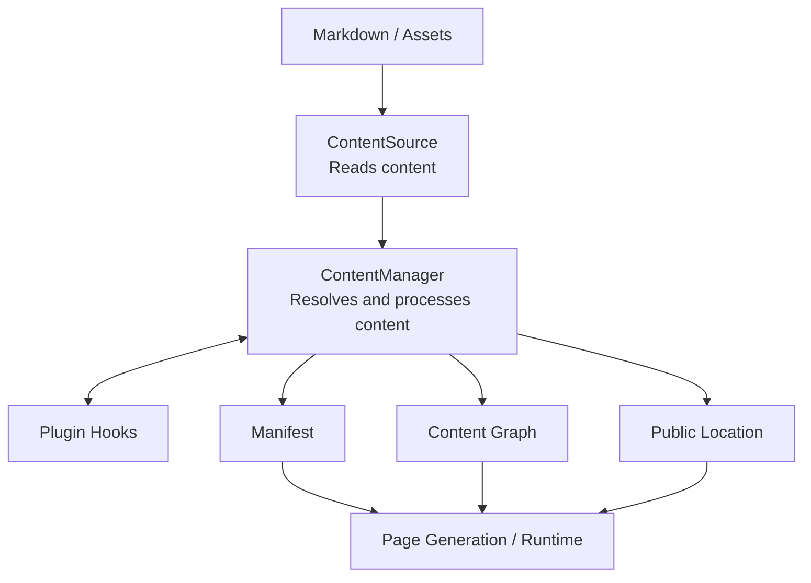
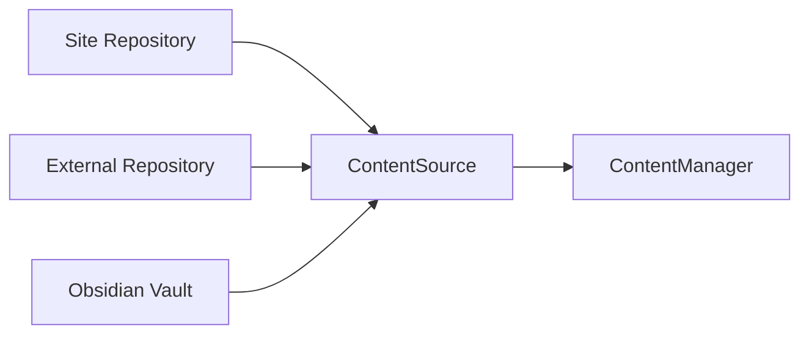
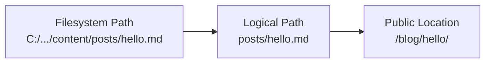
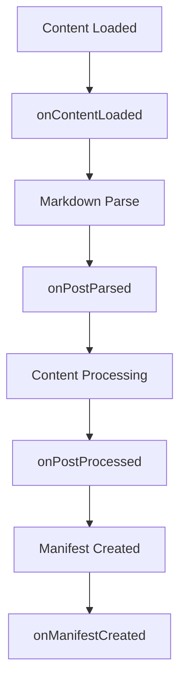

# Sources and management

## Overview



`ContentSource` and `ContentManager` are the center of the system. In short:

```text
ContentSource
  = where content is read from

ContentManager
  = how the loaded content is handled
```

## Two explicit responsibilities

`ContentSource` is the boundary for finding and reading source data. It owns scanning, reading, identity, and source metadata such as mtime, size, ETag, or hashes. `FileSystemContentSource` from `@riebeckite/node` is the normal local implementation.

Content does not have to live inside the site repository. Riebeckite can read
from a site repository, an external repository, or an Obsidian vault, and all of
them reach `ContentManager` through the same `ContentSource` interface.



Because the storage location is abstracted this way, later processing stays the
same even if content moves.

`ContentManager` owns the meaning of that data: parsing, Markdown/HTML pipeline execution, post processing, plugin orchestration, [[manifest|manifest]] creation, and [[content-graph|content-graph]] construction. It should not grow direct filesystem behavior that bypasses `ContentSource`.

### Three kinds of "location"

When working with the Content System, keep three things distinct:

| Kind | Meaning |
| --- | --- |
| Filesystem path | Where the file actually lives |
| Logical path | The content identifier relative to the content root |
| Public location | The URL on the web site |

A file such as `C:\projects\garden\content\posts\hello.md` is handled internally
as the logical path `posts/hello.md`, and its public location might be
`/blog/hello/`.



Separating these three lets a content repository move to another repository
while the site keeps the same URL and content-processing rules.

## ContentManager

`ContentManager` manages the content it receives from `ContentSource` and turns
it into a state the site can use. Its main responsibilities are:

- Read Markdown frontmatter and body
- Decide whether content is published
- Organize slug, permalink, and content ID
- Run plugin hooks
- Resolve public locations
- Generate the manifest
- Generate the content graph
- Prepare query indexes

In other words, `ContentManager` is the orchestrator at the center of the
Content System.

### Plugins join processing

Plugins can hook into the `ContentManager` lifecycle. Representative hooks
include:

```text
onContentLoaded
onPostParsed
onPostProcessed
onManifestCreated
```

Conceptually the flow is:



Plugins use this lifecycle to extend content.
