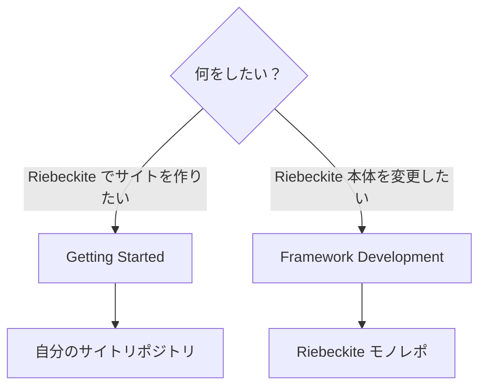
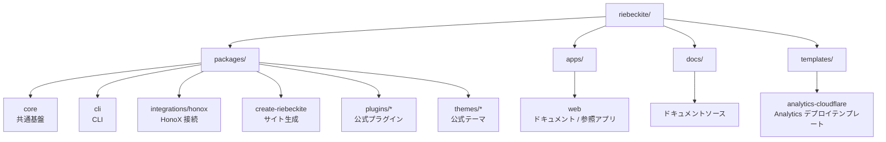
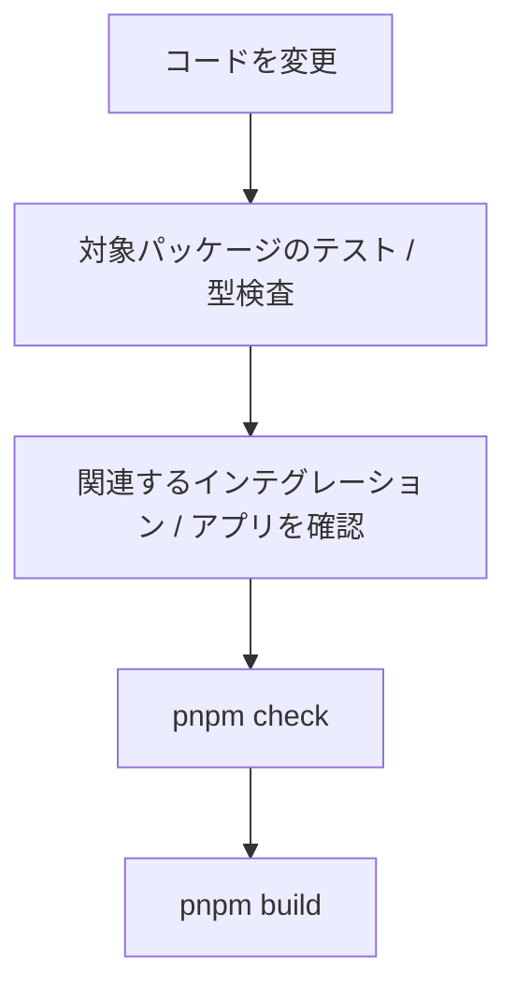
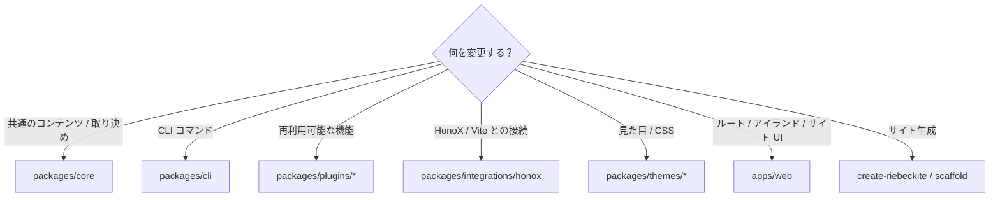
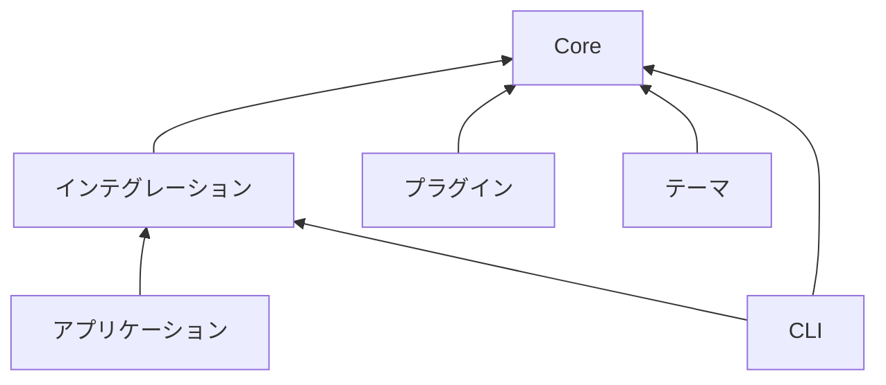
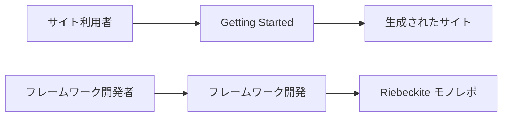

# フレームワーク開発

このページは、**Riebeckite 本体を開発する人向け**のガイドです。次のような変更を行う場合は、このモノレポを使用します。

- Core の機能を追加・変更する
- CLI を変更する
- HonoX インテグレーションを変更する
- 公式プラグイン / テーマを開発する
- サイトのスキャフォールドやテンプレートを変更する
- 公式ドキュメントや参照アプリを変更する

単に Riebeckite を使って自分のサイトを作りたい場合は、**このリポジトリをクローンする必要はありません**。[Getting Started](../getting-started/README.ja.md) からサイトを作成してください。



## 開発環境をセットアップする

Riebeckite 本体を開発する場合は、リポジトリをクローンして依存関係をインストールします。

```bash id="vmx4gu"
git clone https://github.com/rerurate/riebeckite.git
cd riebeckite
pnpm install
pnpm build
```

これで、ワークスペース内のパッケージを開発できる状態になります。

### 開発サーバーを起動する

```bash id="kueg3z"
pnpm dev
```

`apps/web` の参照アプリを使うと、Riebeckite への変更を実際のサイトとして確認できます。

`apps/web` は単なるデモではありません。フレームワーク開発時に、Core、プラグイン、テーマ、インテグレーションが正しく組み合わさることを確認するための参照アプリでもあります。

## リポジトリの構成

Riebeckite は pnpm workspace を使ったモノレポです。大きく次のように分かれています。



| パス | 役割 |
| --- | --- |
| `packages/core` | 設定、コンテンツ、パイプライン、プラグイン、テーマ、診断、可観測性などの共通基盤 |
| `packages/cli` | `riebeckite` CLI |
| `packages/integrations/honox` | HonoX / Vite インテグレーションとスキャフォールドジェネレーター |
| `packages/create-riebeckite` | サイト作成用の公開エントリーポイント |
| `packages/plugins/*` | 公式プラグイン |
| `packages/themes/*` | 公式テーマ |
| `apps/web` | 公式ドキュメントサイトを兼ねたフレームワーク開発用の参照アプリ |
| `docs/` | 公式ドキュメントアプリが読み込むドキュメントソース |
| `templates/analytics-cloudflare` | Analytics Worker のデプロイ用テンプレート |

各パッケージの詳しい責務については [Architecture](./architecture.ja.md) を参照してください。

## よく使うコマンド

フレームワーク開発でよく使うコマンドは次のとおりです。

| コマンド | 用途 |
| --- | --- |
| `pnpm dev` | 開発用サイトを起動する |
| `pnpm build` | ワークスペースをビルドする |
| `pnpm check` | リポジトリ全体を検査する |
| `pnpm test` | テストを実行する |
| `pnpm typecheck` | TypeScript の型を検査する |
| `pnpm check:docs` | ドキュメントを検査する |
| `pnpm docs:sync` | 原本のプラグイン / テーマのドキュメントからパッケージ README を生成する |
| `pnpm check:plugin-docs` | プラグインのドキュメントと生成した README の同期を検査する |
| `pnpm check:theme-docs` | テーマのドキュメントと生成した README の同期を検査する |
| `pnpm check:scaffold` | 生成されるサイトを検査する |

対象を絞れる場合は、次のように限定的なコマンドを使います。

- `pnpm check:docs` は Markdown のリンクとドキュメントの構造を検査します。
- `pnpm check:scaffold` は生成されたスキャフォールドの出力を検査します。
- `pnpm typecheck` はパッケージの型を検査します。
- `pnpm --filter <package> test` は、テストがある場合にそのパッケージのテストを実行します。

### ドキュメントを変更した場合

```bash id="2wm0wz"
pnpm check:docs
```

Markdown のリンクとドキュメントの構造を検査します。ドキュメントを追加・移動・削除したときに実行してください。

### プラグイン / テーマのドキュメントを変更した場合

プラグイン / テーマのドキュメントは、次の所有関係で管理します。

```text
原本:
  docs/docs/plugins/<slug>.md
  docs/docs/plugins/<slug>.ja.md
  docs/docs/themes/<slug>.md
  docs/docs/themes/<slug>.ja.md

生成物:
  packages/plugins/<slug>/README.md
  packages/plugins/<slug>/README_ja.md
  packages/themes/<slug>/README.md
  packages/themes/<slug>/README_ja.md
```

編集するのは原本のドキュメントだけです。生成された README を手動で編集しないでください。変更後は次を実行します。

```bash
pnpm docs:sync
pnpm check:plugin-docs
pnpm check:theme-docs
```

### スキャフォールドを変更した場合

```bash id="5xutky"
pnpm check:scaffold
```

生成される Riebeckite サイトが正しい構成になっているかを検査します。次のようなものを変更した場合に重要です。

- スキャフォールドジェネレーター
- プリセット
- テンプレート
- 生成される `package.json`
- サイトの初期構成

### パッケージの型を確認する

```bash id="hlsudn"
pnpm typecheck
```

TypeScript の型エラーを確認します。

### 特定のパッケージのテストを実行する

変更したパッケージだけを確認したい場合は、`--filter` を使用できます。

```bash id="6s8dyj"
pnpm --filter <package> test
```

たとえば特定のプラグインだけを変更した場合は、最初からリポジトリ全体のテストを実行するのではなく、対象パッケージのテストから確認できます。

## 変更時の検証フロー

必要な検証は変更内容によって異なりますが、基本的には**小さい範囲から確認し、最後に広い範囲を確認する**進め方を推奨します。



たとえばプラグインを変更した場合は、まずそのプラグインのテストを実行します。

```bash id="9dvfqe"
pnpm --filter <plugin-package> test
```

問題がなければ、必要に応じて型検査や参照アプリの確認を行い、最後にリポジトリ全体の検証を行います。変更のたびに最初から最も重いコマンドを実行する必要はありません。

## 変更する場所を選ぶ

機能を追加するときは、まず責務に合ったパッケージを選びます。



判断に迷う場合は、[Architecture](./architecture.ja.md) の責務分離を基準にしてください。

## パッケージの境界

フレームワークを変更するときは、パッケージ間の依存方向を維持してください。大まかな依存関係は次のとおりです。



特に重要なのは、Core から外側への逆依存を作らないことです。たとえば、Core を次のような具体的な実装に依存させてはいけません。

```text id="7nxphg"
apps/web
packages/plugins/*
HonoX
Vite
```

フレームワークに依存しない取り決めは Core に置き、その取り決めをインテグレーションやプラグインが利用します。

## 公開 API を使う

外部のプラグイン / テーマと同じ条件で利用できる API は、公開エクスポートから参照してください。たとえば、次のような公開エントリーポイントを使用します。

```ts id="wj3a9t"
import { ... } from "@riebeckite/core";
```

次のように、パッケージの内部へ直接依存することは避けてください。

```ts id="njjmrh"
import { ... } from "@riebeckite/core/src/...";
```

`src/**` は内部実装であり、安定した公開 API ではありません。公式のプラグインやテーマも、可能な限り公開 API の利用者として実装します。そうすることで、外部パッケージから実際に利用できる取り決めになっていることを確認できます。

## スキャフォールドを独立したサイトとして扱う

スキャフォールドは、Riebeckite モノレポ内でしか動かない構成にしてはいけません。生成されたサイトは、次の流れでモノレポの内部ソースに依存せず動作する必要があります。

```text id="o8ss84"
create-riebeckite
       ↓
Generated Site
       ↓
npm packages
       ↓
build
```

そのため、スキャフォールドを変更した場合は、ワークスペース内で動くだけでなく、外部サイトとして成立することも確認してください。`check:scaffold` と external-site E2E は、この境界を検証するためにあります。

## ドキュメントの境界

一般ユーザー向けのドキュメントでは、Riebeckite モノレポのクローンやワークスペースのセットアップを前提にしません。



サイトを作るユーザーとフレームワークを開発するユーザーでは、必要な環境が異なるためです。

モノレポ固有のコマンド、内部パッケージの構成、フレームワークのビルド方法などは、このフレームワーク開発セクションで扱います。

## 開発時に維持する境界

フレームワークを変更するときは、特に次の点を維持してください。

- Core からアプリケーション、プラグイン内部、フレームワーク固有の実装へ逆依存しない
- 外部のプラグイン / テーマが `src/**` を import せずに実装できる公開 API を維持する
- 一般ユーザー向けドキュメントでモノレポのセットアップを要求しない
- スキャフォールドを、モノレポから独立して動作できるサイトとして維持する
- 変更した範囲から検証し、必要に応じてリポジトリ全体へ検証範囲を広げる

フレームワーク全体の責務については [Architecture](./architecture.ja.md)、テスト方針については [Testing](./testing.ja.md)、リリース手順については [Release Operations](./release.ja.md) を参照してください。CLI については [CLI](../reference/cli.ja.md)、HonoX との接続については [HonoX Integration](./honox-integration.ja.md) を参照してください。
