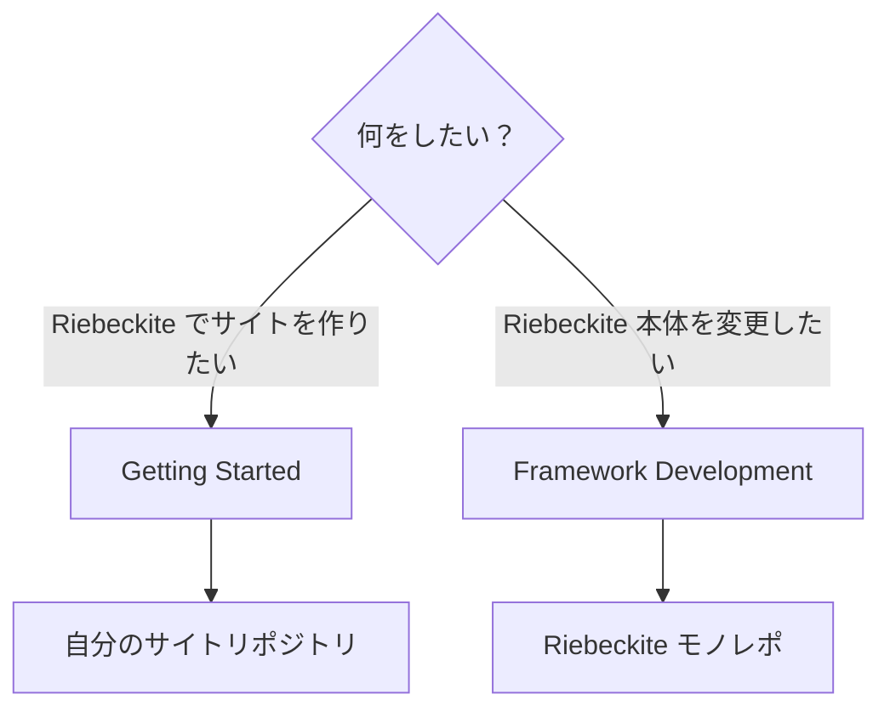

# フレームワーク開発

このページは、**Riebeckite 本体を開発する人向け**のガイドです。次のような変更を行う場合は、このモノレポを使用します。

- Core の機能を追加・変更する
- CLI を変更する
- [[framework/honox-integration|HonoX]] インテグレーションを変更する
- 公式プラグイン / [[glossary/theme|テーマ]]を開発する
- サイトのスキャフォールドやテンプレートを変更する
- 公式ドキュメントや参照アプリを変更する

単に Riebeckite を使って自分のサイトを作りたい場合は、**このリポジトリをクローンする必要はありません**。[Getting Started](../getting-started/README.ja.md) からサイトを作成してください。

## このページの構成

- [セットアップ](./development/setup.ja.md)
- [変更の流れ](./development/workflow.ja.md)
- [境界](./development/boundaries.ja.md)
