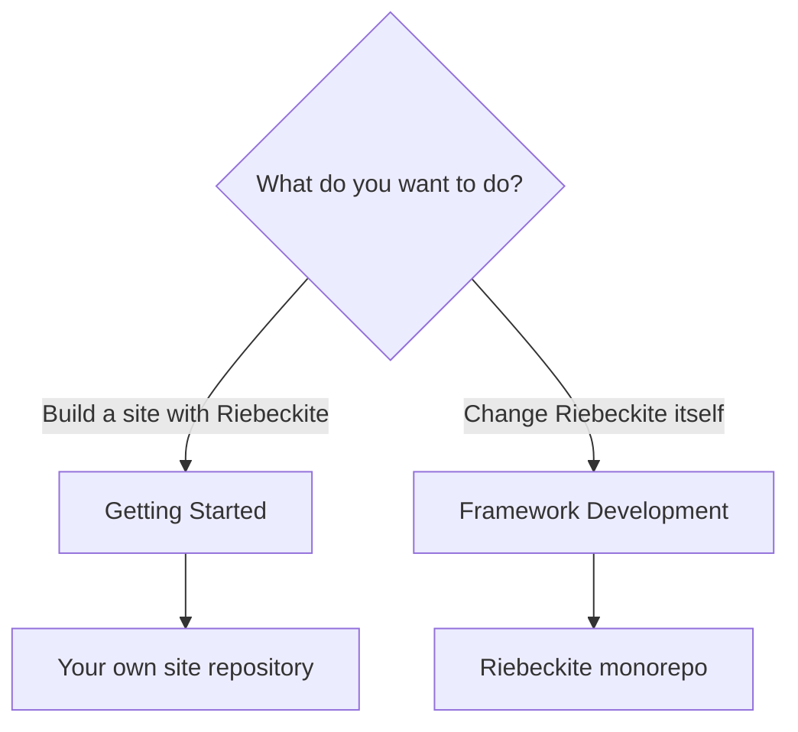

# Framework Development

This page is for people developing Riebeckite itself: core, CLI, [[framework/honox-integration|HonoX]] integration, official plugins, official themes, templates, or the reference app. It is intentionally separate from [Getting Started](../getting-started/README.md). Users who only want to publish a site should use `create-riebeckite` instead of cloning this monorepo.

Use this monorepo when you are changing things such as:

- Core features
- The CLI
- The HonoX integration
- Official plugins and themes
- The site scaffold and templates
- The official documentation or the reference application

If you only want to build your own site with Riebeckite, **you do not need to clone this repository.** Start from [Getting Started](../getting-started/README.md) instead.

## In this section

- [Setup](./development/setup.md)
- [Workflow](./development/workflow.md)
- [Boundaries](./development/boundaries.md)
