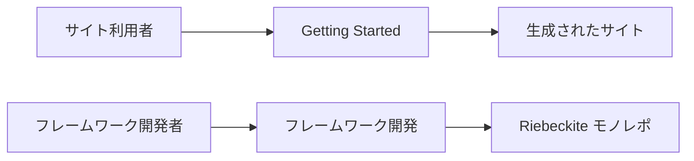

# 境界

## 公開 API を使う

外部のプラグイン / テーマと同じ条件で利用できる API は、公開エクスポートから参照してください。たとえば、次のような公開エントリーポイントを使用します。

```ts id="wj3a9t"
import { ... } from "@riebeckite/core";
```

次のように、パッケージの内部へ直接依存することは避けてください。

```ts id="njjmrh"
import { ... } from "@riebeckite/core/src/...";
```

`src/**` は内部実装であり、安定した公開 API ではありません。公式のプラグインやテーマも、可能な限り公開 API の利用者として実装します。そうすることで、外部パッケージから実際に利用できる取り決めになっていることを確認できます。

## スキャフォールドを独立したサイトとして扱う

スキャフォールドは、Riebeckite モノレポ内でしか動かない構成にしてはいけません。生成されたサイトは、次の流れでモノレポの内部ソースに依存せず動作する必要があります。

```text id="o8ss84"
create-riebeckite
       ↓
Generated Site
       ↓
npm packages
       ↓
build
```

そのため、スキャフォールドを変更した場合は、ワークスペース内で動くだけでなく、外部サイトとして成立することも確認してください。`check:scaffold` と external-site E2E は、この境界を検証するためにあります。

## ドキュメントの境界

一般ユーザー向けのドキュメントでは、Riebeckite モノレポのクローンやワークスペースのセットアップを前提にしません。



サイトを作るユーザーとフレームワークを開発するユーザーでは、必要な環境が異なるためです。

モノレポ固有のコマンド、内部パッケージの構成、フレームワークのビルド方法などは、このフレームワーク開発セクションで扱います。

## 開発時に維持する境界

フレームワークを変更するときは、特に次の点を維持してください。

- Core からアプリケーション、プラグイン内部、フレームワーク固有の実装へ逆依存しない
- 外部のプラグイン / テーマが `src/**` を import せずに実装できる公開 API を維持する
- 一般ユーザー向けドキュメントでモノレポのセットアップを要求しない
- スキャフォールドを、モノレポから独立して動作できるサイトとして維持する
- 変更した範囲から検証し、必要に応じてリポジトリ全体へ検証範囲を広げる

フレームワーク全体の責務については [Architecture](../architecture.ja.md)、テスト方針については [Testing](../testing.ja.md)、リリース手順については [Release Operations](../release.ja.md) を参照してください。CLI については [CLI](../../reference/cli.ja.md)、HonoX との接続については [HonoX Integration](../honox-integration.ja.md) を参照してください。
