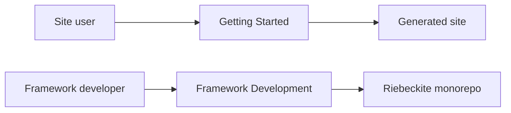

# Boundaries

## Use the public API

APIs that external plugins and themes can also use should be referenced through public exports. Use a public entrypoint such as:

```ts
import { ... } from "@riebeckite/core";
```

Avoid depending directly on package internals like this:

```ts
import { ... } from "@riebeckite/core/src/...";
```

`src/**` is an internal implementation and is not a stable public API. Implementing official plugins and themes as consumers of the public API wherever possible confirms that the contract is actually usable from external packages.

## Treat scaffolds as standalone sites

A scaffold must not be structured to work only inside the Riebeckite monorepo. A generated site has to work without depending on the monorepo's internal sources:

```text
create-riebeckite
       ↓
Generated Site
       ↓
npm packages
       ↓
build
```

So when you change the scaffold, confirm not only that it works inside the workspace but also that it stands up as an external site. `check:scaffold` and the external-site E2E tests exist to verify this boundary.

## Documentation boundaries

General-user documentation does not assume that you cloned the Riebeckite monorepo or set up the workspace.



This is because people who build a site and people who develop the framework need different environments. Monorepo-specific commands, the internal package structure, and how to build the framework are covered in this Framework Development section.

## Boundaries to maintain

Framework changes should especially preserve the following:

- Do not create a reverse dependency from Core to the application, plugin internals, or framework-specific implementations.
- Keep a public API that lets external plugins and themes be implemented without importing `src/**`.
- Do not require monorepo setup in general-user documentation.
- Keep scaffolds working as sites that are independent of the monorepo.
- Verify from the changed scope and widen to the whole repository as needed.

See [Architecture](../architecture.md), [Testing](../testing.md), [Release Operations](../release.md), [CLI](../../reference/cli.md), and [HonoX Integration](../honox-integration.md).
