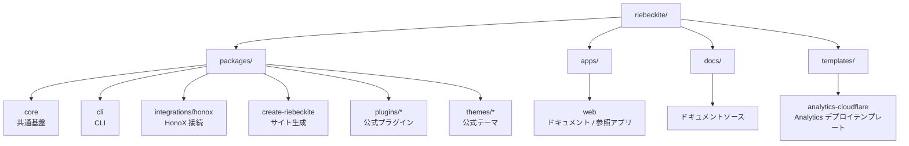

# セットアップ

## 開発環境をセットアップする

Riebeckite 本体を開発する場合は、リポジトリをクローンして依存関係をインストールします。

```bash id="vmx4gu"
git clone https://github.com/rerurate/riebeckite.git
cd riebeckite
pnpm install
pnpm build
```

これで、ワークスペース内のパッケージを開発できる状態になります。

### 開発サーバーを起動する

```bash id="kueg3z"
pnpm dev
```

`apps/web` の参照アプリを使うと、Riebeckite への変更を実際のサイトとして確認できます。

`apps/web` は単なるデモではありません。フレームワーク開発時に、Core、[[glossary/plugin|プラグイン]]、テーマ、インテグレーションが正しく組み合わさることを確認するための参照アプリでもあります。

## リポジトリの構成

Riebeckite は pnpm workspace を使ったモノレポです。大きく次のように分かれています。



| パス | 役割 |
| --- | --- |
| `packages/core` | 設定、コンテンツ、[[glossary/pipeline|パイプライン]]、プラグイン、テーマ、診断、可観測性などの共通基盤 |
| `packages/cli` | `riebeckite` CLI |
| `packages/integrations/honox` | HonoX / Vite インテグレーションとスキャフォールドジェネレーター |
| `packages/create-riebeckite` | サイト作成用の公開エントリーポイント |
| `packages/plugins/*` | 公式プラグイン |
| `packages/themes/*` | 公式テーマ |
| `apps/web` | 公式ドキュメントサイトを兼ねたフレームワーク開発用の参照アプリ |
| `docs/` | 公式ドキュメントアプリが読み込むドキュメントソース |
| `templates/analytics-cloudflare` | Analytics Worker のデプロイ用テンプレート |

各パッケージの詳しい責務については [Architecture](../architecture.ja.md) を参照してください。

## よく使うコマンド

フレームワーク開発でよく使うコマンドは次のとおりです。

| コマンド | 用途 |
| --- | --- |
| `pnpm dev` | 開発用サイトを起動する |
| `pnpm build` | ワークスペースをビルドする |
| `pnpm check` | リポジトリ全体を検査する |
| `pnpm test` | テストを実行する |
| `pnpm typecheck` | TypeScript の型を検査する |
| `pnpm check:docs` | ドキュメントを検査する |
| `pnpm changes:new` | 利用者に影響する変更のエントリを作成する |
| `pnpm changelog` | 変更履歴とリリースノートページを再生成する |
| `pnpm check:changes` | 変更エントリと生成ファイルを検証する |
| `pnpm docs:sync` | 原本のプラグイン / テーマのドキュメントからパッケージ README を生成する |
| `pnpm check:plugin-docs` | プラグインのドキュメントと生成した README の同期を検査する |
| `pnpm check:theme-docs` | テーマのドキュメントと生成した README の同期を検査する |
| `pnpm check:scaffold` | 生成されるサイトを検査する |

対象を絞れる場合は、次のように限定的なコマンドを使います。

- `pnpm check:docs` は Markdown のリンクとドキュメントの構造を検査します。
- `pnpm check:scaffold` は生成されたスキャフォールドの出力を検査します。
- `pnpm typecheck` はパッケージの型を検査します。
- `pnpm --filter <package> test` は、テストがある場合にそのパッケージのテストを実行します。

### ドキュメントを変更した場合

```bash id="2wm0wz"
pnpm check:docs
```

Markdown のリンクとドキュメントの構造を検査します。ドキュメントを追加・移動・削除したときに実行してください。

### プラグイン / テーマのドキュメントを変更した場合

プラグイン / テーマのドキュメントは、次の所有関係で管理します。

```text
原本:
  docs/docs/plugins/<slug>.md
  docs/docs/plugins/<slug>.ja.md
  docs/docs/themes/<slug>.md
  docs/docs/themes/<slug>.ja.md

生成物:
  packages/plugins/<slug>/README.md
  packages/plugins/<slug>/README_ja.md
  packages/themes/<slug>/README.md
  packages/themes/<slug>/README_ja.md
```

編集するのは原本のドキュメントだけです。生成された README を手動で編集しないでください。変更後は次を実行します。

```bash
pnpm docs:sync
pnpm check:plugin-docs
pnpm check:theme-docs
```

### スキャフォールドを変更した場合

```bash id="5xutky"
pnpm check:scaffold
```

生成される Riebeckite サイトが正しい構成になっているかを検査します。次のようなものを変更した場合に重要です。

- スキャフォールドジェネレーター
- [[glossary/preset|プリセット]]
- テンプレート
- 生成される `package.json`
- サイトの初期構成

### パッケージの型を確認する

```bash id="hlsudn"
pnpm typecheck
```

TypeScript の型エラーを確認します。

### 特定のパッケージのテストを実行する

変更したパッケージだけを確認したい場合は、`--filter` を使用できます。

```bash id="6s8dyj"
pnpm --filter <package> test
```

たとえば特定のプラグインだけを変更した場合は、最初からリポジトリ全体のテストを実行するのではなく、対象パッケージのテストから確認できます。
