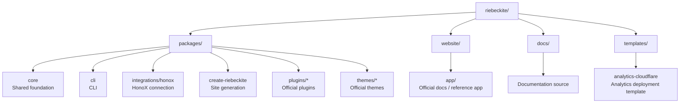

# Setup

## Getting started

To develop Riebeckite itself, clone the repository and install the dependencies:

```bash
git clone https://github.com/Rerurate514/riebeckite.git
cd riebeckite
pnpm install
pnpm build
```

You can now develop the packages in the workspace.

### Start the development server

```bash
pnpm dev
```

The reference app in `website` lets you see Riebeckite changes as a real site.

`website` is not just a demo: it is also the reference application used during framework development to confirm that Core, plugins, themes, and the integration combine correctly.

## Repository layout

Riebeckite is a monorepo built on the pnpm workspace.

The top level is split roughly like this:



| Path | Purpose |
| --- | --- |
| `packages/core` | public config, content, pipeline, plugin, theme, diagnostics, observability APIs |
| `packages/cli` | `riebeckite` command |
| `packages/integrations/honox` | HonoX / Vite integration |
| `packages/create-riebeckite` | public site scaffolding entrypoint |
| `packages/plugins/*` | official plugins |
| `packages/themes/*` | official themes |
| `website` | official documentation app and framework-development reference application |
| `docs/` | documentation source read by the official docs app |
| `templates/analytics-cloudflare` | Analytics Worker deployment templates |

For the detailed responsibilities of each package, see [Architecture](../architecture.md).

## Common commands

The commands you use most often during framework development are:

| Command | Purpose |
| --- | --- |
| `pnpm dev` | Start the development site. |
| `pnpm build` | Build the workspace. |
| `pnpm check` | Check the whole repository. |
| `pnpm test` | Run the tests. |
| `pnpm typecheck` | Check TypeScript types. |
| `pnpm check:docs` | Check the documentation. |
| `pnpm changes:new` | Create a change entry for a user-facing change. |
| `pnpm changelog` | Regenerate the changelog and release notes pages. |
| `pnpm check:changes` | Validate change entries and generated files. |
| `pnpm docs:sync` | Generate [[glossary/plugin|Plugin]] and [[glossary/theme|Theme]] package READMEs from canonical docs. |
| `pnpm check:plugin-docs` | Verify Plugin docs and generated READMEs are synchronized. |
| `pnpm check:theme-docs` | Verify Theme docs and generated READMEs are synchronized. |
| `pnpm check:scaffold` | Check generated preset structure and typecheck all eight generated configs. |

Use targeted commands when possible:

- `pnpm check:docs` validates Markdown links and docs structure.
- `pnpm check:scaffold` validates generated preset structure and typechecks all eight generated configs.
- `pnpm typecheck` checks packages.
- `pnpm --filter <package> test` runs a package test when available.

### When you change the documentation

```bash
pnpm check:docs
```

This validates Markdown links and the documentation structure. Run it whenever you add, move, or delete documentation.

### When you change Plugin or Theme documentation

Plugin / Theme documentation ownership is:

```text
Canonical source:
  docs/docs/plugins/<slug>.md
  docs/docs/plugins/<slug>.ja.md
  docs/docs/themes/<slug>.md
  docs/docs/themes/<slug>.ja.md

Generated outputs:
  packages/plugins/<slug>/README.md
  packages/plugins/<slug>/README_ja.md
  packages/themes/<slug>/README.md
  packages/themes/<slug>/README_ja.md
```

Edit canonical docs only. Never manually edit generated READMEs. After a change, run:

```bash
pnpm docs:sync
pnpm check:plugin-docs
pnpm check:theme-docs
```

### When you change the scaffold

```bash
pnpm check:scaffold
```

This validates that the generated `starter`, `minimal`, `showcase`, and `empty` presets have the correct structure. It also generates the other four presets (`digital-garden`, `blog`, `docs`, `portfolio`) and typechecks all eight generated configurations without an install or a build. It matters when you change things such as:

- the scaffold generator
- a preset
- a template
- the generated `package.json`
- the initial site structure

### Check package types

```bash
pnpm typecheck
```

This reports TypeScript type errors.

### Test a specific package

When you only want to check the package you changed, you can use `--filter`:

```bash
pnpm --filter <package> test
```

For example, if you only changed one plugin, you can start from that package's tests instead of running the entire repository test suite.
