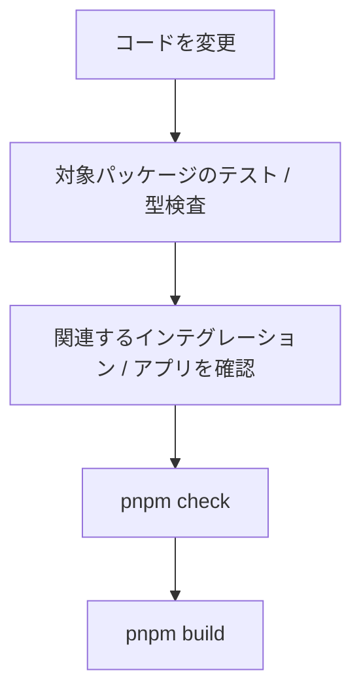
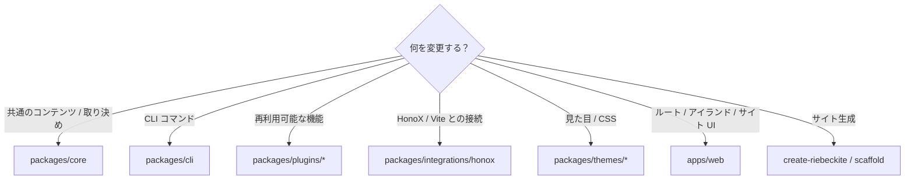
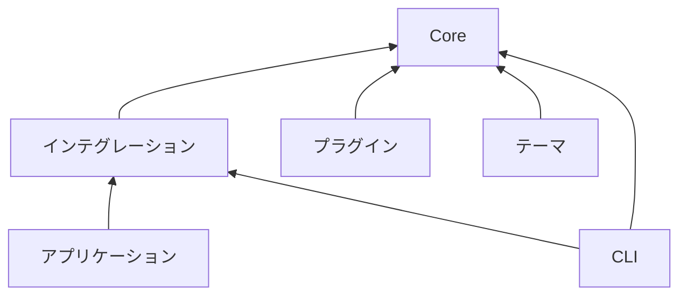

# 変更の流れ

## 変更時の検証フロー

必要な検証は変更内容によって異なりますが、基本的には**小さい範囲から確認し、最後に広い範囲を確認する**進め方を推奨します。



たとえばプラグインを変更した場合は、まずそのプラグインのテストを実行します。

```bash id="9dvfqe"
pnpm --filter <plugin-package> test
```

問題がなければ、必要に応じて型検査や参照アプリの確認を行い、最後にリポジトリ全体の検証を行います。変更のたびに最初から最も重いコマンドを実行する必要はありません。

## 変更する場所を選ぶ

機能を追加するときは、まず責務に合ったパッケージを選びます。



判断に迷う場合は、[Architecture](../architecture.ja.md) の責務分離を基準にしてください。

## パッケージの境界

フレームワークを変更するときは、パッケージ間の依存方向を維持してください。大まかな依存関係は次のとおりです。



特に重要なのは、Core から外側への逆依存を作らないことです。たとえば、Core を次のような具体的な実装に依存させてはいけません。

```text id="7nxphg"
apps/web
packages/plugins/*
HonoX
Vite
```

フレームワークに依存しない取り決めは Core に置き、その取り決めをインテグレーションやプラグインが利用します。
