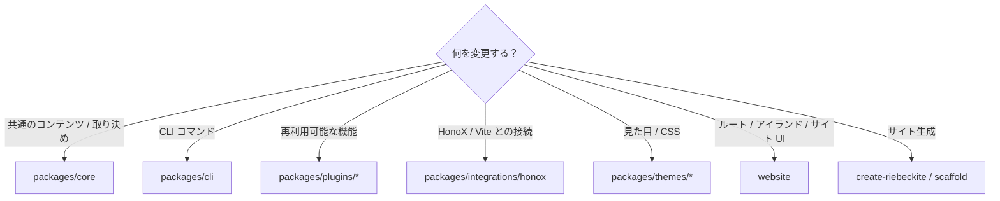
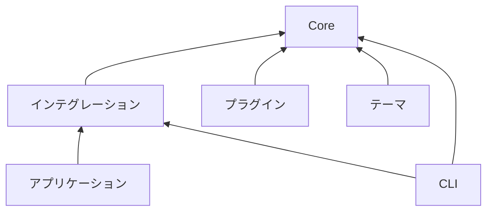

# 変更の流れ

## 変更時の検証フロー

必要な検証は変更内容によって異なりますが、基本的には**小さい範囲から確認し、最後に広い範囲を確認する**進め方を推奨します。


たとえばプラグインを変更した場合は、まずそのプラグインのテストを実行します。

```bash id="9dvfqe"
pnpm --filter <plugin-package> test
```

問題がなければ、必要に応じて型検査や参照アプリの確認を行い、最後にリポジトリ全体の検証を行います。変更のたびに最初から最も重いコマンドを実行する必要はありません。

## 変更する場所を選ぶ

機能を追加するときは、まず責務に合ったパッケージを選びます。



判断に迷う場合は、[Architecture](../architecture.ja.md) の責務分離を基準にしてください。

新しい公開 API や Core の振る舞いを追加する前に、[設計思想](../../philosophy.ja.md) の設計判断のガイドラインを確認してください。

## 記録が必要か判断する

pull request を開く前に、次を確認してください。

1. **ADR が必要か。** 公開契約の変更、アーキテクチャ境界の変更、原則からの意図的な逸脱、セキュリティまたは公開に関する例外、リリース方針の変更では必要です。[Architecture Decision Record](https://github.com/Rerurate514/riebeckite/blob/main/docs/agents/adr/README.md) を参照してください。
2. **変更エントリが必要か。** Riebeckite のパッケージをインストールした利用者が観測できる変更では必要です。`changes/unreleased/` に追加し、`pnpm changelog` を実行します。
3. **破壊的変更か。** 利用者がコードや設定を変更する必要がある場合は `breaking: true` にし、移行手順を書きます。1.0 前はマイナーリリースに含められますが、1.0 以降はメジャーリリースが必要です。
4. **移行ガイドが必要か。** 移行手順が数行を超える場合は必要です。エントリとリリースノートからリンクしてください。
5. **設計思想と矛盾しないか。** 意図的な逸脱なら ADR に記録します。意図しない逸脱なら実装を直します。

通常の内部修正に ADR や変更エントリを要求しないでください。CI が検証するのはエントリの形式と生成ファイルであり、記録が必要だったかどうかではありません。

## パッケージの境界

フレームワークを変更するときは、パッケージ間の依存方向を維持してください。大まかな依存関係は次のとおりです。



特に重要なのは、Core から外側への逆依存を作らないことです。たとえば、Core を次のような具体的な実装に依存させてはいけません。

```text id="7nxphg"
website
packages/plugins/*
HonoX
Vite
```

フレームワークに依存しない取り決めは Core に置き、その取り決めをインテグレーションやプラグインが利用します。
