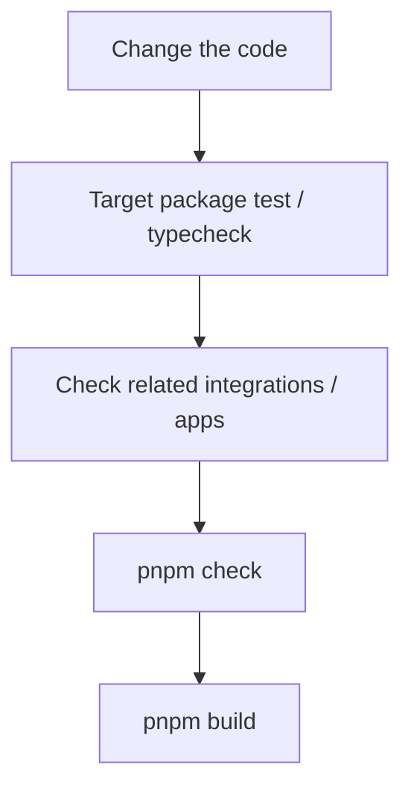
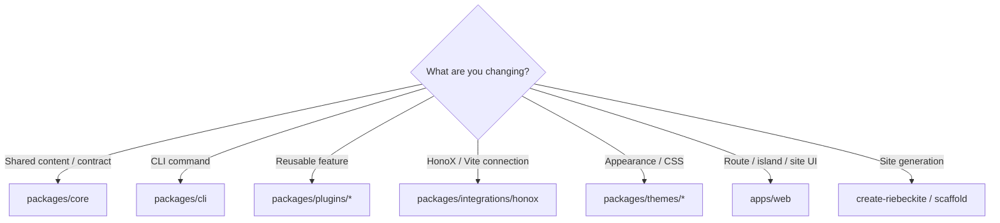
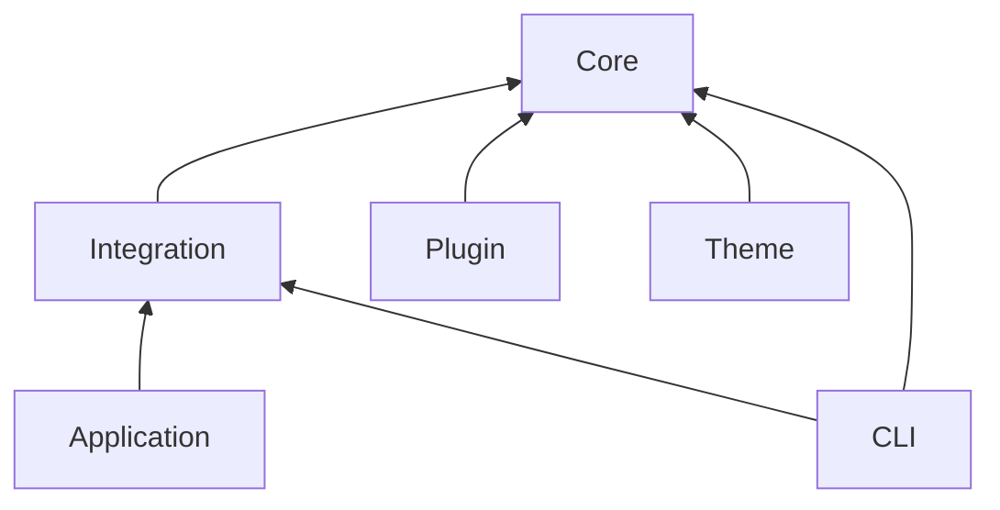

# Workflow

## Basic change flow

The checks you need depend on the change, but the basic approach is to **verify a small scope first and widen it at the end**.



For example, if you change a plugin, run that plugin's tests first:

```bash
pnpm --filter <plugin-package> test
```

If that passes, run type checking or check the reference app as needed, and finally run the repository-wide checks. You do not need to run the heaviest command from scratch on every change.

## Where to make the change

When adding a feature, first pick the package that matches the responsibility.



If you are unsure, use the responsibility boundaries in [Architecture](../architecture.md) as the standard.

Before adding a new public API or a new Core behavior, use the Design Decision Guidelines in [Design Philosophy](../../philosophy.md).

## Decide what to record

Before opening a pull request, answer these questions:

1. **Is an ADR needed?** Yes for a public contract change, an architecture boundary change, an intentional exception to a principle, a security or publication exception, or a release policy change. See [Architecture Decision Records](../../../agents/adr/README.md).
2. **Is a change entry needed?** Yes when someone who installs a Riebeckite package can observe the change. Add it under `changes/unreleased/` and run `pnpm changelog`.
3. **Is it a breaking change?** If users must change code or configuration, set `breaking: true` and write migration steps. Before 1.0, a minor release may carry the change; after 1.0 it needs a major release.
4. **Is a migration guide needed?** Yes when the migration is longer than a few steps. Link it from the entry and the release notes.
5. **Does it conflict with Design Philosophy?** If it is an intentional exception, record the ADR. If it is accidental, change the implementation.

Do not add an ADR or change entry for an ordinary internal fix. CI validates the format of entries and generated files, not whether a change needed one.

## Package boundaries

When changing the framework, keep the dependency direction between packages intact. The rough dependency relationship is:



In particular, do not create a reverse dependency from Core to the outside. For example, Core must not depend on concrete implementations such as:

```text
apps/web
packages/plugins/*
HonoX
Vite
```

Put framework-independent contracts in Core, and have integrations and plugins use those contracts.
