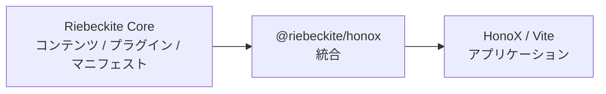
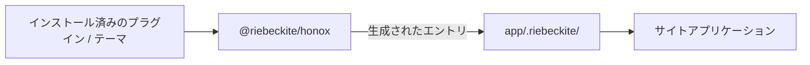
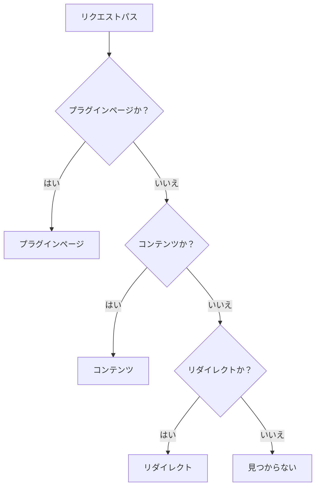
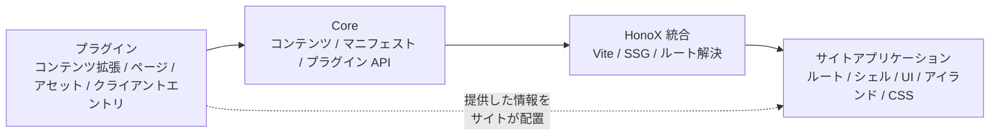

# HonoX との統合

`@riebeckite/honox` は、Riebeckite Core と HonoX / Vite を接続する統合パッケージです。

Core はコンテンツとプラグインの処理を担当しますが、HonoX のルートや Vite のビルド方法については知りません。その間を接続するのが `@riebeckite/honox` です。



主に次の処理を担当します。

- アプリケーションルートと設定の解決
- Vite の開発とビルド
- SSG の設定
- プラグインとテーマのスタイルエントリ生成
- クライアントエントリの生成
- Riebeckite のコンテンツと HonoX アプリケーションの接続

これにより、通常のサイトは Riebeckite 内部の Vite / HonoX 設定を毎回組み立てる必要がありません。

生成されるクライアントモジュールは、オプトインの SPA ランタイムを接続する場所でもあります。[SPA ランタイムの内部実装](./spa-runtime.ja.md) を参照してください。


## このページの構成

- [UI プリミティブ](./honox-integration/ui.ja.md)
- [サイトアプリケーションの責務](./honox-integration/site.ja.md)

## `riebeckiteVite()` で Riebeckite を HonoX に接続する

通常は `vite.config.ts` で `riebeckiteVite()` を登録します。

```ts
import { riebeckiteVite } from "@riebeckite/honox";
import { defineConfig } from "vite";

export default defineConfig({
  plugins: [honox({ ... }), ...riebeckiteVite(), build()],
});
```

`riebeckiteVite()` は通常のサイト向けの高レベルヘルパーです。Riebeckite の Vite プラグインを追加するだけでなく、次の設定もまとめて行います。

- SSG エントリの設定
- 拡張マッピングの設定
- SSR に必要な外部依存の設定
- プラグインとテーマの生成エントリの接続

HonoX プラグイン、デプロイ用のビルドプラグイン、Tailwind など、サイト自身が必要とする Vite プラグインと組み合わせて利用できます。

## プラグイン UI コンポーネントを宣言的に配置する

プラグインの UI コンポーネントは、それぞれのパッケージからインポートし、既定のデータは `@riebeckite/ui` のコンテキストから解決します。サイト側は配置を決めるだけでよく、通常の記事 UI のためにマニフェストを検索したり、プラグインヘルパーを呼び出したりする必要はありません。

```tsx
import { SiteProvider } from "@riebeckite/ui";
import { Article, ArticleBody } from "@riebeckite/honox/ui";
import { Backlinks } from "@riebeckite/plugin-backlinks";
import { ShareControls } from "@riebeckite/plugin-share";

<SiteProvider config={config} manifest={manifest} view={view} path={c.req.path}>
  <Article post={post} entry={entry}>
    <ArticleBody />
    <Backlinks />
    <ShareControls />
  </Article>
</SiteProvider>;
```

`SiteProvider` には `createPublicContentView(manifest)` などで作成した公開コンテンツビューを渡します。`Article` は `post` と公開された `entry` を受け取ると、記事のコンテキストを提供します。必要なコンテキストがないコンポーネントは何も描画しないため、共通レイアウトに置いても安全です。明示的なコンポーネント prop も引き続き利用でき、コンテキストより優先されます。サイト独自のデータ構成が必要な場合は、エクスポートされている純粋なデータヘルパーを使用してください。

依存方向は `plugin → @riebeckite/ui ← honox` です。HonoX のプラグインバレルからプラグイン UI をインポートしないでください。

## アプリケーションルートと設定の解決

`riebeckiteVite()` では、必要に応じて次の場所を指定できます。

| オプション | 意味 |
| --- | --- |
| `appRoot` | サイトアプリケーションの基準ディレクトリ |
| `configRoot` | Riebeckite の設定を探す基準 |
| `configFile` | 使用する設定ファイル |
| `workspaceRoot` | monorepo 開発時のワークスペースルート |

通常は指定する必要はありません。

`appRoot` の既定値は Vite のルート、`configRoot` の既定値は `appRoot` です。Riebeckite の設定は `configRoot` を基準に読み込みます。一方、次のようなコンテンツディレクトリは `appRoot` を基準に解決します。

```ts
content: {
  directory: "./content",
}
```

`resolveHonoxApplication()` は、これらのルートと解決済みの設定をまとめて返します。CLI と Vite がこの共通モデルを利用することで、アプリケーションの解決方法が両者で食い違わないようにしています。

### `workspaceRoot`

`workspaceRoot` は、Riebeckite 自体を monorepo で開発するときに、ソースパッケージのエイリアスを利用するための設定です。

npm から Riebeckite をインストールした通常のサイトでは必要ありません。その場合、パッケージはサイト自身の `node_modules` から解決されます。

## `.riebeckite` に生成される接続ファイル

統合パッケージは、プラグインやテーマを接続するためのファイルを、アプリケーション内の次のディレクトリへ生成します。

```text
app/.riebeckite/
```

たとえば、プラグインのスタイルやテーマのスタイルが生成されます。クライアントモジュールは `.riebeckite` には生成されず、仮想モジュールとして提供されます。



`.riebeckite` は統合パッケージが管理する生成物です。

**サイトのソースコードとして直接編集しないでください**。

## ブートストラップモジュールが設定とコンテンツを供給する

生成されたサイトは、フレームワークが提供するブートストラップモジュールをインポートします。解決済みの設定は `virtual:riebeckite/config`、構成済みのコンテンツランタイムは `virtual:riebeckite/content` です。そのため `app/config.ts`、`app/content.ts`、`app/constants/paths.ts` は生成されません。SSG エントリの `app/server.ts` はこの2つを再エクスポートし、`riebeckiteSsg` はそこからマニフェストを見つけます。

Vite の外で動くスクリプト（`tsx` で起動する Node スクリプトなど）でも同じ設定を解決できます。`@riebeckite/honox/runtime` の `resolveHonoxConfig` を使用します。

## 下位レベルの API で統合を制御する

統合処理をより細かく制御したい場合は、下位レベルの API も利用できます。

- `riebeckite`（Vite プラグイン）
- `riebeckiteSsg`（静的生成）
- `riebeckiteSsgExtensionMap`
- `createRiebeckiteSsg`（Riebeckite の既定値を埋める SSG ラッパー）

通常のサイトでは `riebeckiteVite()` を利用し、独自のビルド統合が必要な場合に限って下位レベルの API を使用してください。

`riebeckiteSsg` は内部の Vite サーバーを、解決済みのアプリケーションルートと define 値で起動します。そのため、サブディレクトリから `riebeckite build` を実行しても、アプリケーションルートから実行した場合と同じ出力になります。`defaultSsgEntry` はルートからの相対パス `./app/server.ts` で、`defaultSsrExternals` は両方のヘルパーが使う SSR の外部依存リストです。

SSG エントリは、解決済みの `config` と `content` を再エクスポートする必要があります。

```ts
export { config, content }
```

`riebeckiteSsg` はこれによってマニフェストを見つけ、プラグインが生成する出力の書き出しと、ページごとの HTML 検査を行います。そのほかのエクスポートは `loadRiebeckiteConfig`、`resolveHonoxApplication`、`resolveHonoxApplicationRoot`、`buildHonoxApplication`、`startHonoxDevServer` です。

## ルーティングと SSG で同じ URL を同じページとして扱う

HonoX の実行時ルーティングと静的生成では、同じ URL が同じページとして扱われる必要があります。特に catch-all ルートがある場合、SSG のルート列挙には注意が必要です。

Riebeckite はこのための2つのヘルパーを提供します。

### `contentRouteSsgParams`

```ts
contentRouteSsgParams(routePath, params)
```

`hono/ssg` の `ssgParams` の代わりに使用します。

このヘルパーは、そのルート自身に属するパラメータだけを返します。

たとえば、次のような catch-all ルートがあっても、

```text
/:slug{.+}
```

次のルートに属するページまで横取りしません。

```text
/tags/:slug{.+}
```

### `ssgEnumerableHandler`

```ts
ssgEnumerableHandler(handler)
```

`next()` を使って兄弟ルートに処理を渡すハンドラーを、SSG の列挙対象として残すためのヘルパーです。

Hono はミドルウェア形式のハンドラーを通常は SSG の列挙対象から外すため、このヘルパーがその差を補います。

## プラグインページをルート解決に組み込む

プラグインは通常のコンテンツとは別に、独自のページを提供できます。

その場合は、

```ts
resolveContentRoute(manifest, path)
```

ではなく、

```ts
resolveRiebeckiteRoute(content, path)
```

を使用します。

SSG のパラメータには、次のヘルパーを追加します。

```ts
pluginPageSsgParams(content)
```

生成されたサイトの catch-all ルートは、これらをまとめた `resolveRiebeckiteContentRequest(c, content)` を使用します。このヘルパーはコンテンツ、プラグインページ、リダイレクト、見つからないページを解決します。さらに `htmlLanguage` と `headTags` をコンテキストへ設定するため、サイトは返された結果を自身の構成に渡すだけで済みます。ルート `/` も、同じ仕組みを共有する `resolveRiebeckiteHomeRequest(c, content)` で解決します。

ルートリゾルバーは次の順序で URL を解決します。



プラグインページの本文は意図的に文字列として扱います。サイトの既存ドキュメントフレーム内に描画し、`page.headTags` もサイトのフレームへ渡します。

この仕組みにより、プラグインが独自ページを提供するためだけに HonoX のルートファイルを追加する必要はありません。

## 統合の境界を保つ

Riebeckite のルーティングでは、すでに解決された公開 URL を使用します。

基本的には、次の順でリクエストを解決します。

```text
byPermalink
    ↓
redirects
```

ファイルシステムのパスやディレクトリ構造から公開 URL を逆算しません。

また、`slug` はコンテンツを内部で検索するためのキーです。実際に公開される URL は、解決済みの `permalink` です。

### 責務の分担

Riebeckite 全体では、次のように責務を分離します。



HonoX、Vite、Cloudflare、ルーティングの API は、このパッケージか `apps/web` に置きます。Core は移植性を保ち、HonoX のルーティングを所有しません。プラグインはアセット、クライアントエントリ、エンドポイント、レンダラーを公開できますが、Core が HonoX のルーターになることはありません。具体的なルート構成やアイランドはアプリケーションが決めます。

**Core はコンテンツを扱い、統合パッケージは HonoX と接続し、プラグインは機能を提供し、サイトが最終的な表示を決める**、という境界を維持してください。

ビルド状態の扱いについては [ビルドシステム](./build-system.ja.md)、パッケージごとの責務については [アーキテクチャ](./architecture.ja.md) を参照してください。
