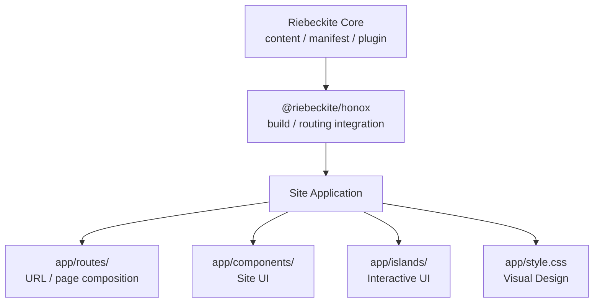

# サイトアプリケーションの責務

Riebeckite のサイトは、最終的には通常の [[framework/honox-integration|HonoX]] アプリケーションです。

`@riebeckite/honox` はコンテンツとビルドをつなぎますが、実際にユーザーが見る [[glossary/ui|UI]] の設計はサイトが管理します。通常の HonoX で編集する手順は [サイトのカスタマイズ](../../guides/customizing-your-site.ja.md) を参照してください。



### ディレクトリの責務

| ディレクトリ | サイトが持つ責務 |
| --- | --- |
| `app/routes/` | URL 処理、ページ構成、リダイレクト、レスポンスメタデータ |
| `app/components/` | サイト固有の UI |
| `app/islands/` | 対話 UI とクライアント側の状態 |
| `app/style.css` | 色、レイアウト、タイポグラフィ、拡張スタイル |

`app/routes/_renderer.tsx` はサイト全体のシェルです。

ここでは主に、

- ドキュメントの head
- ナビゲーション
- ページ全体の枠
- アプリケーションのクライアントエントリ

を管理します。

ルートは `ContentManager` からコンテンツを取得し、

```ts
resolveRiebeckiteRoute(content, c.req.path)
```

でリクエスト URL を解決します。

その結果をどのコンポーネントツリーで表示するかは、サイトが決めます。

Riebeckite リポジトリにある `website` は実装例の 1 つであり、外部のサイトが同じレイアウトを使う必要はありません。

## head タグ

プラグインがドキュメントの head に情報を追加したい場合は、

```ts
ContentManifestEntry.headTags
```

へ `meta` / `link` / `script` を記述します。プラグイン自身が `<head>` を描画するわけではありません。

`resolveRiebeckiteContentRequest` / `resolveRiebeckiteHomeRequest` が、解決したエントリの `headTags` をルートのコンテキストへ設定します。`_renderer.tsx` がそれを読み取って描画します。

```tsx
import { PluginHeadTags } from "@riebeckite/honox/ui";

const headTags = c.get("headTags") ?? [];

<head>
  <PluginHeadTags tags={headTags} />
</head>;
```

つまり、

```text
Plugin
  ↓ headTags を提供
Framework resolver
  ↓ context へ設定
_renderer.tsx
  ↓
<head> に描画
```

という関係です。

たとえば `@riebeckite/plugin-discord-embed` は、この仕組みを使って `theme-color` を提供します。プラグインは `<head>` 自体やタグの並び順を所有しません。

### RiebeckiteHead と PluginHeadTags

`@riebeckite/honox/ui` から公開される 2 つのプリミティブは、head の組み立てにおける責務を分けます。

#### `RiebeckiteHead`

```tsx
import { RiebeckiteHead } from "@riebeckite/honox/ui";

<RiebeckiteHead title="My Site" headTags={[]} />
```

フレームワークが次の標準的な head 要素を描画します。

- `<meta charset="utf-8">`
- `<meta name="viewport" content="width=device-width, initial-scale=1.0">`
- `<title>`（title プロパティが提供する値）
- `<link rel="icon" href="/favicon.ico">`（faviconHref プロパティで上書き可能。null で省略可）
- `<ColorModeScript />`（colorModeScript プロパティで制御。既定は true）
- スタイルシートのエントリ（stylesheets プロパティ。既定は `["/app/style.css"]`）
- クライアントスクリプトのエントリ（clientSrc プロパティ。既定は `"/app/client.ts"`、null で省略可）
- `PluginHeadTag` の値の変換（headTags プロパティ）
- 子要素（children プロパティ）は標準要素の後に追加

`RiebeckiteHead` は `<head>` 要素そのものを描画しません。サイトが `<head>` の所有権を保持し、その中に `RiebeckiteHead` を配置できます。

#### `PluginHeadTags`

```tsx
import { PluginHeadTags } from "@riebeckite/honox/ui";

<PluginHeadTags tags={headTagsFromManifest} />
```

`PluginHeadTag` の値（meta / link / script）を JSX 要素に変換します。`RiebeckiteHead` を使わず、サイトが自分で head を組み立てるときに使います。

#### 使用例

サイトが `<head>` の所有権を保ちながら、標準の head をフレームワークに任せる場合：

```tsx
import { RiebeckiteHead, ThemeRoot } from "@riebeckite/honox/ui";
export default jsxRenderer(({ children }, c) => (
  <ThemeRoot
    theme={config.theme}
    lang={c.get("htmlLanguage") ?? config.site.locale}
  >
    <head>
      <RiebeckiteHead
        title={config.site.title}
        headTags={c.get("headTags") ?? []}
      />
      <meta name="custom-site-value" content="..." />
    </head>
    <body class="riebeckite-page rb-site">{children}</body>
  </ThemeRoot>
));
```

フレームワークは、標準的な head の描画と theme-root 属性の導出を担当します。head の描画には、charset、viewport、既定の title、favicon の配線、カラーモードの初期化が含まれます。スタイルシートとクライアントエントリの配線、PluginHeadTag の変換も含まれます。サイトは `<head>` と `<body>` の構成、およびカスタムの meta / link / script の所有権を保持します。favicon のファイル（`/public/favicon.ico`）はサイトが所有し、既定の link の配線だけをフレームワークが担います。

プラグインが head タグを提供する場合も、既存の `headTags` の仕組みはそのまま機能します。`RiebeckiteHead` と `headTags` は併用できます。

## プラグイン UI の組み立て

プラグインは `headTags` を提供し、データヘルパーと JSX コンポーネントを公開します。サイトは自分の TSX でこれらのコンポーネントを組み立て、それぞれの表示有無、位置、頻度を決めます。各プラグインのデータヘルパーは `PublicContentView`（または同様にフィルタされたファサード）を受け取り、型付きのモデルを返します。その後、コンポーネントはサイトの[[glossary/article-layout|記事レイアウト]]やページテンプレートで直接描画されます。

プラグイン UI は明示的に組み立てます。

```tsx
const view = createPublicContentView(manifest);
const entry = view.findRoutableBySlug(slug);
const backlinks = await getBacklinks({ view, slug });
<Backlinks backlinks={backlinks} />
```

と

```tsx
const data = getProperties({ view, frontmatter: entry.frontmatter });
<Properties data={data} />
```

サイトがレイアウトの配置を決めます。プラグインのコンポーネントは、選択的な CSS とクライアントエントリをエクスポートでき、インテグレーションを通じて登録されます。

## SiteConfig の構造

`packages/core/src/types/site_config.ts` の `SiteConfig` インターフェースは、サイトのメタデータを定義します。

| フィールド | タイプ | 説明 |
| --- | --- | --- |
| `title` | `string` | `<title>` と見出しで使用されます |
| `description` | `string \| undefined` | サイトの説明のメタタグ |
| `author` | `string \| undefined` | メタデータの著者名 |
| `baseUrl` | `string \| undefined` | サイトの基本 URL（例：`https://example.com`） |
| `locale` | `string \| undefined` | ロケールコード（例：`en`、`ja`） |
| `twitterSite` | `string \| undefined` | Twitter カードの帰属を示す `@` ハンドル |
| `defaultOgImage` | `string \| undefined` | ページごとの画像がない場合の `og:image` の既定値 |
| `feed` | `feed \| undefined` | RSS / Atom フィードの設定（title、description、language） |

各フィールドは次のように使われます。

- **title**: 文書の `<title>` とページ見出しに使われます
- **description**: `<meta name="description">` タグとして追加されます
- **author**: 著者メタデータと schema.org のマークアップに追加されます
- **baseUrl**: 正規 URL とサイトマップの生成に使われます
- **locale**: `<html>` の `lang` 属性を設定し、書式に影響します
- **twitterSite**: Twitter カードのメタデータに追加されます
- **defaultOgImage**: ページごとの画像がない場合の `og:image` の既定値として使われます
- **feed**: サイトの RSS / Atom フィードの生成に使われます

```ts
export interface SiteConfig {
  title: string;
  description?: string;
  author?: string;
  baseUrl?: string;
  locale?: string;
  twitterSite?: string;
  defaultOgImage?: string;
  feed?: {
    title?: string;
    description?: string;
    language?: string;
  };
}
```

## フィールドがサイト全体で使われる流れ

上記のフィールドは、`@riebeckite/honox` インテグレーション（`packages/core/src/`）を通じて最終的な公開 UI の組み立てに流れます。`title` と `description` は `<head>` に表示され、`author` と `twitterSite` はソーシャルメタデータに、`baseUrl` は URL 生成に、`locale` は `lang` 属性に影響します。

## 関連用語

- [[glossary/obsidian-vault|Obsidian Vault]]
- [[tag|Tag]]
- [[shortcode|Shortcode]]
- [[callout|Callout]]
- [[sidenote|Sidenote]]
- [[backlink|Backlink]]
- [[glossary/ui|UI]]
