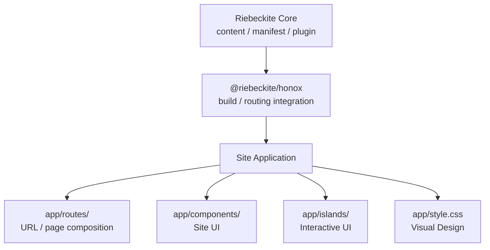

# Site Application の責務

Riebeckite Site は、最終的には通常の HonoX application です。

`@riebeckite/honox` は content と build を接しますが、実際にユーザーが見る UI の設計は Site が管理します。通常の HonoX で編集する手順は [サイトのカスタマイズ](../../guides/customizing-your-site.ja.md) を参照してください。



### ディレクトリの責務

| ディレクトリ | Site が持つ責務 |
| --- | --- |
| `app/routes/` | URL処理、ページ構成、redirect、response metadata |
| `app/components/` | Site 固有の UI |
| `app/islands/` | 対話 UI と client-side state |
| `app/style.css` | 色、layout、typography、extension style |

`app/routes/_renderer.tsx` は Site 全体の shell です。

ここでは主に、

- document head
- navigation
- page chrome
- application client entry

を管理します。

Route は `ContentManager` からコンテンツを取得し、

```ts
resolveRiebeckiteRoute(content, c.req.path)
```

で request URL を解決します。

その結果をどの component tree で表示するかは Site が決定します。

Riebeckite repository にある `apps/web` は実装例の1つであり、外部 Site が同じ layout を使う必要はありません。

## Head Tags

Plugin が document head に情報を追加したい場合は、

```ts
ContentManifestEntry.headTags
```

へ `meta` / `link` / `script` を記述します。

Plugin 自身が `<head>` を描画するわけではありません。

`resolveRiebeckiteContentRequest` / `resolveRiebeckiteHomeRequest` が、解決した entry の `headTags` を route context へ設定します。`_renderer.tsx` がそれを読み取って描画します。

```tsx
import { PluginHeadTags } from "@riebeckite/honox/ui";

const headTags = c.get("headTags") ?? [];

<head>
  <PluginHeadTags tags={headTags} />
</head>;
```

つまり、

```text
Plugin
  ↓ headTags を提供
Framework resolver
  ↓ context へ設定
_renderer.tsx
  ↓
<head> に描画
```

という関係です。

たとえば `@riebeckite/plugin-discord-embed` は、この仕組みを使って `theme-color` を提供します。

Plugin は `<head>` 自体や tag の並び順を所有しません。

### RiebeckiteHead と PluginHeadTags

`@riebeckite/honox/ui` より公開される 2 つの primitive は、head composition の責務分離を明確にします。

#### `RiebeckiteHead`

```tsx
import { RiebeckiteHead } from "@riebeckite/honox/ui";

<RiebeckiteHead title="My Site" headTags={[]} />
```

Framework が次の標準的な head contents を描画します。

- `<meta charset="utf-8">`
- `<meta name="viewport" content="width=device-width, initial-scale=1.0">`
- `<title>`（title prop が提供する値）
- `<link rel="icon" href="/favicon.ico">`（faviconHref プロップで上書き可能、null で省略可）
- `<ColorModeScript />`（colorModeScript プロップで制御、default true）
- stylesheet entries（stylesheets プロップ、default `["/app/style.css"]`）
- client script entry（clientSrc プロップ、default `"/app/client.ts"`、null で省略可）
- `PluginHeadTag` values の変換（headTags プロップ）
- 子要素（children prop）は標準の後に追加

`RiebeckiteHead` は `<head>` 要素自身を描画しません。Site は `<head>` の ownership を保持し、その中に `RiebeckiteHead` を配置できます。

#### `PluginHeadTags`

```tsx
import { PluginHeadTags } from "@riebeckite/honox/ui";

<PluginHeadTags tags={headTagsFromManifest} />
```

`PluginHeadTag` values (meta / link / script) を JSX 要素に変換します。`RiebeckiteHead` を使わず、Site が自分で head を組み立てる際に使用します。

#### 使用例

Site が `<head>` 所有権を維持しつつ標準 head をFrameworkに任せる場合：

```tsx
import { RiebeckiteHead, ThemeRoot } from "@riebeckite/honox/ui";
export default jsxRenderer(({ children }, c) => (
  <ThemeRoot
    theme={config.theme}
    lang={c.get("htmlLanguage") ?? config.site.locale}
  >
    <head>
      <RiebeckiteHead
        title={config.site.title}
        headTags={c.get("headTags") ?? []}
      />
      <meta name="custom-site-value" content="..." />
    </head>
    <body class="riebeckite-page rb-site">{children}</body>
  </ThemeRoot>
));
```

Frameworkは標準 head rendering メカニクスと theme-root attribute 導出を担当します。head rendering メカニクスには charset、viewport、default title、favicon wiring、color-mode bootstrap が含まれます。stylesheet/client entry wiring、PluginHeadTag 変換も含まれます。Site は `<head>`/`<body>` 構成とカスタム meta/link/script の所有権を保持します。favicon FILE (`/public/favicon.ico`) は Site-owned のまま、default link wiring にのみ Framework が所有権を持ちます。

Plugin が head tags を提供する場合は、既存の `headTags` メカニズムはそのまま機能します。`RiebeckiteHead` と `headTags` は併用可能です。

## Plugin UI 組み立て

Plugin は `headTags` を貢献し、データヘルパーと JSX コンポーネントを公開します。Site は自分の TSX でこれらのコンポーネントを組み立て、それぞれの表示有無、位置、頻度を決めます。各 Plugin のデータヘルパーは `PublicContentView`（または同様のフィルタされたファサード）を受け取り、型付き model を返します。その後、component はサイトの記事レイアウトやページテンプレートで直接描画されます。

`ContentManifestEntry` に `bodySlots` フィールドはありません。代わりに、Plugin UI は明示的に composition されます：

```tsx
const view = createPublicContentView(manifest);
const entry = view.findRoutableBySlug(slug);
const backlinks = await getBacklinks({ view, slug });
<Backlinks items={backlinks} />
```

と

```tsx
const data = getProperties({ view, frontmatter: entry.frontmatter });
<Properties data={data} />
```

Site はレイアウトの配置を決定します。累積された `bodySlots` map も `ContentSlot` プリミティブもありません。Plugin コンポーネントは選択的な CSS と client entry をエクスポートでき、integration を通じて登録されます。

以前、 "Body Slots" セクションは廃止された slot システムを文書化していました。このシステムは Phase 4 で完全に削除されました。すべての UI は現在、Site TSX で plugin データヘルパーと component を使用して明示的に composition されます。

## SiteConfig 構造

`packages/core/src/types/site_config.ts` から全 `SiteConfig` インターフェースはサイトのメタデータを定義します：

| フィールド | タイプ | 説明 |
| --- | --- | --- |
| `title` | `string` | `<title>` と見出しで使用されます |
| `description` | `string \| undefined` | site description meta tag |
| `author` | `string \| undefined` | メタデータの著者名 |
| `baseUrl` | `string \| undefined` | サイトの基本URL（例：`https://example.com`） |
| `locale` | `string \| undefined` | ロケールコード（例：`en`、`ja`） |
| `twitterSite` | `string \| undefined` | Twitter `@` ハンドル カード帰属 |
| `defaultOgImage` | `string \| undefined` | ページごとの image が提供されない場合の `og:image` のデフォルト値 |
| `feed` | `feed \| undefined` | RSS/Atom フィードの設定（title、description、language） |

各フィールドは以下のように使用されます：
- **title**: 文書 `<title>` とページ見出しでレンダリングされます
- **description**: `<meta name="description">` タグとして追加されます
- **author**: 著者メタデータと schema.org マークアップに追加されます
- **baseUrl**: 正規URLとsitemapの生成に使用されます
- **locale**: `<html>` の `lang` 属性を設定し、フォーマットに影響を与えます
- **twitterSite**: Twitter card メタデータに追加されます
- **defaultOgImage**: ページごとの image が提供されない場合の `og:image` のデフォルト値として使用されます
- **feed**: サイトの RSS/Atom フィードを生成するために使用されます

```ts
export interface SiteConfig {
  title: string;
  description?: string;
  author?: string;
  baseUrl?: string;
  locale?: string;
  twitterSite?: string;
  defaultOgImage?: string;
  feed?: {
    title?: string;
    description?: string;
    language?: string;
  };
}
```

## フィールドのサイト全体での使用

上記のフィールドは、`@riebeckite/honox` integration (`packages/core/src/`) を通じて最終的な公開 UI を組み立てるために流れます。`title` と `description` は `<head>` に表示され、`author` と `twitterSite` はソーシャルメタデータに、`baseUrl` は URL 生成に、`locale` は `lang` 属性に影響を与えます。

## 関連用語

- [[glossary/obsidian-vault|Obsidian Vault]]
- [[tag|Tag]]
- [[shortcode|Shortcode]]
- [[callout|Callout]]
- [[sidenote|Sidenote]]
- [[backlink|Backlink]]
- [[glossary/ui|UI]]