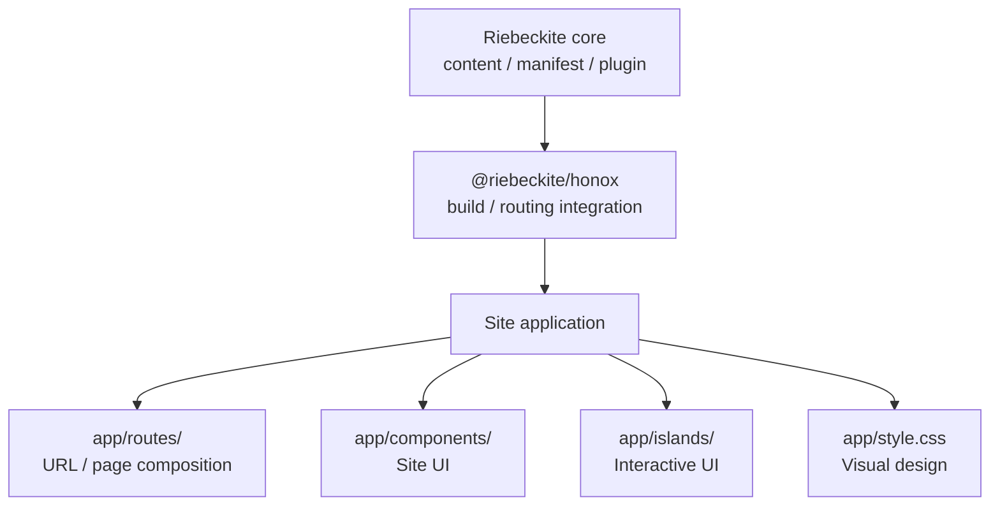
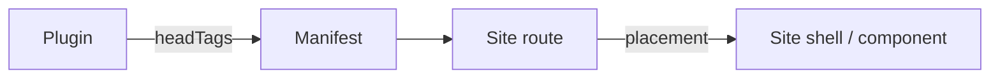

# Site application contract

A Riebeckite site is a normal HonoX application. The integration supplies
content and build wiring; the application owns every user-facing decision.
Keep the following source directories in the site, rather than in an
integration, theme, or plugin. For a walkthrough of editing them with ordinary
HonoX, see [Customizing Your Site](../../guides/customizing-your-site.md).



| Directory | Site-owned responsibility |
| --- | --- |
| `app/routes/` | URL handling, page composition, redirects, and response metadata |
| `app/components/` | Reusable site presentation and composition of the public UI primitives |
| `app/islands/` | Optional interactive UI and its client-side state |
| `app/style.css` and local CSS | Visual tokens, layout, typography, and imports of generated extension styles |

`app/routes/_renderer.tsx` is the site shell. It owns the document head,
navigation, page chrome, and the application client entry. A route resolves a
request with `resolveRiebeckiteContentRequest(c, content)` from
`@riebeckite/honox/server` — which also sets the `htmlLanguage` and `headTags`
context — then chooses its own component tree. When a route needs only route
resolution, without context assignment or loading the processed content, use the
lower-level `resolveRiebeckiteRoute(content, c.req.path)`. The reference
application in `apps/web` is one implementation, not a required layout.

Plugins provide information and UI fragments; the site decides where they are
rendered:



## Head tag handoff

When a plugin provides document head tags, the shell still belongs to the
site. A plugin only describes `meta` / `link` / `script` on
`ContentManifestEntry.headTags`; it never renders them.
`resolveRiebeckiteContentRequest` / `resolveRiebeckiteHomeRequest` set the
resolved entry's tags into the route context, and `app/routes/_renderer.tsx`
decides whether to render them. A plugin does not own the `<head>` or the tag
order.

```tsx
// app/routes/_renderer.tsx
import { PluginHeadTags } from "@riebeckite/honox/ui";

const headTags = c.get("headTags") ?? [];

<head>
  <PluginHeadTags tags={headTags} />
</head>;
```

The flow is:

```text
Plugin
  ↓ provides headTags
Framework resolver
  ↓ sets them on the context
_renderer.tsx
  ↓
renders into <head>
```

For example, `@riebeckite/plugin-discord-embed`, which aligns the Discord embed
color, supplies `theme-color` through this contract.

### `RiebeckiteHead` and `PluginHeadTags`

`@riebeckite/honox/ui` provides two primitives that clarify the separation of
responsibilities between the framework and the site for head composition.

### `RiebeckiteHead`

```tsx
import { RiebeckiteHead } from "@riebeckite/honox/ui";

<RiebeckiteHead title="My Site" headTags={[]} />
```

The framework renders the standard head contents:

- `<meta charset="utf-8">`
- `<meta name="viewport" content="width=device-width, initial-scale=1.0">`
- `<title>` (the value provided by the `title` prop)
- `<link rel="icon" href="/favicon.ico">` (overridable via the `faviconHref` prop; pass `null` to omit)
- `<ColorModeScript />` (controlled by the `colorModeScript` prop, default `true`)
- stylesheet entries (via the `stylesheets` prop, default `["/app/style.css"]`)
- client script entry (via the `clientSrc` prop, default `"/app/client.ts"`; `null` omits it)
- conversion of `PluginHeadTag` values (via the `headTags` prop)
- child elements (via the `children` prop) appended after the standard ones

`RiebeckiteHead` does **not** render the `<head>` element itself. The site retains
ownership of `<head>` and can add custom meta/link/script alongside it.

### `PluginHeadTags`

```tsx
import { PluginHeadTags } from "@riebeckite/honox/ui";

<PluginHeadTags tags={headTagsFromManifest} />
```

Converts `PluginHeadTag` values (meta / link / script) into JSX elements. Use this
when the site composes its own head and does not use `RiebeckiteHead`.

For example, a site that keeps `<head>` ownership and uses `RiebeckiteHead`:

```tsx
import { RiebeckiteHead, ThemeRoot } from "@riebeckite/honox/ui";
export default jsxRenderer(({ children }, c) => (
  <ThemeRoot
    theme={config.theme}
    lang={c.get("htmlLanguage") ?? config.site.locale}
  >
    <head>
      <RiebeckiteHead
        title={config.site.title}
        headTags={c.get("headTags") ?? []}
      />
      <meta name="custom-site-value" content="..." />
    </head>
    <body class="riebeckite-page rb-site">{children}</body>
  </ThemeRoot>
));
```

The framework owns the standard head rendering mechanics (charset, viewport, default title, favicon wiring, color-mode bootstrap, stylesheet/client entry wiring, PluginHeadTag conversion) and theme-root attribute derivation. The site still owns `<head>`/`<body>` composition and can add custom meta/link/script. The favicon FILE (`/public/favicon.ico`) remains site-owned; only the default link wiring is framework-owned.

Plugin-provided head tags continue to work through the existing `headTags` mechanism. `RiebeckiteHead` and `headTags` can be used together.

## Plugin UI composition

Plugins contribute `headTags` and expose data helpers + JSX components. The Site composes these components in its own TSX, choosing whether, where, and how often to render each one. Each plugin's data helper receives a `PublicContentView` (or similar filtered facade) and returns a typed model; the component is then rendered directly by the site's article layout or page template.

There is no `bodySlots` field on `ContentManifestEntry`; instead, plugin UI is composed explicitly:

```tsx
const view = createPublicContentView(manifest);
const entry = view.findRoutableBySlug(slug);
const backlinks = await getBacklinks({ view, slug });
<Backlinks items={backlinks} />
```

and

```tsx
const data = await getProperties({ view, frontmatter: entry.frontmatter });
<Properties data={data} />
```

The Site decides layout placement — there is no accumulated `bodySlots` map or `ContentSlot` primitive. Plugin components may also export optional CSS and client entries, registered through the integration.

Previously, the "Body slot handoff" section documented the now-removed slot system. That system has been completely removed in Phase 4; all UI is now composed explicitly in Site TSX using plugin data helpers and components.

## SiteConfig Structure

The full `SiteConfig` interface from `packages/core/src/types/site_config.ts` defines the site metadata:

| Field | Type | Description |
| --- | --- | --- |
| `title` | `string` | Site title, used in `<title>` and headers |
| `description` | `string \| undefined` | Site description meta tag |
| `author` | `string \| undefined` | Author name, used in metadata |
| `baseUrl` | `string \| undefined` | Base URL for the site (e.g., `https://example.com`) |
| `locale` | `string \| undefined` | Locale code (e.g., `en`, `ja`) |
| `twitterSite` | `string \| undefined` | Twitter `@` handle for card attribution |
| `defaultOgImage` | `string \| undefined` | Default Open Graph image URL |
| `feed` | `feed \| undefined` | RSS/Atom feed configuration (title, description, language) |

Each field is used as follows:
- **title**: Rendered in the document `<title>` and page headers
- **description**: Added as a `<meta name="description">` tag
- **author**: Added to author metadata and schema.org markup
- **baseUrl**: Used for generating canonical URLs and sitemap
- **locale**: Sets the `lang` attribute on `<html>` and affects formatting
- **twitterSite**: Added to Twitter card metadata
- **defaultOgImage**: Used as the default `og:image` when no per-page image is provided
- **feed**: Used to generate the site's RSS/Atom feed

```ts
export interface SiteConfig {
  title: string;
  description?: string;
  author?: string;
  baseUrl?: string;
  locale?: string;
  twitterSite?: string;
  defaultOgImage?: string;
  feed?: {
    title?: string;
    description?: string;
    language?: string;
  };
}
```

## Field Usage Across the Site

The fields above flow through the `@riebeckite/honox` integration (`packages/core/src/`) to compose the final public UI. The `title` and `description` appear in `<head>`, `author` and `twitterSite` in social metadata, `baseUrl` in URL generation, and `locale` in the `lang` attribute.

## Related terms

- [[glossary/obsidian-vault|Obsidian Vault]]
- [[tag|Tag]]
- [[shortcode|Shortcode]]
- [[callout|Callout]]
- [[sidenote|Sidenote]]
- [[backlink|Backlink]]
- [[glossary/ui|UI]]