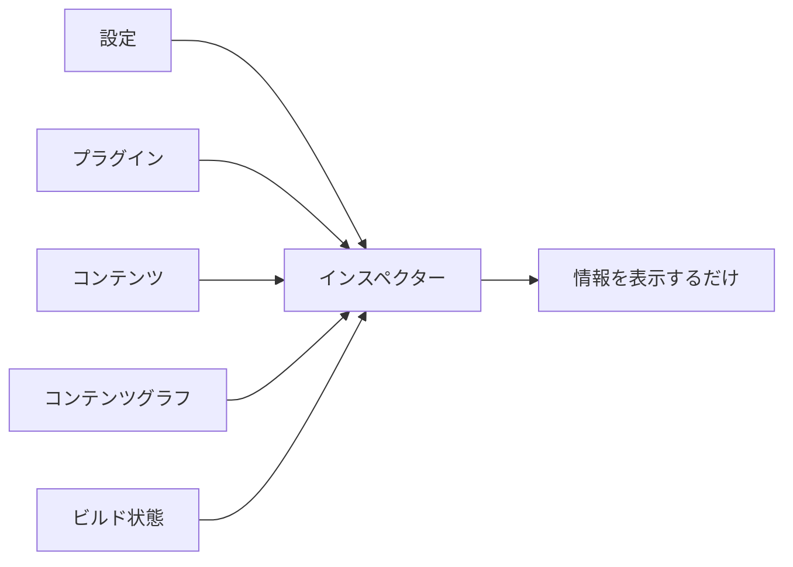
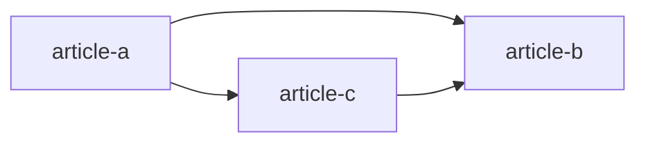
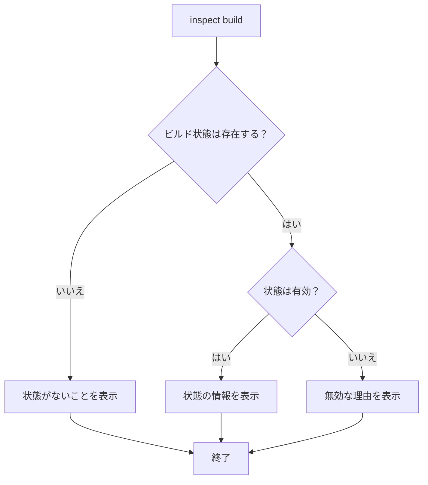
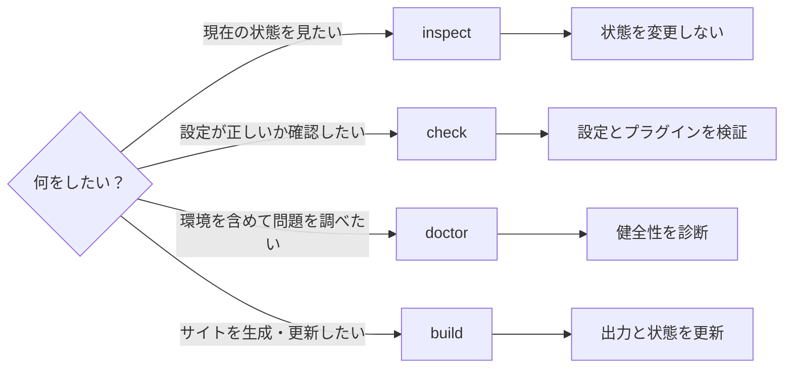

# インスペクター

インスペクターは、Riebeckite がすでに解決した設定やコンテンツ、プラグイン、ビルド状態を確認するための機能です。

簡単に言えば、**「Riebeckite から今どう見えているか」を調べるための読み取り専用ツール**です。

たとえば、

- 実際にどの設定が使われているか
- どのプラグインが有効になっているか
- 記事の最終的な URL は何か
- コンテンツ同士がどうつながっているか
- インクリメンタルビルドの状態は正常か

といった情報を確認できます。



インスペクターはこれらの情報を**確認するだけ**で、ビルドや設定の変更は行いません。

## 基本的な使い方

インスペクターには、確認したい対象ごとにコマンドがあります。

| コマンド | 確認できるもの |
| --- | --- |
| `riebeckite inspect config` | 解決済みの設定 |
| `riebeckite inspect plugins` | 有効になっているプラグイン |
| `riebeckite inspect content --list` | 公開コンテンツと URL |
| `riebeckite inspect graph` | コンテンツ同士の関係 |
| `riebeckite inspect build` | インクリメンタルビルドの状態 |

### 設定を確認する

```sh id="5zrcz3"
riebeckite inspect config
```

Riebeckite が実際に使用する**解決済みの設定**を確認します。

設定ファイルに書いた値そのものではなく、既定値などが適用された後の「Riebeckite が最終的に認識している設定」を確認したいときに使用します。

たとえば、

> 設定したはずなのに期待した動作にならない

という場合に、まず実際の設定値を確認できます。

### プラグインを確認する

```sh id="4g0qba"
riebeckite inspect plugins
```

現在有効になっているプラグインを確認します。

「プラグインを追加したつもりだけれど、本当に読み込まれているのか」を調べるときなどに利用できます。

### コンテンツを確認する

```sh id="v20yqo"
riebeckite inspect content --list
```

Riebeckite が認識しているコンテンツを一覧表示します。

各エントリーについて、解決済みの**正規パーマリンク**（canonical permalink）を確認できます。

たとえば、

```text id="iz0dn3"
content/posts/hello.md
```

というファイルがあっても、実際の公開 URL が

```text id="ewds8n"
/blog/hello/
```

であれば、インスペクターでは最終的に解決された `/blog/hello/` を確認できます。

つまり、ファイルシステム上の場所ではなく、**実際にサイトで使われる URL** を確認するための情報です。

Public Location プラグインが識別メタデータを提供している場合は、コンテンツ ID とその ID がどこから取得されたかも表示します。

### コンテンツグラフを確認する

```sh id="91iyz5"
riebeckite inspect graph
```

コンテンツ同士の関係を確認します。

たとえば、



のようなリンク関係を、Riebeckite がどのように認識しているか調べるために利用します。

リンク、バックリンク、グラフを利用するプラグインを開発するときの確認にも使えます。

### ビルド状態を確認する

```sh id="i6hsvx"
riebeckite inspect build
```

インクリメンタルビルドで利用する状態を確認します。

正常な状態が存在する場合は、その情報を表示します。

状態が利用できない場合は、その理由も確認できます。

たとえば、

- 状態ファイルが存在しない
- JSON が壊れている
- 状態のバージョンが現在の Riebeckite に対応していない
- 状態の構造を認識できない

といった状態です。

インスペクターはこれらを**修復しません**。



状態が壊れていても、インスペクターが新しい状態を作ったり、既存の状態を書き換えたりすることはありません。

## 読み取り専用の保証

インスペクターは**読み取り専用**です。

インスペクターの実行によってプロジェクトの状態が変わってはいけません。

具体的には、次の処理を行いません。

- ビルドの開始
- インクリメンタル状態の書き込み
- プラグインキャッシュの書き込み
- アセットの生成
- 成果物の生成
- Vite / HonoX のビルド
- 設定の自動修正

まだ一度もビルドしておらず、確認対象の情報が存在しない場合も、インスペクターが勝手に生成することはありません。

代わりに、

> 現在はその情報が存在しない

ことを明確に表示します。

この性質により、インスペクターは開発中だけでなく CI でも安全に利用できます。

## `inspect` / `check` / `doctor` / `build` の違い

Riebeckite には似た目的に見えるコマンドがありますが、それぞれ役割が異なります。



| やりたいこと | コマンド |
| --- | --- |
| 現在の解決結果を確認する | `inspect` |
| 設定とプラグインが正しいか検証する | `check` |
| 実行環境を含めて問題を診断する | `doctor` |
| サイトやビルド状態を生成・更新する | `build` |

迷った場合は、

**「見るだけなら `inspect`、検証なら `check`、問題調査なら `doctor`、生成するなら `build`」**

と考えると分かりやすいです。

この役割分担によって、状態を確認するだけのコマンドがキャッシュやデプロイ出力を意図せず変更することを防いでいます。

各コマンドの詳細は [CLI](../reference/cli.ja.md)、診断の仕組みについては[診断](./diagnostics.ja.md)、インクリメンタル状態については [ビルドシステム](./build-system.ja.md) を参照してください。
