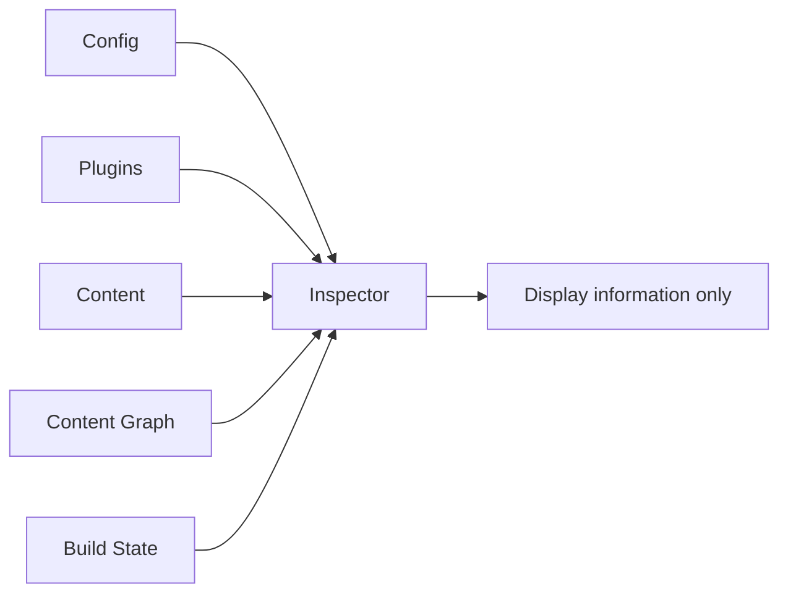
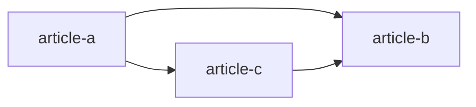
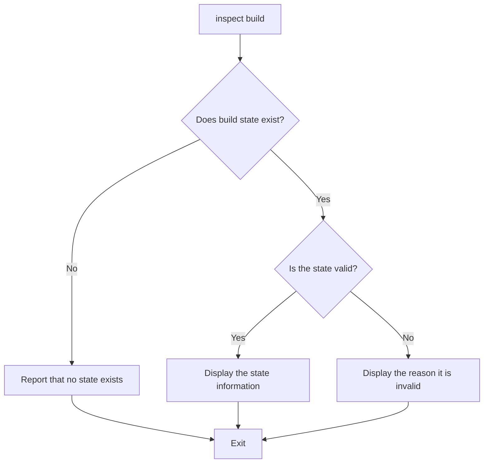
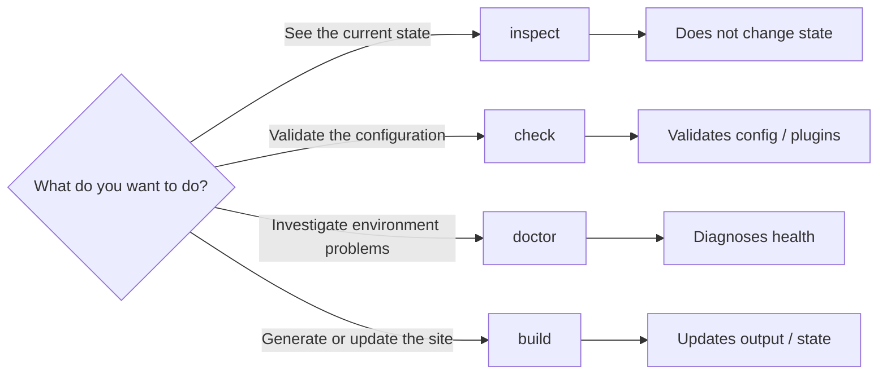

# Inspector

Inspector answers questions about already-resolved state. It is a read-only
tool for seeing how Riebeckite currently understands your site.

Use it through the CLI:

```sh
riebeckite inspect config
riebeckite inspect plugins
riebeckite inspect content --list
riebeckite inspect content --path /blog/hello/
riebeckite inspect graph
riebeckite inspect build
```



Inspector only reads this information. It may process content in memory to resolve
locations, but it does not persist build state or cache, and it does not change your
configuration.

## Basic usage

Inspector has a command for each target you want to inspect:

| Command | What you can inspect |
| --- | --- |
| `riebeckite inspect config` | Resolved configuration |
| `riebeckite inspect plugins` | Enabled plugins |
| `riebeckite inspect content --list` | All scanned content entries (including drafts, private, scheduled) |
| `riebeckite inspect content --path <path-or-permalink>` | One content entry's resolved identity |
| `riebeckite inspect graph` | Relationships between content |
| `riebeckite inspect build` | Incremental build state |
| `riebeckite inspect assets` | Content asset inventory, usage, duplicates, and optimization candidates |

## Inspecting the config

```sh
riebeckite inspect config
```

This shows the **resolved config** that Riebeckite actually uses. It is not
the raw values written in the config file; it is what Riebeckite ends up
recognizing after defaults and other processing are applied.

Use it when something such as:

> I configured it, but it does not behave as expected.

happens, to first check the effective configuration.

## Inspecting plugins

```sh
riebeckite inspect plugins
```

This shows the plugins that are currently enabled. Use it to check whether a
plugin you intended to add is really being loaded.

## Inspecting content

```sh
riebeckite inspect content --list
```

This lists the content Riebeckite recognizes. For each entry you can check the
resolved **canonical permalink**.

For example, even if a file exists at:

```text
content/posts/hello.md
```

and its real public URL is:

```text
/blog/hello/
```

Inspector shows the finally resolved `/blog/hello/`. In other words, this
information is about the **URL actually used by the site**, not the filesystem
location.

If a [[glossary/public-location|Public Location]] plugin provides identity metadata, it also shows the
content ID and where that ID came from.

To inspect one known entry without listing the vault, pass its source path or
resolved permalink with `--path`. The result contains only its path, permalink,
ID, and ID source.

## Inspecting the content graph

```sh
riebeckite inspect graph
```

This shows the relationships between content. For example, it lets you check
how Riebeckite understands link relationships such as:



It is also useful when developing a plugin that uses links, backlinks, or the
graph.

## Inspecting build state

```sh
riebeckite inspect build
```

This shows the state used by incremental builds. If a valid state exists, its
information is displayed. If the state is unavailable, the reason is shown as
well.

For example:

- The state file does not exist
- The JSON is malformed
- The state version does not match the current Riebeckite
- The state structure is unrecognized

Inspector does **not** repair any of these.



Even if the state is broken, Inspector never creates a new state or rewrites
the existing one.

## Development Inspector tabs

The panel has tabs for Overview, Content, Diagnostics, API, Dependencies, Plugins, Output, Derived, Provenance, Assets, and Theme. Overview summarizes build duration, manifest hook timing, cache use, and the slowest plugins. Content lists scanned entries with their visibility, aliases, redirects, incoming links, unresolved links, ambiguous targets, and orphan pages. The API tab lists the resolved API lifecycle registry, including deprecated-since versions, replacements, removal versions, migration guides, and whether the current configuration uses a deprecated entry. It reads the same registry as `riebeckite inspect api` and is read-only. The Assets tab lists content assets with their usage, size, duplicate groups, and optimization candidates. It reads the same read-only asset report as `riebeckite inspect assets` and never deletes or rewrites files.

Plugins can add tabs after the built-in tabs through the `inspector` field:

```ts
export default defineConfig({
  plugins: [
    {
      name: "my-plugin",
      inspector: {
        apiVersion: 1,
        tabs: [
          {
            id: "my-plugin.overview",
            title: { en: "My plugin", ja: "マイプラグイン" },
            order: 100,
            collect: () => ({
              kind: "key-value",
              items: [{ key: "Status", value: "ready" }],
            }),
          },
        ],
      },
    },
  ],
});
```

`collect` runs once when a completed development build snapshot is created, not
on every Inspector request. Return one of these data shapes:

- `{ kind: "key-value", items }`
- `{ kind: "table", columns, rows }`
- `{ kind: "json", value }`
- `{ kind: "error", message }`

Values in these shapes must be JSON-serializable. Tab ids must match `^[a-z0-9][a-z0-9._-]*$` and be unique across plugins. Tabs
are sorted by `order`, then by id; built-in tabs always come first. A failing
`collect` is shown as an error tab and does not affect other tabs.

For custom rendering, set `client` to a module specifier resolvable from the
app root. The module must export `mount(root, { data, locale })` and may return
a cleanup function:

```ts
export function mount(root: HTMLElement, { data, locale }: { data: unknown; locale: "en" | "ja" }) {
  root.textContent = JSON.stringify(data);
  return () => {};
}
```

Inspector imports the client through the Vite development server. The client
runs in the page, so plugins are trusted code. The mount root lives inside the
Inspector shadow root, so the client must bring its own styles. Inspector never
passes its private access token to the client, and the client must not read the
inspector endpoints directly.

`inspector` is unrelated to the plugin `endpoints` field. `endpoints` publishes
HTTP routes on the generated site; `inspector` only contributes tabs to the
development-only panel.

## Read-only guarantee

Inspection is factual and non-mutating. It must not write incremental state or
plugin cache, emit assets, render special artifacts merely for display, invoke
Vite/[[framework/honox-integration|HonoX]] build work, or auto-fix configuration.
Content may be processed in memory to resolve paths and permalinks.
If the requested information does not exist because no build has completed,
report that condition plainly.

`inspect content --list` reports each entry's resolved canonical permalink.
When a public-location plugin records identity metadata, it also shows the ID
and the ID source.

`inspect build` reports the incremental state status. When the state is
invalid, it also reports the reason: malformed JSON, an unsupported state
version, or an unrecognized structure.

This property makes Inspector safe to use not only during development but also
in CI.

## inspect / check / doctor / build

Riebeckite has commands that look similar, but they have different roles:



| What you want to do | Command |
| --- | --- |
| Check the current resolved result | `inspect` |
| Validate config / plugins | `check` |
| Diagnose problems including the environment | `doctor` |
| Generate or update the site or build state | `build` |

If you are unsure, think: **"to just look, `inspect`; to validate, `check`; to
investigate a problem, `doctor`; to generate, `build`."**

This division of roles prevents a command that only checks state from
accidentally modifying cache or deployment output. See
[CLI](../reference/cli.md), [Diagnostics](./diagnostics.md), and
[Build System](./build-system.md) for details.
