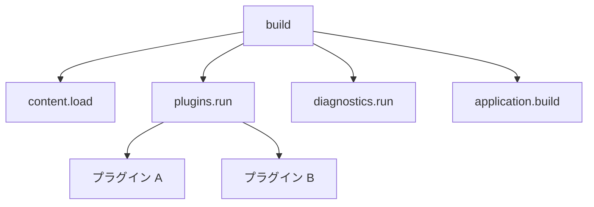
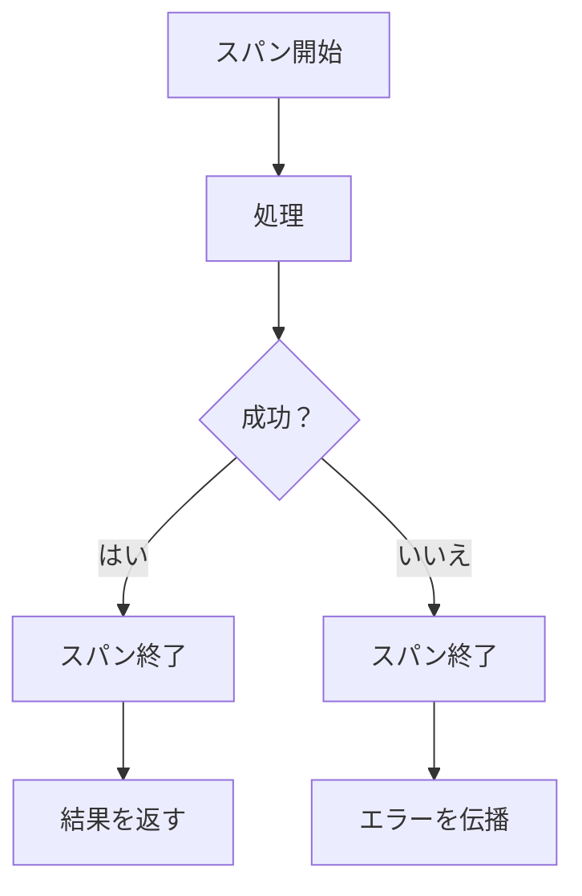
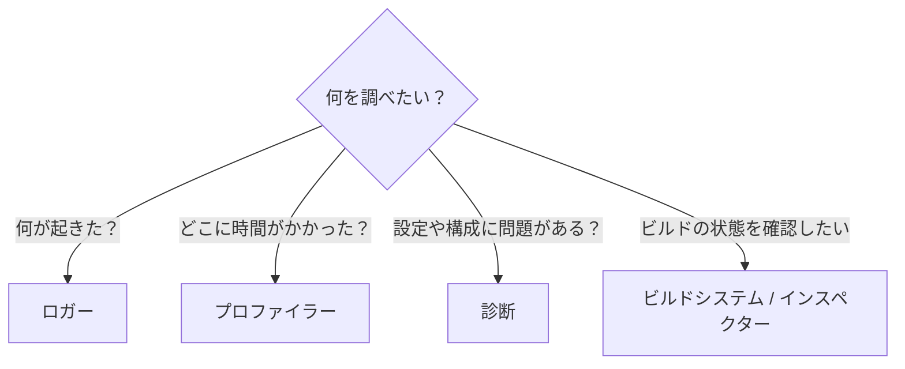

# 可観測性

可観測性は、Riebeckite の実行中に **何が起きたのか、どこに時間がかかったのか** を調べるための仕組みです。

Riebeckite では目的の異なる3つの仕組みを分けています。

- **ロガー**：何が起きたかを知る
- **トレーサー**：どの処理にどれだけ時間がかかったかを記録する
- **プロファイラー**：トレースをまとめて、ビルドのどこを調査すべきか確認する


## ロガー / トレーサー / プロファイラーの違い

| シグナル | 答える問い | 契約 |
| --- | --- | --- |
| ロガー | 何が起きた、または何に失敗したか | 構造化された安全な運用メッセージ |
| トレーサー / `TraceSink` | どこで処理が行われ、どれだけ時間がかかったか | 入れ子になった計測付きスパン |
| プロファイラー | ビルド性能をどこで調査すべきか | トレースデータを消費して報告する |

たとえばビルドが遅い場合、ロガーに大量のメッセージを追加して原因を探すのではなく、トレーサーで処理時間を記録し、プロファイラーでその結果を確認します。

逆に「プラグインの読み込みに失敗した」のような出来事を伝えるのはロガーの役割です。

## トレース

トレースは、ビルドの処理を **span** という単位に分けて処理時間を記録します。

たとえばビルドが次のように実行されたとします。



`build` が親スパン、その中で実行される処理が子スパンになります。

これにより、

> ビルド全体が遅い

だけではなく、

> `plugins.run` の中の特定プラグインに時間がかかっている

といったところまで調べられます。

### スパンを作る場所

すべての関数にスパンを追加する必要はありません。

主に次のような、処理時間を知る意味がある境界へ追加します。

- 主要なビルドフェーズ
- プラグインの処理
- ファイル読み込みなどの I/O
- 診断
- その他、独立して性能を確認したい処理

スパン名には、ビルド間で比較できる安定した名前を使用します。

たとえば、

```text
content.load
plugins.run
diagnostics.run
application.build
```

のような名前です。

入力ファイル名などによってスパン名そのものが毎回変化する設計は避けます。

### スパンは必ず閉じる

処理が成功した場合だけでなく、失敗した場合もスパンを閉じます。



トレースはエラー処理の代わりではありません。

処理が失敗した場合はトレースを記録したうえで、通常の呼び出し元との取り決めに従ってエラーを伝播します。

トレースのためにエラーを握りつぶしてはいけません。

## 並列処理と時間

トレースを読むときは、**処理時間の合計と実際の経過時間は同じとは限らない**ことに注意してください。

たとえばプラグイン A とプラグイン B が並列に実行されたとします。

```mermaid
gantt
    title 並列に実行されるプラグイン処理
    dateFormat X
    axisFormat %L ms

    section プラグイン
    プラグイン A :a, 0, 100
    プラグイン B :b, 0, 100
```



それぞれが 100ms かかった場合、

```text
Plugin A = 100ms
Plugin B = 100ms
```

なので、処理量としては合計 200ms です。

しかし2つは同時に実行されているため、実際の経過時間はおよそ 100ms です。

```text
Cumulative work = 200ms
Wall-clock time = 約100ms
```

プロファイラーはこの違いを維持します。

子スパンの時間を単純に足して、

> plugins.run = 200ms

のように表示すると、並列処理を直列処理のように見せてしまうためです。

## プロファイラー

プロファイラーはトレースを集計して、ビルドのどこに時間がかかっているかを確認するための機能です。

CLI から実行できます。

```sh
riebeckite profile
```

インクリメンタル状態を再利用せず計測する場合は、

```sh
riebeckite profile --full
```

を使用します。

`--full` は、インクリメンタルビルドの影響を避けてビルド全体の性能を調べたい場合に便利です。

プロファイラーの目的は、

**「遅い」という事実から、次にどこを調査すればよいかを絞り込むこと**

です。

プロファイラーはキャッシュの状況も分けて表示します。

- **プラグインキャッシュ**：プラグイン自身が保存した結果のヒット / ミス
- **コンテンツキャッシュ**：永続コンテンツキャッシュのヒット / ミス / バイパスと、ミス / バイパスの理由

これにより、

> なぜウォームビルドなのにキャッシュが使われていないのか

を、安全性のためのバイパスなのか、依存関係の変更によるミスなのかまで区別して確認できます。

## 診断の計測

診断も通常のビルドフェーズと同じように計測されます。

プロファイラーには、

```text
diagnostics.run
```

スパンの所要時間（duration）が表示されます。

さらに診断が生成した指摘の件数も確認できます。

- total
- error
- warning
- info

これにより、

```text
diagnostics.run
├─ duration
├─ total
├─ error
├─ warning
└─ info
```

のように、**診断にどれだけ時間がかかり、どれだけの問題が報告されたのか**を同時に確認できます。

たとえば診断がビルド時間の大部分を占めている場合、そのフェーズをさらに調査する判断材料になります。

## 安全性

可観測性は **Riebeckite の動作を観測するための仕組み**であり、ビルドの結果を変えてはいけません。

計測を有効にしても無効にしても、生成されるサイトは同じである必要があります。

また、ロガーやトレースには次のような情報を記録しないでください。

- 秘密情報
- 認証情報
- トークン
- 不要に機微なコンテンツ本文

観測のために必要な情報だけを記録します。

トレースやプロファイルの保存データもビルド時の情報です。

Cloudflare Workers などの実行環境が、書き換え可能なトレース / プロファイルファイルに依存する設計にはしません。

## 問題を調査するとき

問題の種類によって使う機能を分けます。



ビルドが失敗している場合はロガーや診断を使用します。ビルドが遅い場合はトレース / プロファイラー、インクリメンタルビルドの状態を確認したい場合はインスペクターと組み合わせて調査します。

ビルドの仕組みについては [ビルドシステム](./build-system.ja.md)、問題の報告については[診断](./diagnostics.ja.md)、現在の状態を確認する場合は[インスペクター](./inspector.ja.md)を参照してください。
