# プラグインの独立ページ

プラグインが、サイトのルートを直接追加せずに独立したページを提供するための仕組みです。

たとえば、次のようなページをプラグインから追加したいときに使います。

```text id="9twdpj"
/explore
/report
/tags/example
```

この仕組みがなければ、独立ページを持つプラグインを追加するたびに、HonoX のルートをサイト側へ書き足す必要があります。プラグインとサイトの結び付きが強くなり、プラグインを配布しても、使う側が同じ変更をしないと動きません。

そこでプラグインは「このURLに、この内容を表示する」という情報だけを公開し、実際のルーティングやHTML文書の組み立てはサイトが担当します。

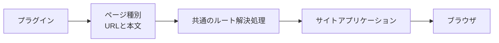

`pageTypes` は、通常の `RiebeckitePlugin` が持つ機能の1つです。ページ専用の別種類のプラグインを作るわけではありません。

## どんなときに使うか

独立したURLを持つページをプラグインから提供するときに使います。

たとえば、次のようなページです。

- Garden Explorer
- プラグインのレポート画面
- プラグインが生成する一覧ページ
- 独自の検索・閲覧ページ

一方、記事本文の中へ何かを表示するだけなら、ページ種別は必要ありません。

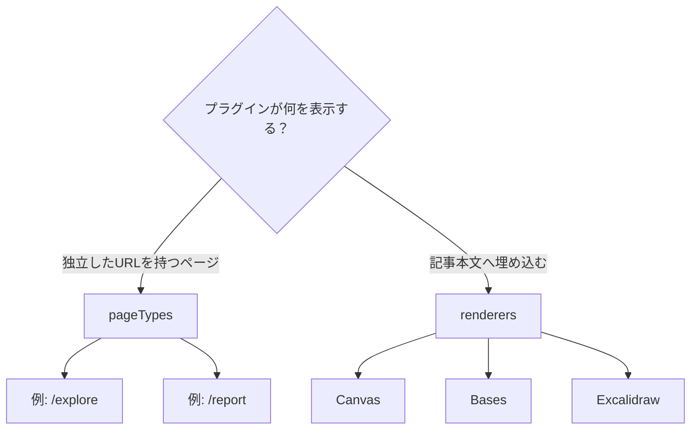

Canvas、Bases、Excalidraw のように記事本文へ埋め込む機能は `renderers` を使います。

## 役割の分担

プラグインがページ全体を所有するわけではありません。役割は次のように分かれます。

| 層 | 責務 |
| --- | --- |
| Core | ページ種別の取り決め、検証、URLの列挙、解決、競合の検出 |
| プラグイン | ページ種別ID、公開URL、フレームワークに依存しないHTML本文 |
| HonoX Integration | 共通ルートの解決、SSGパラメータの生成 |
| サイトアプリケーション | ルート、HTML文書の枠組み、メタデータ、HTMLの描画 |
| テーマ | デザイントークンと安定したCSSフックによる見た目 |

全体では次のような関係になります。

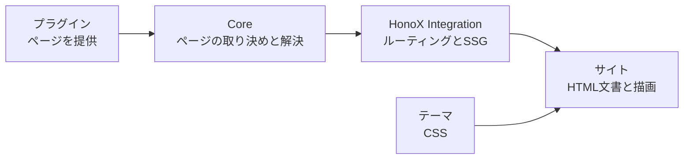

**ルートとHTML文書の枠組みは、サイトアプリケーションが所有します**。プラグインはページの内容を提供しますが、次のようなHTML文書全体を生成するわけではありません。

```html id="snxwcb"
<html>
<head>
...
<body>
```

## 共通のルートへまとめる

以前は、独立ページを持つプラグインごとに、サイト側へ専用のルートが必要でした。

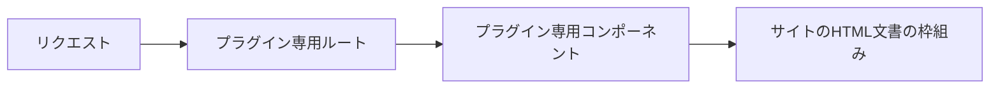

この方式では、プラグインを追加するだけでは動かず、サイトアプリケーションのルートも変更しなければなりません。プラグインとサイトが強く結び付いてしまいます。

そこで、すべてのプラグインページを共通のルート解決処理へ集めます。

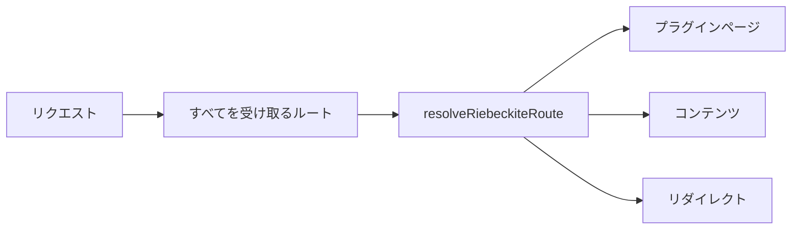

新しいプラグインページを追加しても、HonoXのルートを増やす必要はありません。

## ビルド時とリクエスト時の流れ

処理は、ビルド時とリクエスト時の2つに分かれます。

### ビルド時

ビルド時には、プラグインが提供するページ種別から、静的に生成するURLを集めます。

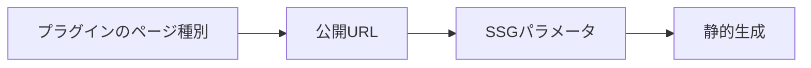

たとえばプラグインが次のURLを提供していれば、そのURLをSSGの生成対象にできます。

```text id="9ifm52"
/report
```

### リクエスト時

リクエストが届くと、共通の解決処理がページの種類を判断します。

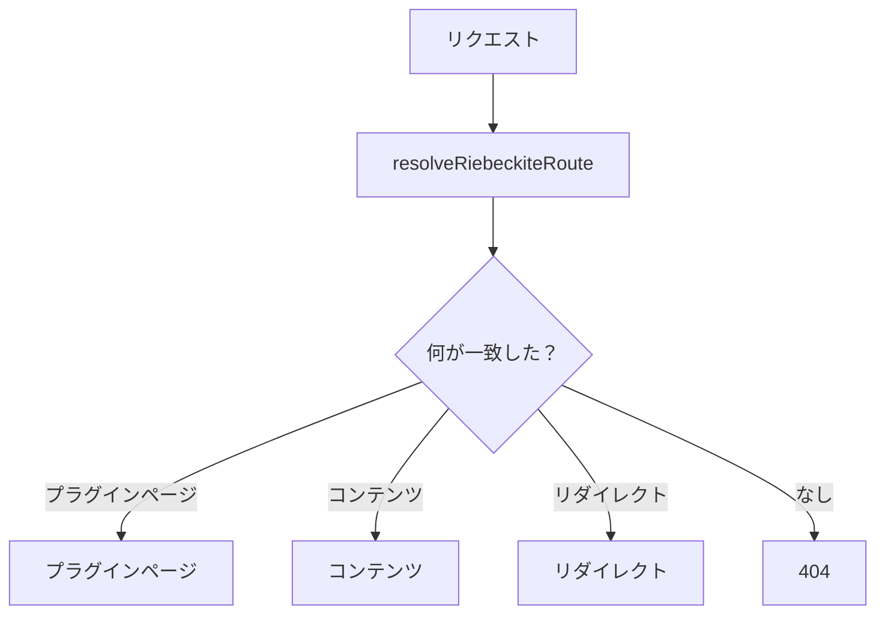

プラグインページが見つかった場合は、その本文をサイトのHTML文書の枠組みの中へ描画します。

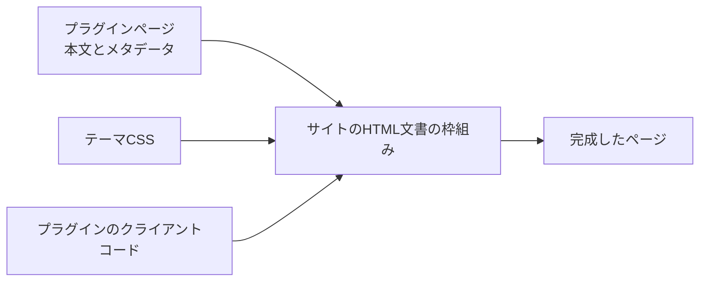

## ページの種類を定義する

ページの種類（Page Type）は、プラグインの `pageTypes` に定義します。

```ts id="1ql4hf"
import { definePlugin } from "@riebeckite/core";

export function report() {
  return definePlugin({
    name: "report",

    pageTypes: [
      {
        id: "example.report",
        paths: ["/report"],

        resolve: ({ pathname, manifest }) =>
          pathname === "/report"
            ? {
                type: "example.report",
                pathname,
                title: "Report",
                body: `<p>${manifest.publicEntries.length} published entries</p>`,
              }
            : null,
      },
    ],
  });
}
```

この例では、プラグインが `/report` というページを提供します。ページ本文には、公開されている記事の数を表示しています。

プラグインがHonoXのコンポーネントやルートファイルを作る必要はありません。

## 公開済みコンテンツだけを参照する

ページ種別の `resolve` には `PluginPageContext` が渡されます。その中の `PluginPageContext.manifest` は、解決済みのマニフェストです。

```ts id="dw2bby"
PluginPageContext.manifest
```

`entries` には `draft` と `scheduled` も含まれるため、ページの出力には使わないでください。

公開URLをすべて列挙する場合は `publicEntries`（`public` と `unlisted`）を、読者へ一覧として見せる場合は `discoverableEntries`（`public` のみ）を使います。記事ごとに分岐が必要な場合だけ、解決済みの `entry.publishing` を読みます。

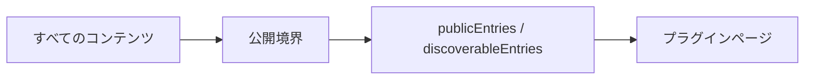

ページ側で非公開コンテンツを独自に探して表示するのではなく、この公開境界を通してください。通常のページと同じ公開範囲を保てます。

## ページ種別の識別子

各ページ種別にはIDが必要です。

```ts id="0evifc"
id: "example.report"
```

IDは、すべてのプラグインを通して一意でなければなりません。次のように、プラグインや用途が分かる名前空間を付けると衝突を避けやすくなります。

```text id="tvplf6"
riebeckite.garden-explorer
example.report
example.search
```

## 公開するURL

静的なページは、`paths` に公開URLを指定します。

```ts id="7rvyz2"
paths: ["/report"]
```

複数のページを提供することもできます。

```ts id="wea35u"
paths: [
  "/report",
  "/report/archive",
]
```

動的ページを静的生成する場合は、SSGのURLを **`manifest.publicEntries` から導出**します。ファイルシステムを独自に走査してURLを作るのではなく、Content Systemが解決した公開状態を利用してください。

## 同じURLに複数のページが一致する場合

複数のページ種別が同じURLに一致することがあります。その場合は `priority` で優先順位を決めます。

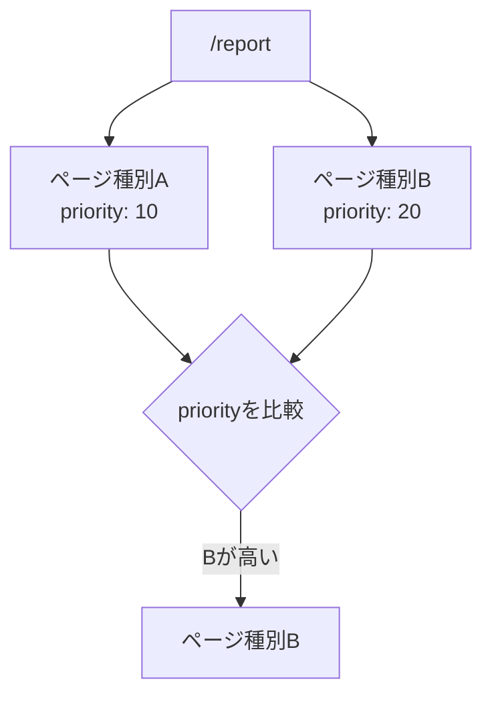

最も高い `priority` を持つページ種別が選ばれます。

ただし、最大の `priority` を持つページ種別が複数一致した場合は、どちらかを暗黙に選びません。

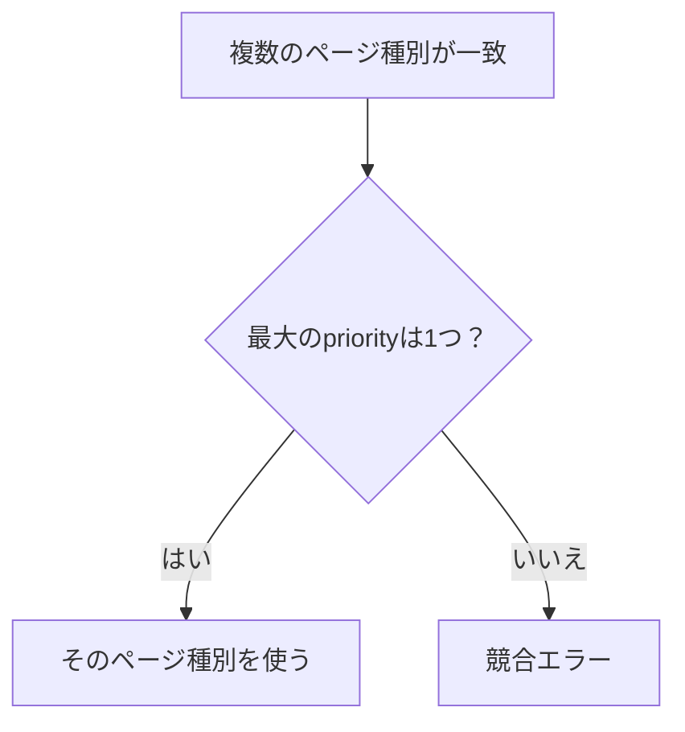

競合をエラーにすることで、プラグインの登録順などによって結果が変わることを防ぎます。

## HonoXサイトへ接続する

プラグインページを利用するHonoXサイトには、すべてのパスを受け取る共通ルートが必要です。`create-riebeckite` などで生成したサイトには、必要な構成があらかじめ含まれています。

概念的には次のように接続します。

```tsx id="xxj9rm"
import {
  contentRouteSsgParams,
  resolveRiebeckiteContentRequest,
  riebeckiteSsgParams,
} from "@riebeckite/honox/server";
import { PageBody } from "@riebeckite/honox/ui";
import { createRoute } from "honox/factory";

export default createRoute(
  contentRouteSsgParams("/:slug{.+}", () => riebeckiteSsgParams(content)),
  async (c) => {
    const resolved = await resolveRiebeckiteContentRequest(c, content);

    if (resolved.kind === "response") return resolved.response;

    if (resolved.kind === "page") {
      return c.render(<PageBody html={resolved.page.body} />);
    }

    return c.render(/* Site 固有の article composition */);
  },
);
```

サイトを利用する人が、プラグインごとにこのルートを追加する必要はありません。共通ルートがプラグインページをまとめて解決します。ルート `/` も、同じ仕組みを共有する `resolveRiebeckiteHomeRequest(c, content)` が解決します。

## ページが返せる情報

プラグインのページは、HTML本文に加えて、必要に応じてページのメタデータを提供できます。

たとえば、次のような情報です。

```text id="m7yad8"
body
title
description
headTags
language
```

ただし、プラグインが**どこへ描画するかまで決めるわけではありません**。

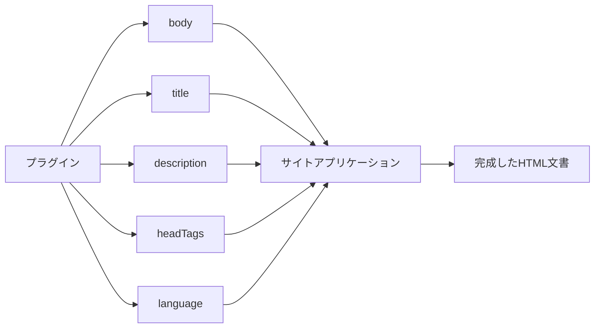

サイトアプリケーションがこれらを受け取り、既存のHTML文書の枠組みへ反映します。そのため、プラグインのページでも、サイト全体のナビゲーション、ヘッダー、フッター、テーマをそのまま利用できます。

## HTMLの安全性

ページ種別の `body` はHTMLとして描画されます。そのためプラグインは、**自分で安全に生成できるHTMLだけを返す**必要があります。

たとえば、リクエストの値をそのままHTMLへ埋め込まないでください。

```ts id="8m9qrl"
// 避ける例
body: `<p>${untrustedRequestValue}</p>`
```

信頼できない入力を扱う場合は、適切にエスケープまたは無害化してから使います。最終的にHTMLをどう描画するかは、サイトアプリケーション側の境界で決まります。ページ種別がサイトのHTML安全性の方針を回避できる仕組みにはしません。

## テーマとの関係

テーマはページ種別のIDを知る必要がありません。たとえば、`example.report` 専用のテーマ処理を作るのではなく、次の仕組みで見た目を変えます。

```text id="z67p3o"
example.report
```

- セマンティックトークン
- 安定したCSSフック
- `data-*` 属性
- CSSのカスケード

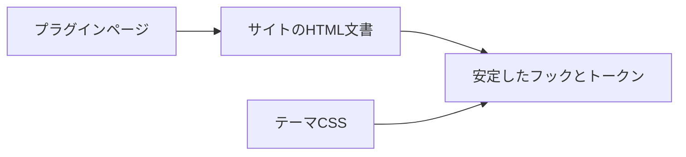

これにより、新しいページ種別が増えても、テーマとプラグインを直接結び付けずに済みます。

## この仕組みが定める境界

最も重要なのは、**プラグインはページを提供するが、アプリケーションを所有しない**という点です。

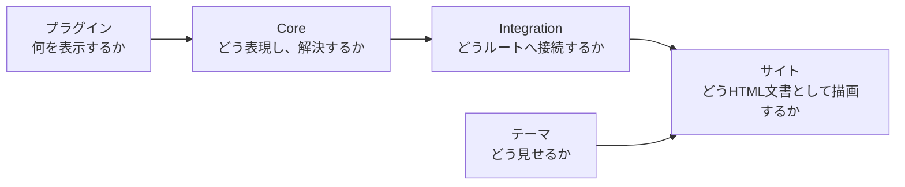

それぞれの責務は次のとおりです。

```text id="9w3k80"
プラグイン
  → ページの内容と公開URLを提供する

Core
  → ページ種別の共通の取り決めと解決規則を提供する

HonoX Integration
  → ページ種別をルーティングとSSGへ接続する

サイトアプリケーション
  → ルート、HTML文書の枠組み、メタデータ、HTMLの安全性を所有する

テーマ
  → サイトの見た目を変更する
```

この境界があるため、プラグインはHonoXや特定のサイト構造に依存せず、インストールするだけで独立ページを提供できます。

ページ種別の全フィールドと実行時検証については [プラグインAPI](../reference/plugin-api.ja.md#プラグインが提供する独立ページ)、サイトとの接続については [HonoXとの統合](./honox-integration.ja.md) を参照してください。
