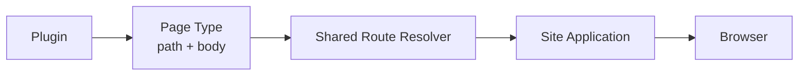

# Page System

The Page System lets a plugin provide a standalone page without taking over an
application route. It is a capability on the normal `RiebeckitePlugin`
contract, not a second kind of plugin.

A plugin uses it when it wants to serve its own pages such as:

```text
/explore
/report
/tags/example
```

Without the Page System, every plugin that provides a page would need its own
[[framework/honox-integration|HonoX]] route added to the site application. With the Page System, a plugin only
publishes "this URL provides this page"; the site owns the actual routing and
document rendering.



## In this section

- [Overview](./page-system/overview.md)
- [Flow and authoring](./page-system/flow-and-authoring.md)
- [Integration](./page-system/integration.md)
